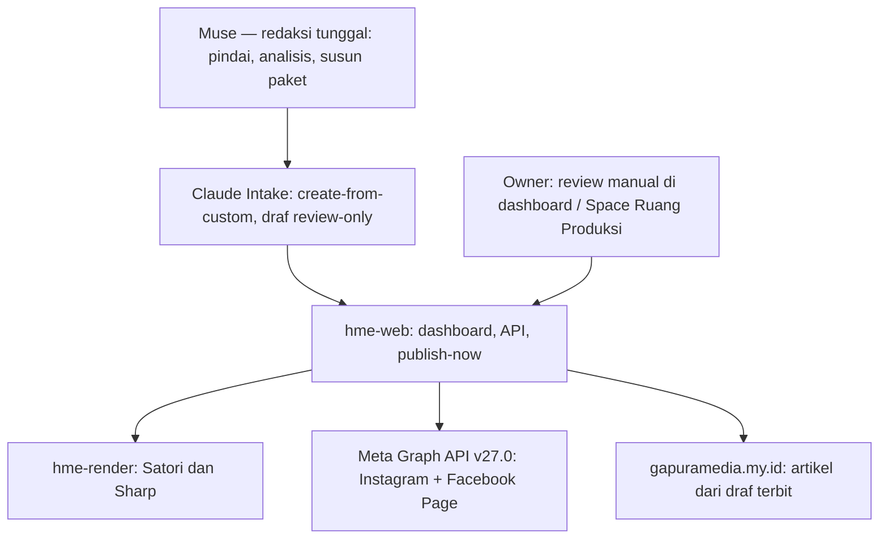

# 🏛️ Gapura Media Engine (GME v2.1)
> **Ruang Redaksi Politik, Sosial, Hukum, Lingkungan & Ekonomi Nasional termasuk Bursa Saham**
> Akun Instagram Resmi: **[`@gapuramedia`](https://instagram.com/gapuramedia)**  
> Portal Dashboard: **[https://gapura.avenia.my.id](https://gapura.avenia.my.id)** · Situs Artikel: **[https://gapuramedia.my.id](https://gapuramedia.my.id)**

**Status produksi — 25 November 2026: LIVE dan beroperasi penuh.**

- **Publikasi Meta LIVE** sejak 2026-11-23: Instagram `@gapuramedia` dan
  Facebook Page "Gapura Media" menerima terbitan nyata lewat Graph API
  v27.0. Gerbang verdict analis sudah **dihapus** dari publish-now dan
  meta-worker (2026-11-23); penerbitan berjalan lewat
  `POST /api/drafts/:id/publish-now`.
- **Muse adalah redaksi tunggal** sejak 2026-11-24 (keputusan owner):
  pemindaian topik, analisis, penyusunan konten, dan publikasi dijalankan
  Muse lewat [Claude Intake](docs/CLAUDE_INTAKE.md). Pipeline internal
  server (Scout/Analis/Copywriter/Designer/SEO/Studio) **dinonaktifkan** —
  timer `gapura-pipeline` dan `gapura-publisher` dimatikan, unit file
  dipertahankan dan reversibel (`systemctl enable --now`). Server hanya
  menjalankan `hme-web` (dashboard + intake), `hme-render`, worker
  publish-now, PostgreSQL, dan Cloudflare Tunnel.
- **Empat edisi otomatis harian** oleh Muse (slot terbit ±07:30/12:15/
  15:30/19:00 WIB, batas total 6 konten/hari, dengan aturan susulan bila
  edisi lain gagal health check), ditambah draf manual owner lewat
  dashboard dan Space **Ruang Produksi Gapura**.
- Setiap draf terbit juga menjadi artikel panjang di
  **gapuramedia.my.id** (repo terpisah `aryarifki/Gapura-Media`); penjaga
  website 30-menitan mengisi artikel yang belum ada.
- Paket pertumbuhan 30 hari akun `@gapuramedia` berjalan sejak 2026-11-24
  (sistem caption & hashtag tetap, laporan performa mingguan tiap Senin).

> **Catatan dokumen:** dokumen rencana dan audit bertanggal di
> [`docs/plans/`](docs/plans/) serta laporan audit bertanggal di `docs/`
> adalah **catatan historis**. Dokumen yang berlaku adalah dokumen hidup:
> README ini, [`docs/CLAUDE_INTAKE.md`](docs/CLAUDE_INTAKE.md),
> [`docs/META_PUBLISHING_RUNBOOK.md`](docs/META_PUBLISHING_RUNBOOK.md),
> [`docs/PANDUAN_PENGGUNAAN.md`](docs/PANDUAN_PENGGUNAAN.md), dan
> [`docs/STATUS_DAN_ROADMAP_FITUR.md`](docs/STATUS_DAN_ROADMAP_FITUR.md).

---

## 📌 Ringkasan Proyek

### Self-hosting dari checkout bersih

Repository berisi source aplikasi, default editorial configuration, design
system/fonts, schema dan migrasi; tidak berisi database produksi, draf,
unggahan, kredensial, atau koneksi akun Meta. Panduan build instalasi baru ada di
[`docs/SELF_HOSTING.md`](docs/SELF_HOSTING.md): `bash scripts/bootstrap.sh`,
buat database PostgreSQL baru, lalu jalankan migrasi dengan opt-in eksplisit.
Intake dan publisher tidak diaktifkan selama bootstrap.

**Gapura Media Engine (GME v2.1)** adalah platform otomasi ruang redaksi modern (*newsroom automation*) untuk isu nasional Indonesia pada enam desk: **politik, sosial, hukum, lingkungan, ekonomi nasional, dan bursa saham**. Dalam operasi produksi saat ini, aplikasi berperan sebagai dashboard, mesin render, dan jalur publikasi; produksi kontennya dijalankan Muse sebagai redaksi tunggal lewat Claude Intake. Kode pipeline internal enam agen (Scout, Analis, Copywriter, Designer, SEO, Studio) tetap ada di repo sebagai referensi dan dapat diaktifkan kembali, tetapi timernya nonaktif dan bukan jalur produksi berjalan.

Platform ini menggabungkan dashboard editorial berbasis web yang responsif, mesin render deterministik berbasis SVG-to-PNG (*Satori + Sharp*), kontrak editorial ketat yang divalidasi server, serta publisher Meta multi-platform — dengan pengawasan manusia (*Human-in-the-Loop*) lewat dashboard dan persetujuan owner.



---

## ✨ Fitur Utama & Batas Implementasi Saat Ini

1. **Dashboard Review Editorial Realtime**
   - Panel pemantauan metrik kurasi: jumlah item mentah, topik lolos analisis, draf siap review, dan postingan terbit.
   - Status kesehatan layanan real-time (Web Dashboard, Render Engine, Database PostgreSQL). Status scheduler internal diperiksa dari timer systemd (keduanya nonaktif sejak 2026-11-24).
2. **Radar Topik Enam Desk & 1-Click Auto-Produce**
   - Agregasi topik lintas politik, sosial, hukum, lingkungan, ekonomi nasional, dan bursa, dengan sumber resmi sebagai atribusi primer saat tersedia.
   - Filter status: *Semua Topik*, *Lolos (≥76)*, *Gugur / Fast-Fail*, dan *Diproduksi*, disertai filter dan badge enam desk.
   - **Buat draf review:** Produksi topik dari dashboard tetap tersedia sebagai jalur manual; jalur produksi utama saat ini adalah Claude Intake (lihat fitur 15). Kebutuhan aset dan durasi bergantung pada konfigurasi, model, jaringan, dan jumlah slide.
3. **Editor Draf & Pratinjau Carousel Live**
   - Menampilkan visual slide beresolusi tinggi (1080×1350 px rasio 4:5).
   - Strip thumbnail interaktif untuk navigasi cepat antar slide.
   - Editor teks narasi, pengubah layout slide, pengaturan parameter metrik angka, caption Instagram, dan tagar.
   - **Simpan & Render Ulang Seketika:** Render ulang slide tunggal dengan pembaruan pratinjau live tanpa reload halaman. Render carousel terjadi satu kali saat draf dibuat (intake/Studio); endpoint `edit-slide` me-render ulang draf yang sudah ada tanpa mengubah isi.
4. **AI Creative Director (Designer Otonom)**
   - Perancangan arsitektur visual berbasis AI (`gemini-3.5-flash-lite`) yang bebas dan tidak kaku dengan template tertentu.
   - Jalur naskah orisinal selalu menghasilkan carousel 3–9 slide. Draf yang disusutkan menjadi 1–2 slide ditolak sebelum pin/render/penulisan; draf legacy single tetap dapat diedit.
   - **Tombol Regenerate AI Instan:** Rancang ulang seluruh carousel secara adaptif dalam 1 klik tanpa dialog popup yang memblokir.
   - Catatan: Designer adalah bagian pipeline internal yang nonaktif; carousel produksi saat ini disusun Muse dan dirender `hme-render`.
5. **Studio Desain & Pembuatan Postingan Kustom**
   - Membuat postingan mandiri on-the-fly dari form Studio Desain; draf Studio memakai endpoint dan kontrak editorial yang sama dengan Claude Intake.
   - Pratinjau live perubahan token desain (palet warna `#102B45` Navy, `#1F7E81` Deep Teal, `#D79344` Golden Amber) di kanvas simulator ponsel.
6. **Kustomisasi 6 Agen & Skills.md**
   - Scout, Analis, Copywriter, Designer, SEO, dan Studio; tidak ada tab/config/skill agen Verifikator pada jalur aktif.
   - Konfigurasi independen untuk setiap agen: Provider (Gemini / OpenAI Compatible), Endpoint, API Key, Model, dan System Prompt.
   - **Editor `skills.md` Kustom:** Setiap agen dapat disematkan berkas panduan eksekusi mandiri di `/root/gapura/config/skills/`. Sejak pipeline internal dinonaktifkan (2026-11-24), berkas skills ini berstatus referensi historis.
7. **Manajemen Sumber Discovery Enam Desk**
    - Tambah, edit, aktifkan/nonaktifkan feed RSS dan sumber resmi secara dinamis dari dashboard, termasuk penetapan desk eksplisit atau inferensi dari judul.
    - Kategori sumber baru default `umum` (**Umum / Lintas Isu**), terpisah dari Desk Editorial. Update API yang tidak mengirim kategori mempertahankan nilai sebelumnya; tidak ada backfill arsip.
8. **Render Microservice Deterministik (Satori + Sharp)**
   - Footprint memori sangat ringan (~65 MB RAM, tanpa Chromium headless).
   - Menghasilkan gambar PNG jernih 1080×1350 px 96 DPI dengan font resmi: `Archivo Black` dan `Inter`.
   - Perilaku renderer produksi terkini (HEAD `0a7cc43` + perbaikan working tree yang sudah terdeploy): slide impact seragam dengan breakdown dan auto-fit; konten slide penutup terpusat vertikal; breakdown auto-fit sampai 6 item; linimasa auto-fit; bar bawah gelap pada slide lead dan penutup dihapus (footer terang seragam); panah geser hanya tampil bila bukan slide terakhir; scrim sampul diperkuat (0.62). Suite render di server: 128/128.
9. **Anti-Cache & CDN Bypass Architecture**
   - Header HTTP anti-stale (`Cache-Control: no-store, no-cache, must-revalidate`, `Surrogate-Control: no-store`) memastikan Cloudflare CDN dan browser tidak menyajikan skrip atau gambar usang.
   - Automatic query busting unik `?t=${Date.now()}_...` pada seluruh aset dinamis.

10. **Agen SEO — Radar Trending (Sumber X Dapat Dikustomisasi)**
    - Memindai akun X (`@handle`), query X, Google Trends geo, dan momentum Google News; daftar sumber dapat ditambah/diubah langsung dari dashboard (**Radar Trending**).
    - Skor virality menimbang bobot sumber, kesegaran, angka, dan relevansi enam desk; item teratas dapat dipromosikan menjadi topik editorial dengan satu klik.
    - Tanpa `X_BEARER_TOKEN`, jalur X otomatis dialihkan ke Google News dan provider yang benar-benar dipakai dicatat pada setiap item (tidak menyamar sebagai data X).
    - Dropdown kategori sumber tren mencakup enam desk serta pilihan umum/lintas isu.
    - Catatan: Radar Trending adalah perkakas dashboard; pemindaian trending produksi saat ini dilakukan Muse dari Google Trends, X Indonesia, dan percakapan Meta.

11. **Review Manusia atas Revisi Konten**
    - Produksi dan review tidak meminta report, badge kebenaran atau confidence mesin. API/UI/fungsi/config Verifikator sudah dilepas; tabel dan kolom historis tetap sebagai arsip tanpa schema removal atau backfill.
    - Persetujuan harus eksplisit atas revisi terkini. Edit membatalkan approval/jadwal; konten yang berubah harus ditinjau kembali.
    - Disclaimer hukum/investasi bersifat opsional dan sesuai konteks hukum/bursa, bukan boilerplate untuk semua desk.

12. **Katalog Provider & Model Multi-Provider**
    - Registry provider (`services/common/providers.js`) mendukung Gemini, OpenAI-compatible, dan Anthropic: Groq, OpenRouter, NVIDIA, endpoint custom, serta provider resmi.
    - Model diambil live dari `/models` tiap provider, di-cache di `config/models.cache.json`, dan dapat diuji dari dashboard tanpa menyimpan perubahan.
    - Rantai fallback global lintas provider (Gemini-first) dengan klasifikasi error `retryable`, sehingga halaman blokir/gateway rusak tidak mematikan seluruh rantai.
    - API key per provider disimpan terpisah di `/etc/gapura/provider-keys.json` (`0600`), tidak pernah dikembalikan ke browser.

13. **Publisher Multi-Platform Meta — LIVE**
    - Tiga adapter terpisah: Instagram Graph (single/carousel), Facebook Pages (foto/feed), dan Threads (image/carousel). Yang aktif di produksi: **Instagram + Facebook**; Threads didukung kode tetapi belum diaktifkan (memerlukan token dan user ID tersendiri serta akses lanjutan Meta).
    - Identitas produksi: Meta app `1123019133826199`, Page ID `102321216076547` ("Gapura Media"), Instagram `17841471438781611` (`@gapuramedia`), Graph API **v27.0**. Izin publish terverifikasi penuh, termasuk `instagram_content_publish` dan `pages_manage_posts`.
    - State publikasi per draf/platform/akun di tabel `publication_targets`; hasil ambigu disimpan sebagai `unknown` dan tidak pernah di-retry buta.
    - Penerbitan berjalan lewat **publish-now**: `POST /api/drafts/:id/publish-now` dengan `{"reviewed": true, "expected_revision": "<revision>"}`. Gerbang verdict analis sudah dihapus dari publish-now dan meta-worker (2026-11-23). Publish-now tidak me-render ulang — render terjadi satu kali saat draf dibuat.
    - Draf yang sudah terbit tidak bisa diterbitkan ulang; repost berarti draf baru.
    - Derivatif JPEG `slide_<n>.jpg` dibuat otomatis di samping PNG dan disajikan lewat URL bertanda tangan berbatas waktu.

14. **Studio Prompt (v2.2)** — produksi konten dari satu prompt admin:
    - Admin menulis arahan editorial (penjelasan isu, analisis, perspektif alternatif, opini, dll).
    - AI menyusun rencana terstruktur (judul, sudut pandang, tujuan, poin isi) yang bisa diedit manual, di-generate ulang dengan instruksi revisi, atau langsung diproduksi.
    - Job queue berbasis Postgres (`prompt_jobs` + `job_logs` + `llm_usage`): topik -> rencana -> draft + render -> review manusia; tidak ada tahap Verifikator.
    - Catatan: worker background pipeline internal nonaktif sejak 2026-11-24; Studio tetap perkakas manual dashboard, bukan jalur produksi berjalan.

15. **Claude Intake & Edisi Harian Muse**
    - `POST /api/drafts/create-from-custom` membuat draf **review-only** (`status='draft'`, `needs_review=true`), dilindungi middleware intake-guard (header `X-Gapura-Intake-Token`, env `GAPURA_INTAKE_TOKEN` di `/etc/gapura/runtime.env`). Detail: [`docs/CLAUDE_INTAKE.md`](docs/CLAUDE_INTAKE.md).
    - Format story ganda: **Quick News 3 slide** untuk berita lugas, **Deep Explainer 5 slide** untuk berita berproses. Kontrak ketat: fakta dari ≥3 penerbit, tanpa kata tanggal relatif, kutipan wajib terdaftar sebagai `fact.quote`, tanggal linimasa persis teks fakta.
    - Batas validator terkini (deploy 2026-11-25): hashtag story 5–30 unik dan umum maks 30 (aturan editorial: selalu tepat 30 berlapis); item breakdown/impact maks 6 per slide; linimasa maks 5 peristiwa; takeaways story 2–4; total caption maks 2.200 karakter; caption Threads maks 500 karakter dengan hashtag menyesuaikan yang muat menurut prioritas. Caption wajib berparagraf (`\n\n` antarparagraf, hashtag di baris tersendiri) + pertanyaan diskusi + CTA simpan/bagikan + rujukan gapuramedia.my.id.
    - Aturan konten yang mengikat setiap paket: komposisi sampul multi-elemen 2–4 elemen khas cerita; gaya sampul komposit foto realistis ala Bloomberg Technoz (ilustrasi datar dilarang; logo/lambang resmi tidak pernah digambar AI — berkas asli dikompositkan); identitas institusi subjek wajib tampil di sampul; daftar bernomor homogen dengan judulnya; penomoran daftar bersambung dan utuh satu slide; jumlah elemen visual sesuai angka di judul; format narasi untuk konten opini/analisis; pendapat pemilik tanpa label; headline sentence case di semua kanal; kicker sampul maks 20 karakter.
    - Empat edisi otomatis harian (pagi/siang/sore/malam) menerbitkan ke Instagram + Facebook dan membuat artikel websitenya; batas total 6 konten/hari dengan aturan susulan antar-edisi.

16. **Website Artikel & Space Ruang Produksi**
    - Setiap draf terbit menjadi artikel panjang di **gapuramedia.my.id** (repo `aryarifki/Gapura-Media`): artikel dibuat dari draf terbit via `scripts/add-article.mjs`; penjaga website 30-menitan mengisi artikel yang kurang.
    - Space **Ruang Produksi Gapura** adalah meja produksi manual owner: ketik prompt → Generate menyusun draf lengkap (carousel, caption, artikel) → Terbitkan / Jadwalkan / edit ilustrasi sampul, dengan aturan editorial yang sama.

---

## 🚀 Panduan Cepat Penggunaan Aplikasi

Panduan lengkap langkah demi langkah tersedia di:  
👉 **[`docs/PANDUAN_PENGGUNAAN.md`](docs/PANDUAN_PENGGUNAAN.md)**

### Alur Kerja Harian (keadaan produksi saat ini):
1. **Edisi otomatis berjalan sendiri:** Muse memindai topik trending, menyusun paket, mengirim via Claude Intake, menerbitkan ke Instagram + Facebook, dan mengunggah artikel ke gapuramedia.my.id — empat kali sehari dalam batas total 6 konten.
2. **Pantau di dashboard:** buka **`https://gapura.avenia.my.id`** untuk melihat draf, status publikasi per platform, dan permalink hasil terbit.
3. **Konten manual owner:** buat draf dari Space **Ruang Produksi Gapura** (prompt bebas → Generate → Terbitkan/Jadwalkan), atau susun langsung di dashboard (Studio Desain / unggah gambar manual untuk cover slide 1).
4. **Terbitkan manual dari dashboard:** tinjau draf di Antrian Review, periksa slide 1 sampai penutup, sesuaikan teks bila perlu lewat editor (Simpan & Render Ulang), lalu terbitkan. Draf terbit tidak dapat diterbitkan ulang.
5. **Perbaikan render draf lama:** gunakan endpoint `edit-slide` untuk me-render ulang carousel draf yang belum terbit tanpa mengubah isinya.

Dashboard langsung terbuka tanpa login atau token admin. API dashboard juga
tersedia tanpa autentikasi. Validasi Origin, redaksi API key, dan gate review
sebelum publikasi tetap berlaku. Secret server untuk signature media dan akses
layanan internal bukan kredensial login dashboard.

---

## 🛠️ Stack Teknologi

- **Backend & API Server:** Node.js v24 (ESM), Express.js
- **Render Engine:** `@vercel/satori` (JSX to SVG) + `sharp` (SVG to PNG)
- **Basis Data:** PostgreSQL 17 (Database `hme` untuk konten & `n8n` untuk canvas/riwayat workflow manual)
- **AI Models:** Registry multi-provider (`config/providers.json` + key per provider) — Gemini, OpenAI-compatible, Anthropic; model catalog live per provider. Produksi konten berjalan di sisi Muse (di luar server).
- **Orkestrasi Alur Kerja:** Redaksi dan penjadwalan dijalankan **Muse** (empat edisi harian + penjaga website). Systemd timer native (`gapura-pipeline.timer`, `gapura-publisher.timer`) **nonaktif sejak 2026-11-24** atas keputusan owner; unit terpasang dipertahankan dan dapat diaktifkan kembali. n8n tidak lagi menjadi bagian operasi berjalan.
- **Reverse Proxy & Edge:** Cloudflare Tunnel + Cloudflare Edge (`cloudflared`)
- **Process Manager:** Systemd Linux Services (`hme-web.service`, `hme-render.service`)

---

## 📋 Status Pengembangan, Isu & Roadmap

Dokumen evaluasi teknis, daftar permasalahan yang telah diselesaikan, dan fitur yang belum selesai dapat dibaca di:  
👉 **[`docs/STATUS_DAN_ROADMAP_FITUR.md`](docs/STATUS_DAN_ROADMAP_FITUR.md)**

### Ringkasan Status Fitur:
- [x] Workspace desain/konten bersih dan backup teruji untuk evaluasi ulang
- [x] Blueprint pembaruan editorial enam desk tersusun; kontrak dan corpus R1 tersedia offline
- [x] R2 — body feed/artikel, metadata sumber dan snapshot versi terpisah dari ringkasan Radar; endpoint pengayaan manual tersedia tanpa produksi draf
- [x] Web Review Dashboard Responsif (Desktop & Mobile)
- [x] Microservice Render Satori + Sharp (1080x1350 px)
- [x] Migrasi Identitas Penuh ke Brand Guidelines Gapura Media (`@gapuramedia`)
- [x] AI Creative Director (Agen Designer adaptif bebas template kaku)
- [x] 1-Click Auto-Produce dari Radar Topik
- [x] Eliminasi Masalah Cloudflare Cache Staling & Dialog `confirm()`
- [x] Kustomisasi 6 agen: Scout, Analis, Copywriter, Designer, SEO, Studio
- [x] Manajemen Sumber Discovery Enam Desk (desk eksplisit + inferensi judul)
- [x] Agen SEO (Radar Trending) dengan sumber X/Google Trends yang dapat dikustomisasi
- [x] R4 — discovery enam desk, cluster judul dan proyeksi metadata Analis/cluster
- [x] R5 — penghapusan Verifikator dari jalur aktif; arsip schema dipertahankan
- [x] R5 — gate unit/DB/API/browser/render dan koreksi niche enam desk lulus; web/render dimuat ulang
- [x] R6 — naskah orisinal dua mode tanpa body/summary penerbit; carousel 3–9 default enam dan caption isi 1.200–1.900 karakter; migrasi additive terpasang di produksi
- [x] R7 — unggah gambar manual sebagai jalur utama; cover slide 1 wajib bergambar sebelum approval/publish, slide isi opsional
- [x] Katalog Provider & Model multi-provider (registry + fallback lintas provider + uji dari dashboard)
- [x] P2 — [audit skor historis & validasi constraint](docs/P2_SCORE_INTEGRITY_AUDIT.md): 1.062 baris valid, 0 perubahan data; `topic_scores_component_total` tervalidasi
- [x] P2 — scheduler native terverifikasi dan terdokumentasi: unit systemd terpasang menjadi sumber kebenaran; tanpa penambahan cron atau aktivasi workflow otomatis n8n
- [x] Publisher Meta multi-platform LIVE: Instagram + Facebook terbit nyata sejak 2026-11-23 (Graph v27.0, izin publish penuh)
- [x] Gerbang verdict analis dihapus dari publish-now dan meta-worker (2026-11-23)
- [x] Claude Intake LIVE (2026-11-23): draf review-only via token guard; publish-now dengan `reviewed` + `expected_revision`
- [x] Sentralisasi redaksi ke Muse (2026-11-24): timer pipeline & publisher internal dinonaktifkan (reversibel); empat edisi harian otomatis berjalan
- [x] Format story ganda Quick News 3 slide / Deep Explainer 5 slide + aturan kualitas editorial hasil audit (2026-11-24)
- [x] Perbaikan renderer terdeploy: impact seragam + auto-fit, penutup terpusat, breakdown 6 item, linimasa auto-fit, bar gelap lead/penutup dihapus (suite render 128/128, common 201/201)
- [x] Validator hashtag disamakan ke maksimum platform: tepat 30 (deploy 2026-11-25, branch `fix/validator-hashtag-30`)
- [x] Website artikel gapuramedia.my.id live + penjaga website 30-menitan
- [x] Space Ruang Produksi Gapura untuk draf manual owner (Generate/Terbitkan/Jadwalkan/edit sampul)
- [x] Paket pertumbuhan 30 hari @gapuramedia (sejak 2026-11-24; laporan mingguan Senin)
- [ ] Aktivasi Threads (kode mendukung; menunggu token/user ID Threads dan akses lanjutan Meta)
- [ ] UI Kalender Konten Interaktif (Drag & Drop Scheduler)
- [ ] Sistem Autentikasi Pengguna & Hak Akses Berjenjang (Multi-Role)
- [ ] Modul Charting Saham Lanjutan (Candlestick & Volume Bandarmology)

---

## 💻 Operasional Layanan (Systemd Commands)

**Sumber kebenaran scheduler adalah unit yang terpasang beserta status runtime
systemd**, termasuk drop-in jika ada. Berkas terlacak di [`deploy/`](deploy/)
merupakan template untuk redeploy; perubahan template belum mengubah unit yang
sedang terpasang. **Keadaan produksi saat ini:** server menjalankan
`hme-web.service` (127.0.0.1:3005) dan `hme-render.service` (127.0.0.1:3000),
PostgreSQL, dan Cloudflare Tunnel. Kedua timer internal
(`gapura-pipeline.timer`, `gapura-publisher.timer`) `disabled/inactive`
**sejak 2026-11-24 atas keputusan owner** — bukan jeda evaluasi: produksi
konten dipusatkan ke Muse sebagai redaksi tunggal. Mengaktifkan kembali
timer berarti menghidupkan lagi pipeline internal; lakukan hanya atas
keputusan owner.

| Unit terpasang | Jadwal / tugas | Keadaan produksi saat ini |
| :--- | :--- | :--- |
| [`gapura-pipeline.timer`](deploy/gapura-pipeline.timer) | Kalender `OnCalendar=*:0/15`, `Persistent=false`, `RandomizedDelaySec=30`; slot yang terlewat saat timer nonaktif tidak dikejar. | `disabled/inactive` sejak 2026-11-24 (unit dipertahankan, reversibel) |
| [`gapura-pipeline.service`](deploy/gapura-pipeline.service) | Oneshot `scripts/run_pipeline.sh`; script memakai `flock -n` dengan default lock `/tmp/opencode/gapura-pipeline.lock` untuk melewati eksekusi bertumpuk. | Tidak dijalankan; pipeline internal nonaktif |
| [`gapura-publisher.timer`](deploy/gapura-publisher.timer) | Monotonic `OnBootSec=3min`, `OnUnitActiveSec=10min`, `AccuracySec=30s`; interval dihitung dari aktivasi service. | `disabled/inactive` sejak 2026-11-24 (unit dipertahankan, reversibel) |
| [`gapura-publisher.service`](deploy/gapura-publisher.service) | Oneshot `services/publisher/meta-worker.js`. | Tidak dijalankan oleh timer; penerbitan berjalan lewat publish-now dari `hme-web` |

`GET /api/workflow` mengembalikan status scheduler **intake** dari systemd:
`kind`, `active`, `next_run`, `last_run`, `interval_minutes`, dan
`delivery_enabled` (lihat [`scheduler.js`](services/web/scheduler.js)).
API ini tidak melaporkan timer publisher; toggle workflow dashboard juga hanya
mengendalikan timer intake. Publisher diperiksa tersendiri melalui systemd.

```bash
# Cek status layanan
systemctl status hme-web.service hme-render.service

# Live monitoring log web dashboard
journalctl -u hme-web.service -f

# Live monitoring log render service
journalctl -u hme-render.service -f

# Jadwal kalender dan monotonic, termasuk timer yang sedang nonaktif
systemctl list-timers --all 'gapura-*'
systemctl status gapura-pipeline.timer gapura-publisher.timer --no-pager

# Definisi terpasang, termasuk drop-in
systemctl cat gapura-pipeline.service gapura-pipeline.timer \
  gapura-publisher.service gapura-publisher.timer --no-pager

# Status dan waktu pemicu: cek realtime maupun monotonic
systemctl show gapura-pipeline.timer gapura-publisher.timer \
  --property=Id,LoadState,UnitFileState,ActiveState,SubState,FragmentPath,DropInPaths,TimersCalendar,TimersMonotonic,LastTriggerUSec,NextElapseUSecRealtime,NextElapseUSecMonotonic,AccuracyUSec,RandomizedDelayUSec,Persistent

# Hasil terakhir service oneshot dan waktu eksekusinya
systemctl status gapura-pipeline.service gapura-publisher.service --no-pager
systemctl show gapura-pipeline.service gapura-publisher.service \
  --property=Id,ActiveState,SubState,Result,ExecMainCode,ExecMainStatus,ExecMainStartTimestamp,ExecMainExitTimestamp
journalctl -u gapura-pipeline.service -u gapura-publisher.service -n 50 --no-pager
```

Service `Type=oneshot` normal berada pada `inactive (dead)` di antara eksekusi;
`systemctl status` dapat mengembalikan exit code nonzero untuk kondisi tersebut.
Nilai `Result`, `ExecMainStatus`, timestamp mulai/selesai, dan journal menentukan
hasil eksekusi terakhir. Timer publisher memakai waktu monotonic, sehingga
`NextElapseUSecRealtime` dapat kosong; periksa `NextElapseUSecMonotonic` dan
`list-timers --all` sebelum menyimpulkan jadwal tidak aktif.

Unit yang dapat dipasang ulang tersedia di [`deploy/`](deploy/). Secret runtime
berada di `/etc/gapura/runtime.env` dan `/etc/gapura/admin-token.env` (`0600`),
tidak dimasukkan ke Git. Konfigurasi publikasi Meta (app, Page, akun Instagram,
mode live, platform aktif) diatur di runtime server; keadaan berlakunya adalah
publikasi live ke Instagram + Facebook seperti tercatat di fitur 13. Threads
membutuhkan token dan user ID tersendiri dan belum diaktifkan.

Langkah koneksi, pemeriksaan izin, rekonsiliasi hasil tak pasti, serta
operasional publish tersedia di
[`docs/META_PUBLISHING_RUNBOOK.md`](docs/META_PUBLISHING_RUNBOOK.md).

---
*© 2026 Gapura Media — Politik, Sosial, Hukum, Lingkungan & Ekonomi Nasional termasuk Bursa Saham.*
