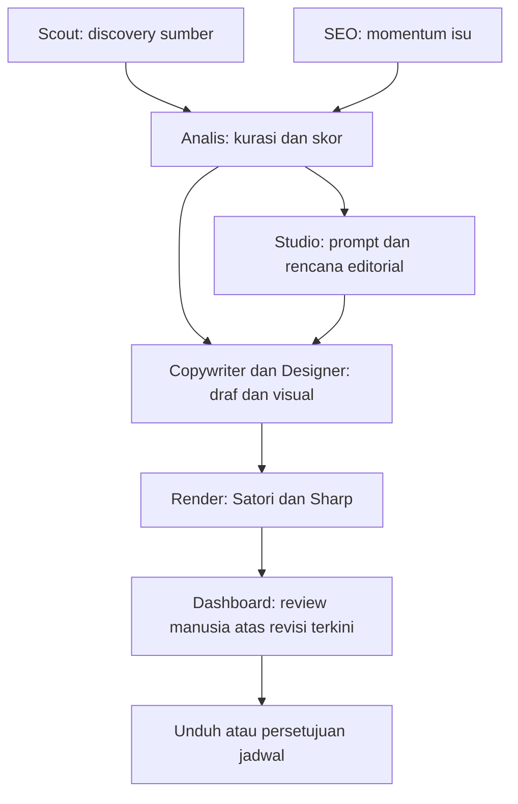

# 🏛️ Gapura Media Engine (GME v2.1)
> **Ruang Redaksi Politik, Sosial, Hukum, Lingkungan & Ekonomi Nasional termasuk Bursa Saham**
> Akun Instagram Resmi: **[`@gapuramedia`](https://instagram.com/gapuramedia)**  
> Portal Dashboard: **[https://gapura.avenia.my.id](https://gapura.avenia.my.id)** · Canvas / Fallback Manual n8n: **[https://n8n.avenia.my.id](https://n8n.avenia.my.id)**

**Mode evaluasi editorial — 18 November 2026:** hasil draf/desain dan antrean
publikasi telah dikosongkan dengan backup/restore teruji. Timer intake dan
publisher tetap `disabled/inactive`, worker background dijeda dengan
`GAPURA_DISABLE_WORKERS=true`, dashboard
dan koneksi Instagram tetap tersedia. Perubahan desain/isi berikutnya mengikuti
[blueprint editorial baru](docs/plans/07_EDITORIAL_REDESIGN_BLUEPRINT.md) dan
[laporan reset](docs/EDITORIAL_WORKSPACE_RESET_20261116.md). Kontrak dan corpus
sintetis [R1](docs/plans/08_R1_EDITORIAL_CONTRACT.md) tersedia offline.
[R2](docs/plans/09_R2_ARTICLE_MATERIALS.md) menambahkan body feed, parser artikel,
snapshot materi dan API pengayaan manual, tanpa backfill/draf baru.
**Arah terbaru owner:** [konten orisinal](docs/plans/10_ORIGINAL_AI_EDITORIAL.md)
dengan visual Gapura sendiri. R7 menjadikan **unggah gambar manual sebagai jalur
utama**; cover adalah slide 1 dan wajib bergambar sebelum approval/publish,
sedangkan ilustrasi AI tetap opsi.
Spesifikasi R3–R8 sudah diselaraskan. [R3](docs/plans/11_R3_AI_ILLUSTRATIONS.md)
menambahkan generator ilustrasi, aset lokal dan disclosure yang teruji; uji
Gemini nyata tertahan 429/kuota gambar Free Tier 0; tidak ada permintaan ulang
atau perpindahan provider gambar. [R4](docs/plans/12_R4_SOURCES_DESKS.md) selesai
untuk discovery enam desk dan proyeksi metadata Analis/cluster.
[R5](docs/plans/13_R5_REMOVE_VERIFICATOR.md) selesai: Verifikator dilepas dari
jalur aktif; koreksi niche enam desk terpasang dan seluruh gate teknis lulus.
[R6](docs/plans/14_R6_ORIGINAL_EDITORIAL.md) selesai: naskah orisinal dua mode
(`explainer`/`current`) tanpa body/summary/foto penerbit, carousel 3–9 slide
dengan default enam, caption isi 1.200–1.900 karakter, Threads ≤500, dan
persistensi tujuh kolom baru yang sudah dimigrasikan ke produksi setelah
backup/restore test. [R7](docs/plans/15_R7_MANUAL_MEDIA.md) selesai pada gate
teknis: unggah gambar manual menjadi jalur utama, cover slide 1 wajib bergambar
sebelum approval/publish, slide isi opsional, dan enam sampel draf manual sudah
dibuat untuk dinilai owner. Tidak ada generasi raster AI nyata, publikasi nyata,
atau aktivasi otomatisasi; kuota gambar AI tetap 0.
Topik populer dipilih dari Google Trends, web/berita (Firecrawl Search), jejaring sosial, dan forum publik. Riset memakai tiga kueri terarah tanpa allowlist penerbit. Gemini memilih ID petikan yang sudah dipasangkan aplikasi dengan teks dan URL sumber. Bila pilihan AI belum mencapai tiga fakta, aplikasi mengambil kalimat sumber yang relevan dan berbeda; bila bahan tetap kurang, generasi berhenti. Cuplikan mesin pencari harus diambil ulang dari halaman asal sebelum boleh mendukung artikel. Artikel, caption, dan carousel selalu menunggu review redaktur.

Firecrawl sudah terautentikasi dan key disimpan operator di secret store server `0600`; dashboard publik tidak menerima key. Migrasi artikel terpasang sejak 19 November 2026 setelah backup/restore teruji. Uji riset awal dilakukan di memori. Atas mandat owner berikutnya, enam sampel pipeline terbaru lintas desk disimpan sebagai **draf 150–155**, lengkap artikel, fakta/rujukan, caption, carousel, dan cover; semuanya `needs_review` tanpa publikasi. [Paket review dan lembar keputusan R7](docs/plans/18_R7_SIX_DESK_REVIEW.md) menunggu keputusan owner/redaktur. Timer pipeline/publisher tetap nonaktif. Detail metode ada di [laporan perbaikan riset](docs/plans/17_PUBLIC_RESEARCH_RELIABILITY.md). Backup pra-migrasi: `backups/hme_pre_longform_20261119.dump` (SHA-256 `e38c43c75c1d94e23a6680f813c2d0d3f32a309beadaf1f1dfbec3b7a02889fc`).

---

## 📌 Ringkasan Proyek

**Gapura Media Engine (GME v2.1)** adalah platform otomasi ruang redaksi modern (*newsroom automation*) untuk isu nasional Indonesia pada enam desk: **politik, sosial, hukum, lingkungan, ekonomi nasional, dan bursa saham**. Arah produknya adalah topik dan metadata discovery yang dikembangkan menjadi naskah serta visual orisinal Gapura Media. Proyeksi discovery R4, jalur naskah orisinal R6, dan unggah gambar manual R7 sudah tersedia; penerimaan visual owner dan aktivasi bertahap R8 masih menunggu keputusan owner.

Platform ini menggabungkan **6 agen: Scout, Analis, Copywriter, Designer, SEO, dan Studio**, dengan pengawasan manusia (*Human-in-the-Loop*), mesin render deterministik berbasis SVG-to-PNG (*Satori + Sharp*), serta dashboard editorial berbasis web yang responsif. Scout dan SEO mengumpulkan serta menilai momentum secara deterministik; agen produksi memakai model sesuai konfigurasi provider.



---

## ✨ Fitur Utama & Batas Implementasi Saat Ini

1. **Dashboard Review Editorial Realtime**
   - Panel pemantauan metrik kurasi: jumlah item mentah, topik lolos analisis, draf siap review, dan postingan terbit.
   - Status kesehatan layanan real-time (Web Dashboard, Render Engine, Database PostgreSQL, dan n8n). Kesehatan n8n menunjukkan ketersediaan canvas manual; status scheduler diperiksa dari timer systemd.
2. **Radar Topik Enam Desk & 1-Click Auto-Produce**
   - Agregasi topik lintas politik, sosial, hukum, lingkungan, ekonomi nasional, dan bursa, dengan sumber resmi sebagai atribusi primer saat tersedia.
   - Filter status: *Semua Topik*, *Lolos (≥76)*, *Gugur / Fast-Fail*, dan *Diproduksi*, disertai filter dan badge enam desk.
   - **Buat draf review:** Produksi topik yang lolos Analis tanpa laporan mesin, lalu buka editor untuk review. Kebutuhan aset dan durasi tetap bergantung pada konfigurasi, model, jaringan, dan jumlah slide.
3. **Editor Draf & Pratinjau Carousel Live**
   - Menampilkan visual slide beresolusi tinggi (1080×1350 px rasio 4:5).
   - Strip thumbnail interaktif untuk navigasi cepat antar slide.
   - Editor teks narasi, pengubah layout slide, pengaturan parameter metrik angka, caption Instagram, dan tagar.
   - **Simpan & Render Ulang Seketika:** Render ulang slide tunggal dalam < 200 ms dengan pembaruan pratinjau live tanpa reload halaman.
4. **AI Creative Director (Designer Otonom)**
   - Perancangan arsitektur visual berbasis AI (`gemini-3.5-flash-lite`) yang bebas dan tidak kaku dengan template tertentu.
   - Jalur R6 selalu menghasilkan carousel 3–9 slide dengan default enam. Draf yang disusutkan menjadi 1–2 slide ditolak sebelum pin/render/penulisan; draf legacy single tetap dapat diedit.
   - **Tombol Regenerate AI Instan:** Rancang ulang seluruh carousel secara adaptif dalam 1 klik tanpa dialog popup yang memblokir.
5. **Studio Desain & Pembuatan Postingan Kustom**
   - Membuat postingan mandiri on-the-fly dari form Studio Desain.
   - Pratinjau live perubahan token desain (palet warna `#102B45` Navy, `#1F7E81` Deep Teal, `#D79344` Golden Amber) di kanvas simulator ponsel.
6. **Kustomisasi 6 Agen & Skills.md**
   - Scout, Analis, Copywriter, Designer, SEO, dan Studio; tidak ada tab/config/skill agen Verifikator pada jalur aktif R5.
   - Konfigurasi independen untuk setiap agen: Provider (Gemini / OpenAI Compatible), Endpoint, API Key, Model, dan System Prompt.
   - **Editor `skills.md` Kustom:** Setiap agen dapat disematkan berkas panduan eksekusi mandiri di `/root/gapura/config/skills/`.
7. **Manajemen Sumber Discovery Enam Desk**
    - Tambah, edit, aktifkan/nonaktifkan feed RSS dan sumber resmi secara dinamis dari dashboard, termasuk penetapan desk eksplisit atau inferensi dari judul.
    - Kategori sumber baru default `umum` (**Umum / Lintas Isu**), terpisah dari Desk Editorial. Update API yang tidak mengirim kategori mempertahankan nilai sebelumnya; tidak ada backfill arsip.
8. **Render Microservice Deterministik (Satori + Sharp)**
   - Footprint memori sangat ringan (~65 MB RAM, tanpa Chromium headless).
   - Menghasilkan gambar PNG jernih 1080×1350 px 96 DPI dengan font resmi: `Archivo Black` dan `Inter`.
9. **Anti-Cache & CDN Bypass Architecture**
   - Header HTTP anti-stale (`Cache-Control: no-store, no-cache, must-revalidate`, `Surrogate-Control: no-store`) memastikan Cloudflare CDN dan browser tidak menyajikan skrip atau gambar usang.
   - Automatic query busting unik `?t=${Date.now()}_...` pada seluruh aset dinamis.

10. **Agen SEO — Radar Trending (Sumber X Dapat Dikustomisasi)**
    - Memindai akun X (`@handle`), query X, Google Trends geo, dan momentum Google News; daftar sumber dapat ditambah/diubah langsung dari dashboard (**Radar Trending**).
    - Skor virality menimbang bobot sumber, kesegaran, angka, dan relevansi enam desk; item teratas dapat dipromosikan menjadi topik editorial dengan satu klik.
    - Tanpa `X_BEARER_TOKEN`, jalur X otomatis dialihkan ke Google News dan provider yang benar-benar dipakai dicatat pada setiap item (tidak menyamar sebagai data X).
    - Dropdown kategori sumber tren mencakup enam desk serta pilihan umum/lintas isu.

11. **Review Manusia atas Revisi Konten**
    - Produksi dan review tidak meminta report, badge kebenaran atau confidence mesin. API/UI/fungsi/config Verifikator dilepas di R5; tabel dan kolom historis tetap sebagai arsip tanpa schema removal atau backfill.
    - Persetujuan harus eksplisit atas revisi terkini. Edit membatalkan approval/jadwal; konten yang berubah harus ditinjau kembali.
    - Disclaimer hukum/investasi bersifat opsional dan sesuai konteks hukum/bursa, bukan boilerplate untuk semua desk.

12. **Katalog Provider & Model Multi-Provider**
    - Registry provider (`services/common/providers.js`) mendukung Gemini, OpenAI-compatible, dan Anthropic: Groq, OpenRouter, NVIDIA, endpoint custom, serta provider resmi.
    - Model diambil live dari `/models` tiap provider, di-cache di `config/models.cache.json`, dan dapat diuji dari dashboard tanpa menyimpan perubahan.
    - Rantai fallback global lintas provider (Gemini-first) dengan klasifikasi error `retryable`, sehingga halaman blokir/gateway rusak tidak mematikan seluruh rantai.
    - API key per provider disimpan terpisah di `/etc/gapura/provider-keys.json` (`0600`), tidak pernah dikembalikan ke browser.

13. **Publisher Multi-Platform Meta**
    - Tiga adapter terpisah: Instagram Graph (single/carousel), Facebook Pages (foto/feed), dan Threads (image/carousel).
    - State publikasi per draf/platform/akun di tabel `publication_targets`; hasil ambigu disimpan sebagai `unknown` dan tidak pernah di-retry buta.
    - Mode `shadow` (default) mencatat rencana publikasi tanpa panggilan jaringan; mode `live` hanya aktif lewat `META_PUBLISH_MODE=live`.
    - Derivatif JPEG `slide_<n>.jpg` dibuat otomatis di samping PNG dan disajikan lewat URL bertanda tangan berbatas waktu.
    - Gate publikasi memakai audit persetujuan manusia `approved_auto`, `content_hash` yang cocok dengan revisi terkini, `needs_review=false`, serta pemeriksaan sumber/skor Analis, jadwal dan akun yang berlaku. Meta dan publisher legacy memeriksa ulang konten dalam row lock sebelum panggilan publikasi akhir; report/confidence mesin tidak dipakai.
    - Timer publisher tetap dijeda, terpisah dari siklus intake. Gate R5 lulus: 606 unit, 56 DB/API, 10 akses, Chromium serta 84 renderer; suite beririsan dan tidak dijumlahkan.

14. **Studio Prompt (v2.2)** — produksi konten dari satu prompt admin:
    - Admin menulis arahan editorial (penjelasan isu, analisis, perspektif alternatif, opini, dll).
    - AI menyusun rencana terstruktur (judul, sudut pandang, tujuan, poin isi) yang bisa diedit manual, di-generate ulang dengan instruksi revisi, atau langsung diproduksi.
    - Job queue berbasis Postgres (`prompt_jobs` + `job_logs` + `llm_usage`): topik -> rencana -> draft + render -> review manusia; tidak ada tahap Verifikator.
    - Mode `review` menunggu ACC admin; publikasi terjadwal tetap mengikuti gate editorial dan persetujuan redaktur.
    - Progres per langkah lewat SSE tersedia; worker background saat ini dijeda dengan `GAPURA_DISABLE_WORKERS=true`. Telegram tetap bergantung pada konfigurasi bot.

---

## 🚀 Panduan Cepat Penggunaan Aplikasi

Panduan lengkap langkah demi langkah tersedia di:  
👉 **[`docs/PANDUAN_PENGGUNAAN.md`](docs/PANDUAN_PENGGUNAAN.md)**

### Alur Kerja Harian Redaktur:
1. Buka dashboard di browser: **`https://gapura.avenia.my.id`**.
2. (Opsional) Buka **Radar Trending** untuk memindai berita/percakapan naik daun, lalu promosikan trend menjadi topik editorial.
3. Masuk ke menu **Radar Topik**, gunakan filter desk dan status, lalu pilih topik yang lolos Analis.
4. Gunakan **Buat draf review**; Designer & Copywriter menyiapkan draf tanpa meminta laporan mesin. Di editor draf, unggah gambar manual untuk cover (slide 1) dan, bila perlu, slide isi. Cover wajib bergambar sebelum disetujui; kuota gambar AI masih 0 sehingga jalur manual adalah yang utama.
5. Periksa visual slide, gunakan tombol panah atau strip thumbnail untuk memeriksa slide 1 sampai penutup.
6. Jika ingin sudut pandang visual baru, klik **`✨ Regenerate AI (Desain Ulang)`**.
7. Sesuaikan teks jika diperlukan, lalu klik **`🔄 Simpan & Render Ulang Slide`**.
8. Salin caption melalui tombol **`📋 Salin Caption & Hashtags`** atau unduh seluruh gambar melalui **`📥 Download Semua Slide (ZIP)`**.
9. Persetujuan memerlukan konfirmasi review dan revisi terkini; perubahan konten harus direview ulang. Selama evaluasi ini jangan mengaktifkan timer atau menjalankan publish nyata.

Dashboard langsung terbuka tanpa login atau token admin. API dashboard juga
tersedia tanpa autentikasi. Validasi Origin, redaksi API key, dan gate review
sebelum publikasi tetap berlaku. Secret server untuk signature media dan akses
layanan internal bukan kredensial login dashboard.

---

## 🛠️ Stack Teknologi

- **Backend & API Server:** Node.js v24 (ESM), Express.js
- **Render Engine:** `@vercel/satori` (JSX to SVG) + `sharp` (SVG to PNG)
- **Basis Data:** PostgreSQL 17 (Database `hme` untuk konten & `n8n` untuk canvas/riwayat workflow manual)
- **AI Models:** Registry multi-provider (`config/providers.json` + key per provider) — Gemini, OpenAI-compatible, Anthropic; model catalog live per provider
- **Orkestrasi Alur Kerja:** Systemd timer native (`gapura-pipeline.timer` kalender 15 menit, `gapura-publisher.timer` monotonic 10 menit), saat ini keduanya `disabled/inactive`; unit terpasang dan status runtime systemd menjadi sumber kebenaran operasional. n8n Community Edition tetap canvas/fallback manual
- **Reverse Proxy & Edge:** Cloudflare Tunnel + Cloudflare Edge (`cloudflared`)
- **Process Manager:** Systemd Linux Services (`hme-web.service`, `hme-render.service`, `hme-n8n.service`)

---

## 📋 Status Pengembangan, Isu & Roadmap

Dokumen evaluasi teknis, daftar permasalahan yang telah diselesaikan, dan fitur yang belum selesai dapat dibaca di:  
👉 **[`docs/STATUS_DAN_ROADMAP_FITUR.md`](docs/STATUS_DAN_ROADMAP_FITUR.md)**

### Ringkasan Status Fitur:
- [x] Workspace desain/konten bersih dan backup teruji untuk evaluasi ulang
- [x] Blueprint pembaruan editorial enam desk tersusun; kontrak dan corpus R1 tersedia offline
- [x] R2 — body feed/artikel, metadata sumber dan snapshot versi terpisah dari ringkasan Radar; endpoint pengayaan manual tersedia tanpa produksi draf
- [x] Web Review Dashboard Responsif (Desktop & Mobile)
- [x] Microservice Render Satori + Sharp (1080x1350 px)
- [x] Migrasi Identitas Penuh ke Brand Guidelines Gapura Media (`@gapuramedia`)
- [x] AI Creative Director (Agen Designer adaptif bebas template kaku)
- [x] 1-Click Auto-Produce dari Radar Topik
- [x] Eliminasi Masalah Cloudflare Cache Staling & Dialog `confirm()`
- [x] Kustomisasi 6 agen: Scout, Analis, Copywriter, Designer, SEO, Studio
- [x] Manajemen Sumber Discovery Enam Desk (desk eksplisit + inferensi judul)
- [x] Agen SEO (Radar Trending) dengan sumber X/Google Trends yang dapat dikustomisasi
- [x] R4 — discovery enam desk, cluster judul dan proyeksi metadata Analis/cluster
- [x] R5 — penghapusan Verifikator dari jalur aktif; arsip schema dipertahankan
- [x] R5 — gate unit/DB/API/browser/render dan koreksi niche enam desk lulus; web/render dimuat ulang, timer tetap dijeda
- [x] R6 — naskah orisinal dua mode tanpa body/summary penerbit; carousel 3–9 default enam dan caption isi 1.200–1.900 karakter; migrasi additive terpasang di produksi
- [x] R7 — unggah gambar manual sebagai jalur utama; cover slide 1 wajib bergambar sebelum approval/publish, slide isi opsional; enam sampel manual dibuat, menunggu review owner (kuota gambar AI tetap 0)
- [x] Katalog Provider & Model multi-provider (registry + fallback lintas provider + uji dari dashboard)
- [x] P2 — [audit skor historis & validasi constraint](docs/P2_SCORE_INTEGRITY_AUDIT.md): 1.062 baris valid, 0 perubahan data; `topic_scores_component_total` tervalidasi
- [x] P2 — scheduler native terverifikasi dan terdokumentasi: unit systemd terpasang menjadi sumber kebenaran; tanpa penambahan cron atau aktivasi workflow otomatis n8n
- [x] Publisher Meta multi-platform tersedia; Instagram Unified terhubung, timer publisher dijeda dan mode shadow dipertahankan selama evaluasi
- [ ] R8 / aktivasi publish Meta live *(setelah review owner, batch/shadow, izin platform, dan persetujuan uji terpisah)*
- [ ] Bot Notifikasi & Approval Telegram *(engine siap, menunggu `TELEGRAM_BOT_TOKEN`)*
- [ ] UI Kalender Konten Interaktif (Drag & Drop Scheduler)
- [ ] Sistem Autentikasi Pengguna & Hak Akses Berjenjang (Multi-Role)
- [ ] Modul Charting Saham Lanjutan (Candlestick & Volume Bandarmology)

---

## 💻 Operasional Layanan (Systemd Commands)

**Sumber kebenaran scheduler adalah unit yang terpasang beserta status runtime
systemd**, termasuk drop-in jika ada. Berkas terlacak di [`deploy/`](deploy/)
merupakan template untuk redeploy; perubahan template belum mengubah unit yang
sedang terpasang. **Keadaan terbaru setelah reset evaluasi:** kedua timer
`disabled/inactive`, serta `hme-web` memiliki drop-in `editorial-review.conf`
dengan `GAPURA_DISABLE_WORKERS=true` untuk menjeda worker background. Tabel
berikut mencatat keadaan evaluasi yang dipertahankan selama R5. Lihat
[laporan reset](docs/EDITORIAL_WORKSPACE_RESET_20261116.md) sebelum re-enable.

| Unit terpasang | Jadwal / tugas | Keadaan evaluasi yang dipertahankan |
| :--- | :--- | :--- |
| [`gapura-pipeline.timer`](deploy/gapura-pipeline.timer) | Kalender `OnCalendar=*:0/15`, `Persistent=false`, `RandomizedDelaySec=30`; slot yang terlewat saat timer nonaktif tidak dikejar. | `disabled/inactive` |
| [`gapura-pipeline.service`](deploy/gapura-pipeline.service) | Oneshot `scripts/run_pipeline.sh`, `GAPURA_ENABLE_DELIVERY=false`; script memakai `flock -n` dengan default lock `/tmp/opencode/gapura-pipeline.lock` untuk melewati eksekusi bertumpuk. | Tidak dijalankan dalam pekerjaan R5 |
| [`gapura-publisher.timer`](deploy/gapura-publisher.timer) | Monotonic `OnBootSec=3min`, `OnUnitActiveSec=10min`, `AccuracySec=30s`; interval dihitung dari aktivasi service. | `disabled/inactive` |
| [`gapura-publisher.service`](deploy/gapura-publisher.service) | Oneshot `services/publisher/meta-worker.js`; mode publikasi mengikuti konfigurasi runtime `shadow`, bukan timer. | Tidak dijalankan dalam pekerjaan R5; tidak ada publish nyata |

`GET /api/workflow` mengembalikan status scheduler **intake** dari systemd:
`kind`, `active`, `next_run`, `last_run`, `interval_minutes`, dan
`delivery_enabled=false` (lihat [`scheduler.js`](services/web/scheduler.js)).
API ini tidak melaporkan timer publisher; toggle workflow dashboard juga hanya
mengendalikan timer intake. Publisher diperiksa tersendiri melalui systemd.

n8n (`hme-n8n.service`) tetap `active (running)` untuk canvas/fallback manual.
Berkas `workflow.json`/ekspor workflow dan flag `active` pada database n8n hanya
menjadi referensi canvas/riwayat, bukan bukti scheduler operasional. Workflow
otomatis lama `d3j0Kr9koCQFlRIG` terverifikasi read-only pada snapshot P2
16 November 2026 dengan `active=f` dan `execution_count=0`.
Penyelesaian lingkup scheduler P2 memakai native timer yang sudah terpasang,
tanpa menambahkan cron atau mengaktifkan workflow otomatis n8n.

```bash
# Cek status layanan
systemctl status hme-web.service hme-render.service hme-n8n.service

# Live monitoring log web dashboard
journalctl -u hme-web.service -f

# Live monitoring log render service
journalctl -u hme-render.service -f

# Jadwal kalender dan monotonic, termasuk timer yang sedang nonaktif
systemctl list-timers --all 'gapura-*'
systemctl status gapura-pipeline.timer gapura-publisher.timer --no-pager

# Definisi terpasang, termasuk drop-in
systemctl cat gapura-pipeline.service gapura-pipeline.timer \
  gapura-publisher.service gapura-publisher.timer --no-pager

# Status dan waktu pemicu: cek realtime maupun monotonic
systemctl show gapura-pipeline.timer gapura-publisher.timer \
  --property=Id,LoadState,UnitFileState,ActiveState,SubState,FragmentPath,DropInPaths,TimersCalendar,TimersMonotonic,LastTriggerUSec,NextElapseUSecRealtime,NextElapseUSecMonotonic,AccuracyUSec,RandomizedDelayUSec,Persistent

# Hasil terakhir service oneshot dan waktu eksekusinya
systemctl status gapura-pipeline.service gapura-publisher.service --no-pager
systemctl show gapura-pipeline.service gapura-publisher.service \
  --property=Id,ActiveState,SubState,Result,ExecMainCode,ExecMainStatus,ExecMainStartTimestamp,ExecMainExitTimestamp
journalctl -u gapura-pipeline.service -u gapura-publisher.service -n 50 --no-pager
```

Service `Type=oneshot` normal berada pada `inactive (dead)` di antara eksekusi;
`systemctl status` dapat mengembalikan exit code nonzero untuk kondisi tersebut.
Nilai `Result`, `ExecMainStatus`, timestamp mulai/selesai, dan journal menentukan
hasil eksekusi terakhir. Timer publisher memakai waktu monotonic, sehingga
`NextElapseUSecRealtime` dapat kosong; periksa `NextElapseUSecMonotonic` dan
`list-timers --all` sebelum menyimpulkan jadwal tidak aktif.

Unit yang dapat dipasang ulang tersedia di [`deploy/`](deploy/). Secret runtime
berada di `/etc/gapura/runtime.env` dan `/etc/gapura/admin-token.env` (`0600`),
tidak dimasukkan ke Git. `META_PUBLISH_MODE=shadow` dan
`META_PLATFORMS=instagram,facebook` adalah konfigurasi runtime aktif; journal
pemeriksaan P2 mengonfirmasi `mode=shadow`. Mode shadow tidak ditetapkan oleh timer. Publikasi live
menunggu izin `instagram_content_publish` dan `pages_manage_posts`, serta satu
draf dengan audit persetujuan manusia atas hash revisi terkini, sumber/skor
Analis yang memenuhi gate, aset siap, jadwal/akun yang sesuai, dan recheck dalam
row lock sebelum publish. Threads membutuhkan token
dan user ID tersendiri.

Langkah pemberian izin, review, uji live, serta rekonsiliasi tersedia di
[`docs/META_PUBLISHING_RUNBOOK.md`](docs/META_PUBLISHING_RUNBOOK.md).
Ketentuan review R5 pada [laporan R5](docs/plans/13_R5_REMOVE_VERIFICATOR.md)
dan README ini menggantikan syarat report/confidence pada runbook historis.
Aktivasi tetap mengikuti urutan R7–R8 dalam blueprint dan mandat eksplisit owner.

---
*© 2026 Gapura Media — Politik, Sosial, Hukum, Lingkungan & Ekonomi Nasional termasuk Bursa Saham.*
