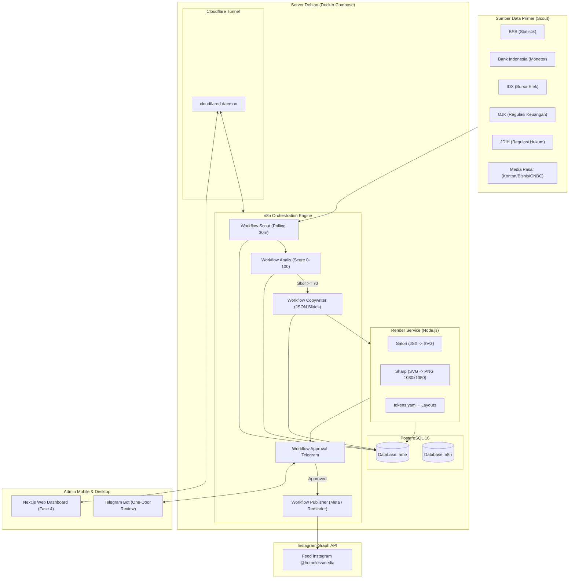

# MASTER BLUEPRINT & ROADMAP ORKESTRASI
## Homeless Media Engine (HME) v2.0 · Hybrid Architecture

Dokumen ini adalah peta jalan induk (Master Blueprint) untuk pembangunan sistem otomasi Homeless Media Engine (HME) berdasarkan Product Requirements Document (PRD v2.0). Sistem ini dirancang untuk akun Instagram niche data, hukum, dan ekonomi bursa saham (@homelessmedia) dengan arsitektur **Hybrid n8n Community + Node.js Render Micro-service (Satori + Sharp)** yang berjalan 100% self-hosted di server Debian lokal.

---

## 1. Visi, Prinsip Desain & Batasan (Boundaries)

### 1.1 Visi Produk
Setiap pagi, admin cukup membuka Telegram di ponsel cerdas, meninjau carousel draf yang telah tersaring secara otomatis oleh AI scoring engine, menekan tombol **Setujui** (atau mengedit ringan), dan menutup ponsel dengan kepastian bahwa jadwal tayang hari itu aman dan bermutu tinggi.

### 1.2 Tiga Prinsip Desain Non-Kompromi
1. **AI Memproduksi, Manusia Memutuskan (Human-in-the-Loop):** Nol konten boleh tayang tanpa persetujuan eksplisit admin. Tidak ada fitur "autopilot unreviewed".
2. **Saring Dulu, Baru Produksi (Cost-Effective Funnel):** Topik berkualitas rendah digugurkan di gerbang awal menggunakan fast-fail rules dan model murah (Gemini Flash / GPT-4o-mini). Model penulisan flagship hanya dipanggil untuk topik yang lolos skor threshold (>= 70-75).
3. **Satu Pintu Review:** Seluruh siklus preview, edit ringan, dan approval terpusat di Bot Telegram sejak Hari Pertama (disusul Web Dashboard di Fase 4 untuk review massal).

### 1.3 Anti-Slop Safeguards (Kepatuhan Finansial & Visual)
- **Kepatuhan Finansial/Hukum Mutlak:**
  - Dilarang keras merekomendasikan beli/jual saham tertentu (No Stock Picking / No Pump & Dump).
  - Wajib menyertakan disclaimer otomatis: `Bukan Nasihat Keuangan` atau `Bukan Nasihat Hukum`.
  - Setiap data statistik atau pergerakan pasar wajib menyertakan sumber primer resmi yang tercetak di slide. Kutipan pasal hukum wajib verbatim.
- **Visual Anti-Slop:**
  - Tidak ada generasi gambar generik via Diffusion / DALL-E. Desain 100% deterministik berbasis `tokens.yaml` dan 9 layout template JSX.
  - Maksimal 2 keluarga font (`Archivo Black` untuk display angka/judul, `Inter` untuk isi/label).
  - Skala grid 8px, warna flat tanpa gradasi ungu generik, tanpa stiker, tanpa efek 3D berlebihan.

---

## 2. Arsitektur Sistem Global

Sistem berjalan di atas 4 kontainer Docker Compose di jaringan internal:

---

## 3. Struktur Dokumen Perencanaan (Modular Execution Plan)

Agar pengerjaan dapat dilakukan secara detail, modular, dan penuh ketelitian, blueprint ini dipecah ke dalam 6 dokumen teknis spesifik:

| Kode Dokumen | Nama Dokumen | Fokus & Tanggung Jawab Utama | Target Fase |
| :--- | :--- | :--- | :--- |
| **DOC-01** | `01_PHASE_0_FOUNDATION_INFRASTRUCTURE.md` | Lingkungan Docker Compose (4 kontainer), DDL PostgreSQL 16 (12 tabel, ekstensi `pg_trgm`, indeks hash), konfigurasi Cloudflare Tunnel, dan registrasi Bot Telegram. | Fase 0 |
| **DOC-02** | `02_PHASE_0_RENDER_SERVICE_DESIGN_SYSTEM.md` | Micro-service render Node.js (`satori` + `sharp`), spesifikasi `tokens.yaml`, manajemen font lokal, 9 template JSX, logika auto-fit text truncation, dan kontrak REST internal. | Fase 0 & 2 |
| **DOC-03** | `03_PHASE_1_SCOUT_AND_ANALIS_ENGINE.md` | Pipeline polling sumber data niche (RSS/Scraper), dedup 2 lapis (SHA256 URL + `pg_trgm` title), rubrik penilaian 5 komponen (0-100), fast-fail filter, prompt Analis, dan telemetri `agent_runs`. | Fase 1 |
| **DOC-04** | `04_PHASE_2_COPYWRITER_AND_CAROUSEL_PIPELINE.md` | Prompt Copywriter data-editorial, skema JSON slide 5-8 lembar, injeksi disclaimer kepatuhan, integrasi panggilan Render Service, pembuatan album preview carousel. | Fase 2 |
| **DOC-05** | `05_PHASE_3_APPROVAL_PUBLISHING_OPERATIONS.md` | Logika interaktif Bot Telegram (inline keyboard Approve/Edit/Reject), state machine transisi draf, engine publikasi Meta Graph API + fallback reminder manual, automated backup & git sync. | Fase 3 |
| **DOC-06** | `06_PHASE_4_DASHBOARD_AND_MAINTENANCE.md` | Web review dashboard (Next.js 14, Tailwind, keyboard shortcuts untuk 20 draf < 20 menit), kalibrasi mingguan skor vs performa, disaster recovery runbook. | Fase 4 |

---

## 4. Matriks Metrik Keberhasilan & Target 90 Hari

| Parameter / Metrik | Baseline Operasi Manual | Target Operasional HME v2.0 | Metode Verifikasi |
| :--- | :--- | :--- | :--- |
| **Waktu Kerja Harian Admin** | 2–3 jam / hari | **< 20 menit / hari** | Catatan interaksi Telegram bot |
| **Frekuensi Posting** | 1–2 / hari (inkonsisten) | **2–4 / hari (konsisten)** | Audit status `published` di database |
| **Topik Dievaluasi per Hari** | ±10 topik | **40–80 topik otomatis** | Hitungan baris di `topic_scores` |
| **Rasio Draf Disetujui** | Tidak terukur | **>= 50%** | `COUNT(approved) / COUNT(drafts)` |
| **Konten Tayang Tanpa Approval** | 0 (disiplin manual) | **0 (dijamin arsitektur DB/Code)**| Validasi check constraint & audit log |
| **Biaya Operasional Bulanan** | Rp0 + 2-3 jam lelah | **<= Rp300.000 / bulan** | Total token LLM + server + domain |

---

## 5. Tata Kelola Eksekusi Bertahap

Untuk menjamin eksekusi berjalan tanpa error dan tanpa deviasi dari PRD:
1. Pengerjaan dilakukan **dokumen demi dokumen** secara terisolasi.
2. Setiap dokumen memiliki **Verification & Exit Criteria** yang wajib dites sebelum berpindah ke dokumen berikutnya.
3. Semua artefak kode (skema SQL, source code microservice, template JSX, workflow JSON, konfigurasi tokens) disimpan di direktori terstruktur di dalam repository `/root/gapura/`.
