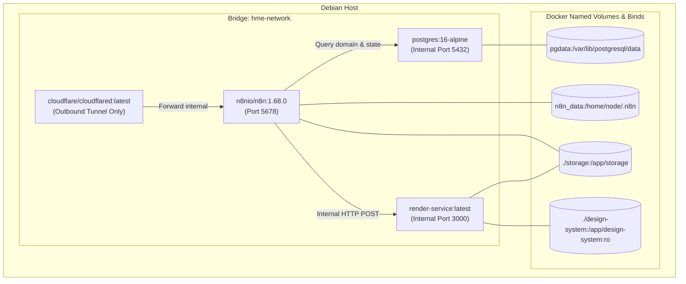

# DOKUMEN 01: FASE 0 — FONDASI & INFRASTRUKTUR
## Homeless Media Engine (HME) v2.0

Dokumen ini memuat spesifikasi teknis lengkap untuk mendirikan infrastruktur dasar HME di mesin Debian server. Dokumen ini mendukung dua pendekatan runtime:
1. **Opsi A: Bare-Metal Native Systemd (Rekomendasi Utama — Hemat Storage & RAM):** Menggunakan PostgreSQL 17, Node.js 24, n8n via npm, dan cloudflared yang berjalan langsung di OS host tanpa kontainer. Sangat ideal untuk server dengan sisa penyimpanan terbatas (< 7 GB) karena **menghemat 2,5–3,5 GB** ruang disk.
2. **Opsi B: Docker Compose (4 Kontainer Terisolasi):** Alternatif kontainerisasi penuh menggunakan `docker-compose.yml`.

---

## 1. Opsi A: Bare-Metal Native Systemd (Storage-Optimized)

### 1.1 Perbandingan Penggunaan Resource

| Aspek | Opsi A: Bare-Metal Native Systemd | Opsi B: Docker Compose |
| :--- | :--- | :--- |
| **Konsumsi Disk** | **~400–500 MB** total | **~3.000–4.000 MB** (Image + Base layers) |
| **Konsumsi RAM Overhead** | **0 MB** overhead (proses langsung) | **150–250 MB** overhead Docker daemon & bridge |
| **PostgreSQL** | Memakai PostgreSQL 17 lokal yang sudah aktif | Image postgres baru di volume terpisah |
| **Node.js & Tooling** | Memakai Node.js v24 yang sudah terpasang | Image node alpine terpisah |
| **Manajemen Service** | Unit `systemd` standar Debian (`systemctl`) | `docker compose up/down` |

### 1.2 Topologi Port & Keamanan Bare-Metal
Semua service mendengarkan (*listen*) **hanya** pada interface loopback lokal (`127.0.0.1`), sehingga tidak ada port yang terbuka ke jaringan publik/LAN luar tanpa melalui Cloudflare Tunnel:
- `PostgreSQL 17`: `127.0.0.1:5432`
- `n8n Web Engine`: `127.0.0.1:5678`
- `Render Service`: `127.0.0.1:3000` (diproteksi header `X-Render-Secret`)
- `Cloudflare Tunnel`: Membuka outbound tunnel ke domain admin aman.

### 1.3 Konfigurasi Unit Systemd

#### A. Service Render (`/etc/systemd/system/hme-render.service`)
```ini
[Unit]
Description=Homeless Media Engine - Render Service (Satori + Sharp)
After=network.target

[Service]
Type=simple
User=root
WorkingDirectory=/root/gapura/services/render
EnvironmentFile=/root/gapura/.env
ExecStart=/usr/bin/node server.js
Restart=always
RestartSec=5
StandardOutput=journal
StandardError=journal

[Install]
WantedBy=multi-user.target
```

#### B. Service n8n (`/etc/systemd/system/hme-n8n.service`)
```ini
[Unit]
Description=Homeless Media Engine - n8n Workflow Engine
After=network.target postgresql.service

[Service]
Type=simple
User=root
EnvironmentFile=/root/gapura/.env
ExecStart=/usr/bin/n8n
Restart=always
RestartSec=10
StandardOutput=journal
StandardError=journal

[Install]
WantedBy=multi-user.target
```

#### C. Service Cloudflare Tunnel (`/etc/systemd/system/cloudflared.service`)
```ini
[Unit]
Description=Cloudflare Tunnel for HME
After=network.target

[Service]
Type=simple
User=root
ExecStart=/usr/local/bin/cloudflared tunnel run --token ${CLOUDFLARE_TUNNEL_TOKEN}
Restart=always
RestartSec=10

[Install]
WantedBy=multi-user.target
```

---

## 2. Opsi B: Spesifikasi Docker Compose (Alternatif 4 Kontainer)

Arsitektur terdiri dari 4 layanan yang diisolasi dalam satu jaringan internal Docker (`hme-network`), tanpa membuka port database atau render service ke jaringan publik host secara sembarangan.

### 1.1 Diagram Jaringan & Volume



### 1.2 Rincian Konfigurasi `docker-compose.yml`

File `docker-compose.yml` akan ditempatkan di root repositori dengan struktur environment variables yang aman melalui `.env`.

- **`postgres`**:
  - Image: `postgres:16-alpine`
  - Inisialisasi: Skrip SQL otomatis di `/docker-entrypoint-initdb.d/` untuk membuat 2 database: `hme` (data domain) dan `n8n` (state engine).
  - Healthcheck: `pg_isready -U ${POSTGRES_USER} -d hme`.
- **`n8n`**:
  - Image: `n8nio/n8n:1.68.0` (versi di-pin, tidak menggunakan `:latest` untuk stabilitas produksi).
  - Env: `DB_TYPE=postgresdb`, `DB_POSTGRESDB_DATABASE=n8n`, `N8N_ENCRYPTION_KEY`, `WEBHOOK_URL`, `N8N_DEFAULT_BINARY_DATA_MODE=filesystem`.
  - Depends_on: `postgres` dengan kondisi `service_healthy`.
- **`render-service`**:
  - Build: `./services/render` (Node.js 20/22 Alpine, Satori + Sharp).
  - Jaringan: Hanya terhubung ke `hme-network`, port 3000 tidak di-expose ke host.
  - Auth: `X-Render-Secret` header validation.
  - Volume: Mount `./storage` (rw) untuk menyimpan PNG output, dan `./design-system` (ro) untuk membaca `tokens.yaml` dan layout JSX.
- **`cloudflared`**:
  - Image: `cloudflare/cloudflared:latest`.
  - Mode: `tunnel run --token ${CLOUDFLARE_TUNNEL_TOKEN}`.
  - Akses: Hanya mengekspos n8n web editor ke subdomain aman yang dilindungi Cloudflare Zero Trust / Access Policy (Email OTP).

---

## 2. Skema Basis Data PostgreSQL 16 (12 Tabel Inti)

Database `hme` dirancang sebagai *single source of truth*. Kolom dinamis disimpan sebagai `JSONB` untuk fleksibilitas evolusi prompt dan tokens, sementara integritas audit dilindungi secara `append-only`.

### 2.1 Skrip Inisialisasi Database (`init-db.sql`)

```sql
-- Buat database terpisah untuk n8n jika belum ada
CREATE DATABASE n8n;

-- Hubungkan ke database hme
\c hme;

-- Ekstensi untuk pencarian kemiripan teks (deduplikasi judul)
CREATE EXTENSION IF NOT EXISTS "uuid-ossp";
CREATE EXTENSION IF NOT EXISTS "pg_trgm";

-- ENUM Types
CREATE TYPE topic_status AS ENUM ('new', 'scored', 'rejected', 'produced', 'archived');
CREATE TYPE draft_status AS ENUM ('draft', 'approved', 'scheduled', 'published', 'rejected', 'failed');
CREATE TYPE post_mode AS ENUM ('auto', 'manual');
CREATE TYPE schedule_status AS ENUM ('pending', 'publishing', 'success', 'failed');
CREATE TYPE agent_type AS ENUM ('scout', 'analis', 'copywriter', 'designer', 'publisher');

-- 1. TABEL SOURCES (Daftar Sumber Niche Scout)
CREATE TABLE sources (
    id SERIAL PRIMARY KEY,
    name VARCHAR(100) NOT NULL,
    type VARCHAR(50) NOT NULL, -- 'rss', 'api', 'scraper'
    url_or_query TEXT NOT NULL,
    category VARCHAR(50) NOT NULL, -- 'data_bps', 'bi_moneter', 'idx_pasar', 'ojk_regulasi', 'jdih_hukum', 'news_pasar'
    poll_interval_mins INT DEFAULT 30,
    is_active BOOLEAN DEFAULT TRUE,
    created_at TIMESTAMPTZ DEFAULT CURRENT_TIMESTAMP,
    updated_at TIMESTAMPTZ DEFAULT CURRENT_TIMESTAMP
);

-- 2. TABEL RAW_ITEMS (Bahan Mentah Hasil Polling Scout)
CREATE TABLE raw_items (
    id BIGSERIAL PRIMARY KEY,
    source_id INT NOT NULL REFERENCES sources(id) ON DELETE RESTRICT,
    url TEXT NOT NULL,
    url_hash CHAR(64) NOT NULL UNIQUE, -- SHA-256 dari URL
    title TEXT NOT NULL,
    content_raw TEXT,
    published_at TIMESTAMPTZ,
    fetched_at TIMESTAMPTZ DEFAULT CURRENT_TIMESTAMP
);
CREATE INDEX idx_raw_items_fetched_at ON raw_items(fetched_at);
CREATE INDEX idx_raw_items_title_trgm ON raw_items USING gin (title gin_trgm_ops);

-- 3. TABEL TOPICS (Topik Ternormalisasi yang Masuk Pipeline)
CREATE TABLE topics (
    id BIGSERIAL PRIMARY KEY,
    raw_item_id BIGINT REFERENCES raw_items(id) ON DELETE SET NULL,
    title TEXT NOT NULL,
    summary TEXT,
    url TEXT,
    primary_source VARCHAR(100),
    status topic_status DEFAULT 'new',
    created_at TIMESTAMPTZ DEFAULT CURRENT_TIMESTAMP,
    updated_at TIMESTAMPTZ DEFAULT CURRENT_TIMESTAMP
);
CREATE INDEX idx_topics_status ON topics(status);

-- 4. TABEL TOPIC_SCORES (Hasil Penilaian Agen Analis 0-100)
CREATE TABLE topic_scores (
    id BIGSERIAL PRIMARY KEY,
    topic_id BIGINT NOT NULL REFERENCES topics(id) ON DELETE CASCADE,
    score_relevance INT NOT NULL CHECK (score_relevance BETWEEN 0 AND 30),
    score_credibility INT NOT NULL CHECK (score_credibility BETWEEN 0 AND 25),
    score_momentum INT NOT NULL CHECK (score_momentum BETWEEN 0 AND 20),
    score_engagement INT NOT NULL CHECK (score_engagement BETWEEN 0 AND 15),
    score_compliance INT NOT NULL CHECK (score_compliance BETWEEN 0 AND 10),
    score_total INT NOT NULL CHECK (score_total BETWEEN 0 AND 100),
    verdict VARCHAR(20) NOT NULL, -- 'passed', 'rejected', 'fast_failed'
    reasoning TEXT,
    model VARCHAR(50) NOT NULL,
    prompt_version VARCHAR(20) DEFAULT 'v1.0',
    created_at TIMESTAMPTZ DEFAULT CURRENT_TIMESTAMP
);
CREATE INDEX idx_topic_scores_topic_id ON topic_scores(topic_id);

-- 5. TABEL DRAFTS (Pusat Keputusan Konten & Carousel Admin)
CREATE TABLE drafts (
    id BIGSERIAL PRIMARY KEY,
    topic_id BIGINT NOT NULL REFERENCES topics(id) ON DELETE RESTRICT,
    slides JSONB NOT NULL, -- Array of slide objects (no, layout, teks, data)
    caption TEXT NOT NULL,
    hashtags TEXT[] DEFAULT '{}',
    disclaimer_type VARCHAR(20), -- 'keuangan', 'hukum', NULL
    status draft_status DEFAULT 'draft',
    needs_review BOOLEAN DEFAULT FALSE,
    tokens_version VARCHAR(50) NOT NULL DEFAULT 'v1.0',
    copy_model VARCHAR(50) NOT NULL,
    created_at TIMESTAMPTZ DEFAULT CURRENT_TIMESTAMP,
    updated_at TIMESTAMPTZ DEFAULT CURRENT_TIMESTAMP
);
CREATE INDEX idx_drafts_status ON drafts(status);

-- 6. TABEL DRAFT_SLIDES (Audit Visual & Riwayat Render per Slide)
CREATE TABLE draft_slides (
    id BIGSERIAL PRIMARY KEY,
    draft_id BIGINT NOT NULL REFERENCES drafts(id) ON DELETE CASCADE,
    slide_no INT NOT NULL,
    layout VARCHAR(50) NOT NULL,
    render_path TEXT NOT NULL, -- Path file PNG di storage
    text_snapshot TEXT,
    data_snapshot JSONB,
    rendered_at TIMESTAMPTZ DEFAULT CURRENT_TIMESTAMP,
    UNIQUE (draft_id, slide_no)
);

-- 7. TABEL TEMPLATES (Pustaka Layout Brand)
CREATE TABLE templates (
    id SERIAL PRIMARY KEY,
    name VARCHAR(50) NOT NULL UNIQUE, -- 'cover-stat', 'chart-bar', dll.
    tokens_version VARCHAR(50) NOT NULL DEFAULT 'v1.0',
    layout_meta JSONB,
    preview_path TEXT,
    is_active BOOLEAN DEFAULT TRUE,
    created_at TIMESTAMPTZ DEFAULT CURRENT_TIMESTAMP
);

-- 8. TABEL BRAND_SETTINGS (Voice Profile & Aturan Teks)
CREATE TABLE brand_settings (
    id SERIAL PRIMARY KEY,
    brand_name VARCHAR(100) DEFAULT 'Homeless Media',
    instagram_handle VARCHAR(50) DEFAULT '@homelessmedia',
    voice_examples JSONB NOT NULL DEFAULT '[]', -- Array 5-10 contoh caption terbaik
    signature_words TEXT[] DEFAULT '{}',
    banned_words TEXT[] DEFAULT '{}',
    niche_keywords TEXT[] DEFAULT '{}',
    updated_at TIMESTAMPTZ DEFAULT CURRENT_TIMESTAMP
);

-- 9. TABEL SCHEDULED_POSTS (Antrean & Riwayat Eksekusi Publikasi)
CREATE TABLE scheduled_posts (
    id BIGSERIAL PRIMARY KEY,
    draft_id BIGINT NOT NULL REFERENCES drafts(id) ON DELETE RESTRICT,
    mode post_mode NOT NULL DEFAULT 'auto',
    scheduled_at TIMESTAMPTZ NOT NULL,
    published_at TIMESTAMPTZ,
    status schedule_status DEFAULT 'pending',
    retry_count INT DEFAULT 0,
    ig_creation_id VARCHAR(100),
    ig_media_id VARCHAR(100),
    error_message TEXT,
    created_at TIMESTAMPTZ DEFAULT CURRENT_TIMESTAMP
);
CREATE INDEX idx_scheduled_posts_status ON scheduled_posts(status, scheduled_at);

-- 10. TABEL AGENT_RUNS (Telemetri Eksekusi Agen AI & Biaya Operasional)
CREATE TABLE agent_runs (
    id BIGSERIAL PRIMARY KEY,
    agent agent_type NOT NULL,
    entity_id BIGINT, -- ID topik atau draf terkait
    started_at TIMESTAMPTZ DEFAULT CURRENT_TIMESTAMP,
    completed_at TIMESTAMPTZ,
    status VARCHAR(20) NOT NULL, -- 'success', 'error', 'retried'
    model VARCHAR(50) NOT NULL,
    tokens_input INT DEFAULT 0,
    tokens_output INT DEFAULT 0,
    est_cost_idr NUMERIC(10, 2) DEFAULT 0.00,
    error_log TEXT
);
CREATE INDEX idx_agent_runs_agent ON agent_runs(agent, started_at);

-- 11. TABEL AUDIT_LOG (Jejak Append-Only Keputusan Admin)
CREATE TABLE audit_log (
    id BIGSERIAL PRIMARY KEY,
    entity VARCHAR(50) NOT NULL, -- 'draft', 'topic', 'settings', 'token'
    entity_id BIGINT NOT NULL,
    action VARCHAR(50) NOT NULL, -- 'approve', 'reject', 'edit', 'publish'
    actor VARCHAR(50) NOT NULL DEFAULT 'admin',
    payload JSONB, -- Data sebelum/sesudah perubahan
    created_at TIMESTAMPTZ DEFAULT CURRENT_TIMESTAMP
);
CREATE INDEX idx_audit_log_entity ON audit_log(entity, entity_id);

-- 12. TABEL APP_SETTINGS (Konfigurasi Dinamis Aplikasi)
CREATE TABLE app_settings (
    key VARCHAR(50) PRIMARY KEY,
    value JSONB NOT NULL,
    description TEXT,
    updated_at TIMESTAMPTZ DEFAULT CURRENT_TIMESTAMP
);

-- Inisialisasi Nilai Default Konfigurasi
INSERT INTO app_settings (key, value, description) VALUES
('score_threshold', '{"min_score": 70, "initial_strict_score": 75}', 'Ambang batas kelulusan topik oleh Analis'),
('publishing_hours_wib', '["07:00", "12:00", "18:00", "21:00"]', 'Jam optimal penayangan konten otomatis'),
('min_post_interval_hours', '3', 'Jarak aman minimal antar publikasi carousel'),
('daily_ai_cost_limit_idr', '15000', 'Batas maksimal pengeluaran token AI harian (Rp)'),
('telegram_admin_whitelist', '[]', 'Daftar chat_id Telegram yang sah untuk review & command');
```

---

## 3. Konfigurasi Cloudflare Tunnel & Telegram Bot

### 3.1 Cloudflare Tunnel (Zero Open Ports)
1. **Keamanan:** Host router tidak membuka port 80/443 sama sekali. Seluruh koneksi bersifat outbound melalui daemon `cloudflared`.
2. **Access Control:**
   - Subdomain n8n: `n8n.yourdomain.com` diarahkan ke `http://n8n:5678`.
   - Wajib diproteksi oleh **Cloudflare Zero Trust Access Policy**: otentikasi 2-faktor via email OTP admin sebelum halaman login n8n dapat diakses.

### 3.2 Registrasi Telegram Bot API
1. Bot didaftarkan melalui `@BotFather` dengan handle `@HomelessMediaEngineBot`.
2. Dapatkan `TELEGRAM_BOT_TOKEN`.
3. Catat `ADMIN_CHAT_ID` dari akun Telegram pribadi admin.
4. Set webhook n8n atau long-polling di n8n Telegram Trigger node dengan whitelist ketat hanya menerima instruksi dari `ADMIN_CHAT_ID`.

---

## 4. Rencana Pengujian & Kriteria Lolos (Exit Criteria Fase 0)

1. [ ] **Verifikasi Docker Compose:** Perintah `docker compose up -d` berjalan mulus tanpa crash loop pada ke-4 kontainer.
2. [ ] **Verifikasi Database:**
   - Database `hme` dan `n8n` terbuat otomatis.
   - 12 tabel terinisialisasi lengkap beserta indeks dan tipe ENUM.
   - Ekstensi `pg_trgm` aktif (`SELECT similarity('IHSG Anjlok', 'IHSG Melemah');`).
3. [ ] **Verifikasi n8n:** Dashboard n8n dapat dibuka melalui Cloudflare Tunnel dengan proteksi Access, dan koneksi ke PostgreSQL n8n terverifikasi hijau.
4. [ ] **Verifikasi Render Service:** Endpoint internal `http://render-service:3000/health` merespons `{ "status": "ok" }`.
