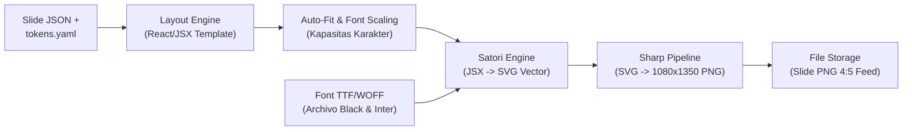

# DOKUMEN 02: RENDER SERVICE & SISTEM DESAIN ANTI-SLOP
## Homeless Media Engine (HME) v2.0

Dokumen ini memuat arsitektur teknis dan implementasi micro-service render Node.js deterministik (`satori` + `sharp`), spesifikasi `tokens.yaml`, manajemen font lokal, pustaka 9 template layout JSX, algoritma auto-fit teks, chart generator flat, serta kontrak API internal.

---

## 1. Arsitektur Micro-Service Render (Node.js)

Micro-service ini adalah satu-satunya komponen perangkat lunak kustom yang dibangun dari nol di HME v2.0. Beroperasi secara deterministik murni: input JSON + token desain selalu menghasilkan file PNG identik piksel demi piksel tanpa ketergantungan pada browser Chromium (Playwright/Puppeteer), sehingga hanya membutuhkan memori RAM sekitar **30 MB** (jauh lebih efisien dibanding 500 MB+ pada Chromium).

### 1.1 Pipeline Rendering



---

## 2. Spesifikasi Design Tokens (`tokens.yaml`)

Satu berkas `tokens.yaml` menjadi sumber kebenaran tunggal untuk seluruh visual brand @homelessmedia. Tidak ada nilai warna atau ukuran font yang boleh di-*hardcode* di dalam kode template JSX.

```yaml
# design-system/tokens.yaml
brand:
  name: "Homeless Media"
  handle: "@homelessmedia"
  tagline: "Data, Hukum & Ekonomi Bursa"

canvas:
  width: 1080
  height: 1350
  aspect_ratio: "4:5"

palette:
  bg: "#f7f5f0"          # Latar terang mirip kertas koran editorial (off-white)
  card_bg: "#ffffff"     # Kontainer kartu data
  ink: "#14202e"         # Teks judul & angka utama (deep navy/slate)
  ink_secondary: "#2c3e50"
  accent: "#0f4c81"      # Biru brand editorial
  muted: "#5a6b7c"       # Label penjelas, caption kecil, dan sumber
  border: "#e2ded4"      # Garis pemisah halus
  up: "#1a7a4f"          # Indikator pasar naik / positif (hijau teduh)
  down: "#b23a48"        # Indikator pasar turun / negatif (merah bata teduh)

typography:
  display_font: "Archivo Black" # Angka raksasa, persentase, dan judul utama
  text_font: "Inter"            # Teks narasi, pasal hukum, label, dan sumber
  weights:
    regular: 400
    medium: 500
    bold: 700
  scale:
    hero: 72       # px - Angka stat utama di cover
    title: 44      # px - Judul slide
    subtitle: 28   # px - Subjudul / headline pasal
    body: 20       # px - Paragraf narasi dan poin aturan
    caption: 14    # px - Label unit, metadata, dan atribusi sumber

grid:
  margin: 72       # px - Padding tepi kanvas (dikunci di semua slide)
  gutter: 24       # px - Jarak antar kolom / elemen
  accent_rule: 6   # px - Ketebalan garis aksen visual

chart:
  gridline_style: "dashed" # dashed, solid, none
  gridline_color: "#d0cbc0"
  show_source: true        # Wajib mencetak sumber data di kaki chart
  max_series: 2            # Maksimal 2 seri data agar tetap flat & bersih
```

---

## 3. Manajemen Font Lokal & Satori Engine

Satori membutuhkan font dalam bentuk `ArrayBuffer` saat proses inisialisasi. Seluruh font disimpan secara lokal di `/design-system/fonts/` agar render bekerja secara offline tanpa koneksi Google Fonts.

- `ArchivoBlack-Regular.ttf` (untuk display angka hero & judul).
- `Inter-Regular.ttf` & `Inter-Bold.ttf` (untuk teks tubuh, label, dan tabel).

---

## 4. Pustaka 9 Template Layout JSX

Setiap layout dirancang khusus untuk memetakan jenis konten editorial niche:

| Nama Layout | Target Penggunaan | Aturan Desain & Komponen Utama |
| :--- | :--- | :--- |
| `cover-stat` | Slide 1 (Hook Angka) | Angka raksasa display (64-72px), 1 kalimat ringkas penjelas, badge kategori, branding handle di header. |
| `big-statement` | Pernyataan Pejabat / Analis | Blok kutipan verbatim tipografi besar, atribusi nama/jabatan, garis aksen vertikal di samping. |
| `stat-grid` | 3–4 Angka Pendukung | Grid 2x2 atau 3 kolom seimbang, angka seragam, label kecil muted, unit nilai konsisten. |
| `chart-bar` | Perbandingan Antar Kategori | Bar horizontal/vertikal flat murni (SVG), label nilai langsung di ujung bar, sumber resmi di footer. |
| `chart-line` | Tren Waktu (Time Series) | Maksimal 2 kurva garis flat, titik data terakhir diberi label nilai eksplisit, gridline putus-putus. |
| `regulasi` | Kutipan Pasal / Regulasi | Kotak pasal berlatar kertas bergaris tipis, kutipan verbatim wajib, nomor & tahun aturan di header blok. |
| `timeline` | Kronologi Kebijakan | Maksimal 5 titik kronologi tersusun rapi, indikator tanggal tebal, narasi 1 baris per titik. |
| `comparison` | Sebelum-Sesudah / Sektor | Dua kartu kolom seimbang (kiri vs kanan), header jelas, warna netral tanpa framing sensasional. |
| `cta-close` | Slide Penutup | Ringkasan 1 kalimat, CTA follow & share, handle akun, blok box disclaimer kepatuhan wajib. |

### 4.1 Logika Auto-Fit & Fallback `needs_review`
Untuk mencegah teks meluap (*overflow*) atau terpotong jelek:
1. Setiap slot teks memiliki batas karakter rekomendasi (`char_limit`).
2. Jika panjang teks melebihi kapasitas standar sebesar 10–25%, ukuran font diturunkan bertahap (skala -2px hingga -4px).
3. Jika teks tetap melebihi batas toleransi keterbacaan (kurang dari 14px), slide **tidak boleh dipotong diam-diam**, melainkan:
   - Diberi flag `needs_review = true` pada draf.
   - Dikirim ke Telegram dengan sorotan khusus agar admin dapat menyunting teks.

---

## 5. Kontrak API HTTP Render Service

Service mengekspos endpoint internal pada port 3000 dengan proteksi shared secret `X-Render-Secret`.

### 5.1 `POST /render` (Batch Render Full Carousel)
- **Header:** `X-Render-Secret: <SECRET>`, `Content-Type: application/json`
- **Request Body:**
  ```json
  {
    "draft_id": 101,
    "tokens_version": "v1.0",
    "slides": [
      {
        "no": 1,
        "layout": "cover-stat",
        "teks": "Inflasi Agustus 2,12%",
        "data": { "unit": "YoY", "category": "EKONOMI MAKRO" },
        "source": "BPS"
      },
      {
        "no": 2,
        "layout": "chart-line",
        "teks": "Tren Inflasi 6 Bulan Terakhir",
        "data": {
          "labels": ["Mar", "Apr", "Mei", "Jun", "Jul", "Agu"],
          "values": [3.05, 2.87, 2.84, 2.51, 2.37, 2.12]
        },
        "source": "Badan Pusat Statistik (BPS)"
      }
    ]
  }
  ```
- **Response (200 OK):**
  ```json
  {
    "status": "success",
    "draft_id": 101,
    "rendered_slides": [
      {
        "slide_no": 1,
        "layout": "cover-stat",
        "file_path": "/app/storage/drafts/101/slide_1.png",
        "render_time_ms": 42
      },
      {
        "slide_no": 2,
        "layout": "chart-line",
        "file_path": "/app/storage/drafts/101/slide_2.png",
        "render_time_ms": 58
      }
    ],
    "total_time_ms": 100
  }
  ```

### 5.2 `POST /render/preview` (Single Slide Preview)
Menerima satu objek slide dan mengembalikan buffer gambar PNG secara langsung untuk pratinjau cepat (misal saat admin mengedit 1 baris teks via Telegram).

### 5.3 `POST /tokens/reload`
Memuat ulang berkas `tokens.yaml` dan layout JSX dari disk ke *memory cache* tanpa perlu me-*restart* kontainer Docker.

### 5.4 `GET /health`
Mengembalikan status service, versi Satori, ketersediaan font, dan waktu aktif (*uptime*).

---

## 6. Rencana Pengujian & Kriteria Lolos (Exit Criteria Dokumen 02)

1. [ ] **Verifikasi Font & Satori:** Service berhasil me-load font `Archivo Black` dan `Inter` tanpa error missing glyphs.
2. [ ] **Verifikasi 9 Template Layout:** Semua 9 layout berhasil dirender ke PNG berdimensi tepat 1080 × 1350 piksel (aspek rasio 4:5).
3. [ ] **Verifikasi Auto-Fit:** Teks panjang tidak merusak layout; font mengecil secara proporsional atau memicu flag `needs_review`.
4. [ ] **Performa:** Render 6 slide carousel tuntas dalam waktu < 600 milidetik dengan penggunaan RAM di bawah 50 MB.
