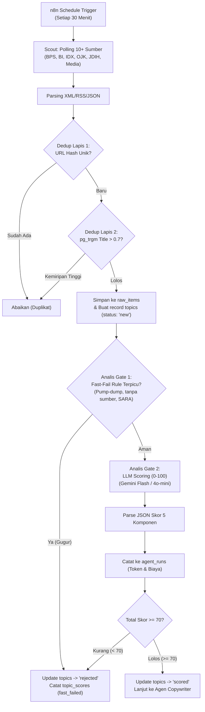

# DOKUMEN 03: AGEN SCOUT & ANALIS ENGINE
## Homeless Media Engine (HME) v2.0

Dokumen ini memuat arsitektur teknis dan panduan implementasi untuk dua agen pertama: **Agen Scout** (pemantau sumber primer tanpa henti dengan deduplikasi dua lapis) dan **Agen Analis** (filter aturan cepat tanpa LLM serta skoring berbobot 0–100 untuk mengeliminasi topik berkualitas rendah).

---

## 1. Alur Kerja Estafet Scout & Analis



---

## 2. Agen Scout: Registrasi Sumber & Deduplikasi

### 2.1 Katalog Sumber Resmi & Pembagian Prioritas

Scout memantau sumber primer secara teratur dengan pengelompokan kategori:

1. **Sumber Primer Data & Makro:**
   - **BPS (Badan Pusat Statistik):** RSS siaran pers inflasi, PDB, ekspor-impor, ketenagakerjaan (`https://www.bps.go.id/id/pressrelease.xml`).
   - **Bank Indonesia (BI):** RSS siaran pers suku bunga acuan (BI-Rate), cadangan devisa, stabilitas moneter (`https://www.bi.go.id/id/rss/`).
2. **Sumber Primer Pasar Modal & Regulasi Keuangan:**
   - **Bursa Efek Indonesia (IDX):** Pengumuman keterbukaan informasi, rilis suspensi, evaluasi indeks mayor.
   - **Otoritas Jasa Keuangan (OJK):** Rilis peraturan perbankan, pasar modal, dan siaran pers satgas waspada investasi.
3. **Sumber Primer Hukum & Kebijakan:**
   - **JDIH / Peraturan.go.id:** RSS dokumen UU, PP, dan Peraturan Menteri terbaru.
   - **Mahkamah Konstitusi (MK):** Putusan pengujian undang-undang terkait ekonomi, pajak, atau investasi.
4. **Media Pasar Sekunder (Untuk Momentum & Kutipan Analis):**
   - **Kontan, Bisnis Indonesia, CNBC Indonesia:** RSS kanal pasar modal dan ekonomi makro.
5. **Driver Global & Query Terarah:**
   - **Reuters / Bloomberg / BBC (Kanal Bisnis):** Sentimen ekonomi global dan komoditas utama (minyak, nikel, emas).
   - **Google News RSS:** Query terfokus (`IHSG`, `POJK`, `Suku Bunga BI`, `APBN`, `Dividen`).

### 2.2 Deduplikasi Dua Lapis (Two-Layer Dedup Engine)

Deduplikasi melindungi sistem dari pemborosan token dan topik berulang:

1. **Lapis 1 (URL Hash Deterministic):**
   - URL dinormalisasi (menghapus query tracking `utm_*`, `ref`, dll.).
   - Hitung `SHA-256(url_normalized)`.
   - Cek ke tabel `raw_items` kolom `url_hash`. Jika sudah ada, lewati.
2. **Lapis 2 (Kemiripan Semantik Judul via PostgreSQL `pg_trgm`):**
   - Jika URL baru, jalankan kueri trigram pada topik 7 hari terakhir:
     ```sql
     SELECT id, title, similarity(title, $1) AS sm
     FROM raw_items
     WHERE fetched_at > NOW() - INTERVAL '7 days'
       AND similarity(title, $1) > 0.70
     ORDER BY sm DESC
     LIMIT 1;
     ```
   - Jika similarity > 0.70 (judul nyaris identik), tandai sebagai duplikat dan jangan buat topik baru.

---

## 3. Agen Analis: Fast-Fail & Rubrik Penilaian 0–100

### 3.1 Gerbang Fast-Fail (Hemat Token 100%)
Sebelum mengirim teks ke LLM, fungsi filter deterministik mengecek aturan gagal-cepat:
- Terdeteksi ajakan membeli/menjual saham tertentu (*stock picking* / *pumping*).
- Klaim pergerakan angka tanpa menyebutkan sumber resmi atau lembaga penerbit.
- Kutipan hukum tanpa nomor pasal atau nomor regulasi.
- Konten mengandung unsur SARA, gosip selebritas, atau hoaks sensasional.
Jika terpicu, topik langsung berstatus `rejected` dengan alasan spesifik tanpa memanggil API LLM sama sekali.

### 3.2 Rubrik Skor 5 Komponen (Total 100 Poin)

| Komponen | Bobot | Parameter yang Dinilai | Skor Minimal Aman |
| :--- | :--- | :--- | :--- |
| **Relevansi Niche** | 30 poin | Kedekatan langsung dengan data statistik, hukum regulasi, IHSG, atau kebijakan fiskal/moneter. | 22 |
| **Kualitas Data & Kredibilitas** | 25 poin | Tersedia angka konkret (persentase, nilai transaksi) dan sumber primer resmi (bukan rumor). | 18 |
| **Momentum & Kesegaran** | 20 poin | Usia berita < 24 jam, pengumuman terjadwal, atau topik yang sedang hangat diperbincangkan. | 14 |
| **Potensi Interaksi** | 15 poin | Relevan dengan keuangan masyarakat/investor ritel; memancing diskusi berbasis opini sehat. | 9 |
| **Keamanan & Kepatuhan** | 10 poin | Bebas dari risiko pelanggaran regulasi finansial, bebas fitnah, aman terhadap guideline Meta. | 8 |

**Ambang Batas (Threshold):**
- Topik dinyatakan **LOLOS** jika `score_total >= 70` (direkomendasikan **75** pada bulan pertama kalibrasi).
- Topik yang gugur tetap tersimpan di database untuk audit kalibrasi mingguan.

### 3.3 Spesifikasi Prompt Agen Analis (Structured JSON)

Model: Gemini 2.5/3.0 Flash atau GPT-4o-mini (hemat biaya & latensi rendah).

```text
SYSTEM PROMPT:
Kamu adalah Agen Analis dari Homeless Media (@homelessmedia), akun media edukasi niche data, hukum regulasi, dan ekonomi bursa saham Indonesia.
Tugasmu adalah menganalisis topik berita/rilis dan memberikan skor obyektif (0-100) serta keputusan apakah topik ini layak diproduksi menjadi carousel edukatif.

PEDOMAN BOBOT PENILAIAN (TOTAL 100):
1. Relevansi Niche (0-30): Wajib berhubungan erat dengan data ekonomi, pasar saham IDX, regulasi OJK/BI/Pemerintah, atau geopolitik yang menggerakkan pasar.
2. Kualitas Data (0-25): Harus ada angka terukur, persentase resmi, atau dokumen regulasi yang valid.
3. Momentum (0-20): Kebaruan dan relevansi waktu saat ini.
4. Potensi Interaksi (0-15): Dampak ke investor ritel atau masyarakat luas.
5. Kepatuhan (0-10): Nol rekomendasi saham, aman dari delik hukum dan hoaks.

ATURAN OUTPUT:
Kembalikan HANYA JSON valid tanpa markdown, tanpa teks pengantar, dengan struktur berikut:
{
  "scores": {
    "relevance": 28,
    "credibility": 22,
    "momentum": 18,
    "engagement": 12,
    "compliance": 10
  },
  "score_total": 90,
  "verdict": "passed", // "passed" jika total >= 70, else "rejected"
  "reasoning": "Alasan singkat maksimal 40 kata mengenai kelayakan topik ini.",
  "recommended_format": "stat card" // Pilihan: "stat card", "chart card", "explainer regulasi", "timeline kebijakan", "perbandingan", "market wrap"
}
```

---

## 4. Telemetri & Pencatatan `agent_runs`

Setiap pemanggilan Analis mencatat metrik ke tabel `agent_runs`:
- `agent`: `'analis'`
- `entity_id`: ID topik
- `tokens_input` & `tokens_output`
- `est_cost_idr`: Perhitungan biaya token ke Rupiah (kurs acuan USD/IDR).
- Jika total akumulasi biaya harian mendekati batas `daily_ai_cost_limit_idr` (misal 80%), bot Telegram mengirim peringatan ke admin.

---

## 5. Rencana Pengujian & Kriteria Lolos (Exit Criteria Dokumen 03)

1. [ ] **Verifikasi Polling Scout:** Workflow n8n berhasil mem-polling RSS feeds dan menyimpan minimal 20 raw items ke tabel `raw_items`.
2. [ ] **Verifikasi Deduplikasi:** Input URL yang sama atau variasi parameter UTM menghasilkan reject di Lapis 1. Judul serupa di Lapis 2 terdeteksi oleh pg_trgm.
3. [ ] **Verifikasi Fast-Fail:** Topik tiruan berisi pom-pom saham (misal: "Beli saham XYZ pasti terbang besok") langsung gugur dengan verdict `fast_failed`.
4. [ ] **Verifikasi Scoring:** Rilis resmi BPS inflasi diproses LLM dan menghasilkan skor > 75 dengan JSON terurai sempurna ke tabel `topic_scores`.
5. [ ] **Stabilitas 3 Hari:** Pipeline berjalan 3 hari berturut-turut menghasilkan rata-rata 5–10 topik lolos berkualitas per hari tanpa intervensi manual.
