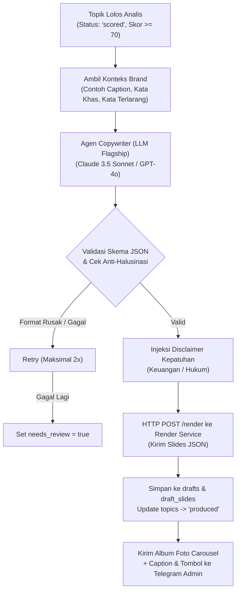

# DOKUMEN 04: AGEN COPYWRITER & PIPELINE CAROUSEL
## Homeless Media Engine (HME) v2.0

Dokumen ini memuat spesifikasi teknis dan implementasi **Agen Copywriter** (penulis narasi editorial berbasis data dengan aturan kepatuhan finansial ketat), integrasi otomatis dengan **Render Service**, pencatatan draf ke basis data, serta pengiriman pratinjau carousel berformat album ke Telegram.

---

## 1. Alur Pipeline Produksi Draf Konten



---

## 2. Karakteristik & Suara Editorial Agen Copywriter

### 2.1 Gaya "Data-Editorial"
- **Nada Bicara:** Objektif, lugas, tenang, berbasis fakta, seperti lembar opini/analisis pasar koran ekonomi berkualitas tinggi.
- **Pola Pembuka (Hook):** Selalu menempatkan angka konkret atau kutipan regulasi di depan (misal: *"Cadangan devisa Indonesia melonjak USD 4,2 miliar..."*, bukan kalimat pembuka klise seperti *"Tahukah kamu?"*).
- **Struktur Alur Narasi Carousel (5–8 Slide):**
  - **Slide 1:** Hook angka hero atau judul regulasi utama (`cover-stat`).
  - **Slide 2:** Konteks dan latar belakang peristiwa (`big-statement` atau `comparison`).
  - **Slide 3:** Bukti data konkret dalam bentuk grafik flat atau kutipan pasal (`chart-bar`, `chart-line`, atau `regulasi`).
  - **Slide 4:** Dampak terhadap bursa saham, likuiditas, atau ekonomi riil (`stat-grid` atau `timeline`).
  - **Slide 5 (Akhir):** Kesimpulan ringkas, CTA ajakan follow, dan kotak disclaimer resmi (`cta-close`).

### 2.2 Tiga Aturan Kepatuhan & Anti-Halusinasi Mutlak
1. **Nol Rekomendasi Saham (No Stock-Picking):** Dilarang keras menuliskan kalimat ajakan *"Waktunya serok"*, *"Target harga saham ABC ke Rp5.000"*, atau saran transaksi serupa.
2. **Kutipan Verbatim:** Kutipan nomor pasal, ayat, dan isi undang-undang/POJK wajib bersumber tepat dari dokumen rilis, dilarang disimpulkan atau ditebak.
3. **Anti-Halusinasi Angka:** Jika angka pembanding (misal: data historis tahun lalu) tidak tercantum di dokumen sumber, LLM dilarang mengarang angka. Model wajib menandai `needs_review: true` agar diverifikasi oleh admin.

---

## 3. Spesifikasi Prompt & Kontrak Output JSON

### 3.1 Prompt Agen Copywriter

```text
SYSTEM PROMPT:
Kamu adalah Senior Editor & Copywriter untuk Homeless Media (@homelessmedia) — media edukasi niche data ekonomi, hukum bisnis, dan bursa saham Indonesia.
Tugasmu adalah menyusun draf carousel Instagram (5-8 slide) lengkap dengan caption mendalam berdasarkan bahan berita resmi yang diberikan.

PANDUAN GAYA & IDENTITAS BRAND:
- Gaya: Data-editorial. Tenang, berwibawa, analitis, tanpa sensasionalisme, tanpa emoji berlebihan di slide.
- Dilarang merekomendasikan aksi beli/jual saham tertentu!
- Semua angka statistik harus persis sama dengan rilis berita. Jika data tidak lengkap, set field "needs_review": true.
- Aturan hukum/pasal wajib dikutip secara verbatim.
- Pilih layout yang paling tepat untuk setiap slide dari 9 layout yang tersedia:
  ["cover-stat", "big-statement", "stat-grid", "chart-bar", "chart-line", "regulasi", "timeline", "comparison", "cta-close"].

STRUKTUR OUTPUT JSON:
Hasilkan HANYA output JSON valid tanpa teks pembuka atau penutup dengan format:
{
  "slides": [
    {
      "no": 1,
      "layout": "cover-stat",
      "teks": "Inflasi Agustus Turun ke 2,12%",
      "data": { "unit": "YoY", "badge": "DATA BPS" },
      "source": "Badan Pusat Statistik"
    },
    {
      "no": 2,
      "layout": "chart-line",
      "teks": "Pergerakan 6 Bulan Terakhir",
      "data": {
        "labels": ["Mar", "Apr", "Mei", "Jun", "Jul", "Agu"],
        "values": [3.05, 2.87, 2.84, 2.51, 2.37, 2.12]
      },
      "source": "BPS"
    },
    {
      "no": 3,
      "layout": "stat-grid",
      "teks": "Penyumbang Terbesar Inflasi",
      "data": {
        "items": [
          { "label": "Beras", "value": "0,42%", "unit": "andil" },
          { "label": "Bahan Bakar", "value": "0,18%", "unit": "andil" },
          { "label": "Tarif Listrik", "value": "0,11%", "unit": "andil" }
        ]
      },
      "source": "BPS Rilis Resmi"
    },
    {
      "no": 4,
      "layout": "big-statement",
      "teks": "Tekanan inflasi pangan bergejolak mulai terkendali berkat panen raya dan intervensi pasokan pangan daerah.",
      "data": { "author": "Deputi Bidang Statistik Distribusi BPS" },
      "source": "Konferensi Pers BPS"
    },
    {
      "no": 5,
      "layout": "cta-close",
      "teks": "Bagaimana inflasi mempengaruhi daya beli dan portofolio investasimu?",
      "data": { "cta": "Simpan postingan ini & ikuti @homelessmedia untuk data harian" },
      "source": "@homelessmedia"
    }
  ],
  "caption": "Badan Pusat Statistik (BPS) mencatat inflasi tahunan (YoY) per Agustus sebesar 2,12%...\n\n[Analisis 150-300 kata]...\n\nSumber Data: BPS RI (Rilis Berita Resmi No. 58/09/Th. XXVII)\n\n---\nDisclaimer: Informasi disajikan untuk tujuan edukasi data publik dan bukan merupakan rekomendasi investasi keuangan.",
  "hashtags": {
    "branded": ["#HomelessMedia"],
    "niche": ["#DataEkonomi", "#Inflasi", "#BPS", "#BursaSaham", "#IHSG"],
    "trending": ["#EkonomiIndonesia"]
  },
  "alt_text": "Grafik carousel statistik inflasi Indonesia Agustus 2026 sebesar 2,12% bersumber dari BPS.",
  "disclaimer": "keuangan", // "keuangan" | "hukum" | null
  "needs_review": false
}
```

---

## 4. Integrasi dengan Render Service & Basis Data

1. **Pemanggilan Render Service:**
   - Node n8n HTTP Request mengirim payload `slides` ke `http://render-service:3000/render`.
   - Menerima respons berisi array path file PNG di shared storage (misal: `/app/storage/drafts/101/slide_1.png` s/d `slide_5.png`).
2. **Penyimpanan ke Database:**
   - Buat baris baru di tabel `drafts` dengan status awal `'draft'`.
   - Simpan entri visual per slide di tabel `draft_slides`.
   - Update tabel `topics` yang bersangkutan menjadi `status = 'produced'`.

---

## 5. Pengiriman Notifikasi & Pratinjau ke Telegram Admin

Ketika draf selesai dirender, n8n mengeksekusi Telegram Node untuk mengirim pratinjau lengkap ke admin:

1. **Media Group (Photo Album):**
   - Mengirim seluruh file PNG slide (1–5+) sekaligus sebagai 1 album teratur di ruang obrolan Telegram.
2. **Pesan Informasi & Tombol Keputusan (Inline Keyboard):**
   - Pesan teks menyertai album berisi:
     - 📌 **ID Draf & Judul Topik**
     - 📊 **Skor Kelulusan & Alasan Analis**
     - 📝 **Caption Lengkap & Hashtags**
     - ⚠️ **Badge Warning** jika `needs_review = true`.
   - **Tiga Tombol Keputusan:**
     - `[ ✅ Setujui Draf ]` (Callback: `approve:draft_id`)
     - `[ ✏️ Edit Teks ]` (Callback: `edit:draft_id`)
     - `[ ❌ Tolak Draf ]` (Callback: `reject:draft_id`)

---

## 6. Rencana Pengujian & Kriteria Lolos (Exit Criteria Dokumen 04)

1. [ ] **Verifikasi Skema Copywriter:** Model berhasil menghasilkan output JSON yang tervalidasi 100% tanpa sintaks error.
2. [ ] **Verifikasi Kepatuhan:** Tidak ditemukan rekomendasi saham spekulatif; disclaimer terpasang otomatis sesuai jenis konten.
3. [ ] **Verifikasi End-to-End Render:** Panggilan API `/render` dari n8n berhasil mengubah JSON Copywriter menjadi berkas gambar PNG di shared folder.
4. [ ] **Verifikasi Pratinjau Telegram:** Admin menerima album gambar 5 slide beresolusi tajam (1080x1350) beserta teks caption dan 3 tombol interaktif di Telegram.
5. [ ] **Target Uji Coba:** Minimal 20 draf carousel berturut-turut berhasil diproduksi dan terkirim ke Telegram tanpa kegagalan parsing.
