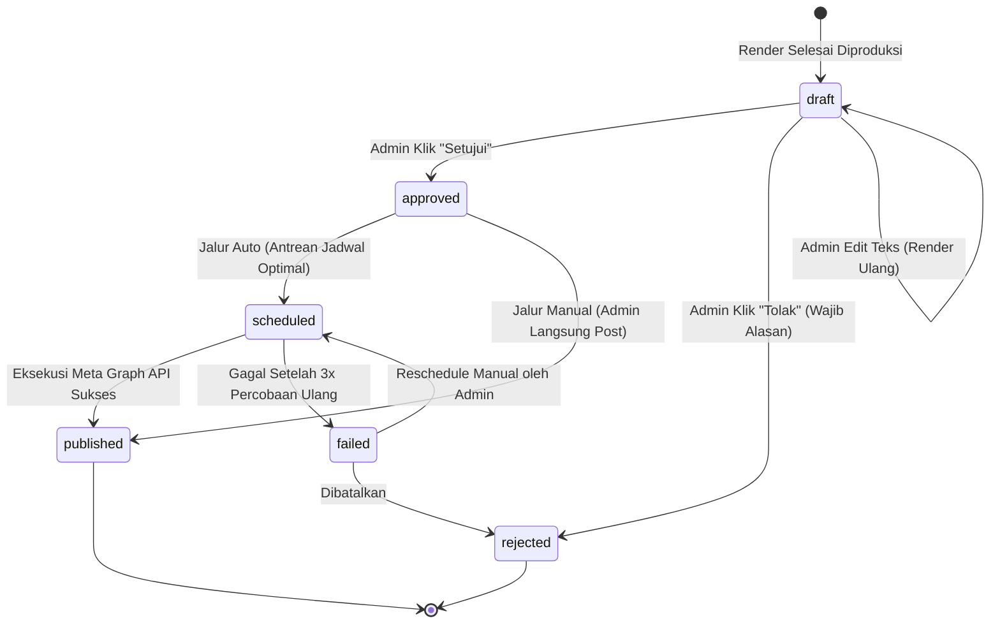

# DOKUMEN 05: ALUR APPROVAL TELEGRAM & OPERASIONAL PUBLIKASI
## Homeless Media Engine (HME) v2.0

Dokumen ini memuat spesifikasi teknis dan implementasi alur **Human-in-the-Loop Approval Bot Telegram**, mesin transisi status draf, engine **Publikasi Hybrid** (Meta Graph API otomatis dan Fallback Reminder manual), penanganan galat (*error handling*), serta prosedur pencadangan otomatis (*backup*) dan sinkronisasi Git.

---

## 1. Mesin Status Draf Konten (Finite State Machine)

Setiap draf mengikuti mesin status yang dikunci secara ketat di level basis data. Tidak ada satu pun node workflow yang diizinkan mempublikasikan konten yang belum berstatus `approved`.

---

## 2. Logika Interaksi Bot Telegram (Satu Pintu Review)

Review konten dirancang dapat dilakukan dalam hitungan detik dari aplikasi Telegram di ponsel:

### 2.1 Mekanisme Tombol & Aksi Admin
Setiap draf yang masuk mengirim album gambar diikuti pesan kontrol dengan 3 tombol inline:

1. **Tombol `[ ✅ Setujui ]` (Callback: `approve:<draft_id>`):**
   - Menampilkan pilihan mode publikasi:
     - **Mode Auto:** Memasukkan draf ke antrean jam tayang optimal berikutnya (07.00, 12.00, 18.00, atau 21.00 WIB) dengan aturan jarak minimal 3 jam antar postingan.
     - **Mode Manual:** Mengirim reminder di jam yang ditentukan beserta file gambar resolusi penuh dan caption siap salin.
   - Status draf berubah dari `draft` menjadi `approved` (lalu `scheduled`).
   - Tercatat otomatis di tabel `audit_log`.

2. **Tombol `[ ✏️ Edit ]` (Callback: `edit:<draft_id>`):**
   - Bot menanyakan: *"Ketik nomor slide dan teks baru (contoh: 'slide 1: Inflasi Turun ke 2.1%') atau ketik 'caption: [isi baru]'."*
   - Admin membalas pesan. Render service memproses render ulang hanya untuk slide yang diubah (< 5 detik).
   - Bot mengirimkan gambar pratinjau slide baru untuk konfirmasi ulang.

3. **Tombol `[ ❌ Tolak ]` (Callback: `reject:<draft_id>`):**
   - Bot mewajibkan alasan penolakan via quick reply (pilihan: *"Data basi"*, *"Sudah pernah diangkat"*, *"Kurang menarik"*, atau ketik alasan manual).
   - Status draf berubah menjadi `rejected` dan topik terkait ditandai `archived`.
   - Alasan penolakan dicatat di `audit_log` sebagai data kalibrasi mingguan Agen Analis.

### 2.2 Keamanan & Idempotency Key
- **Whitelist Chat ID:** Bot hanya memproses callback dari `ADMIN_CHAT_ID`. Permintaan dari pengguna lain diabaikan dan dicatat ke log peringatan keamanan.
- **Idempotency Key:** Mencegah klik ganda (*double click*) yang dapat memicu pembuatan dua jadwal tayang untuk draf yang sama.

---

## 3. Engine Publikasi Hybrid (Auto & Manual)

### 3.1 Jalur Otomatis: Instagram Graph API (2-Step Publishing)
Untuk akun Instagram Business/Creator yang terhubung ke Facebook Page:
1. **Langkah 1 (Media Container):**
   - n8n mengunggah tiap slide PNG ke penampungan sementara dan membuat media container item:
     `POST /{ig-user-id}/media?image_url={url}&is_carousel_item=true`
   - Mengumpulkan seluruh `container_id` slide (1 s/d N).
2. **Langkah 2 (Carousel Container):**
   - Membuat container utama berjenis carousel:
     `POST /{ig-user-id}/media?media_type=CAROUSEL&children={container_ids}&caption={caption}`
3. **Langkah 3 (Publish Execution):**
   - Mengeksekusi penayangan publik:
     `POST /{ig-user-id}/media_publish?creation_id={carousel_container_id}`
4. **Strategi Retry & Penanganan Gagal:**
   - Jika API Meta mengembalikan error sementara (rate limit / timeout), sistem melakukan retry maksimal 3 kali dengan jeda bertingkat (2 menit, 5 menit, 15 menit).
   - Jika tetap gagal, status menjadi `failed` dan bot Telegram segera mengirimkan peringatan instan ke admin.

### 3.2 Jalur Manual (Fallback Anti-Macet)
Jika token Meta kedaluwarsa atau terjadi gangguan API:
- Bot Telegram mengirim notifikasi reminder saat jam tayang tiba.
- Dilengkapi tombol konfirmasi `[ Tandai Sudah Terbit Manual ]` agar status draf tetap terdata rapi di database.

---

## 4. Error Handling Global & Rutinitas Pemeliharaan

### 4.1 Global Error Workflow di n8n
- Setiap alur kerja di n8n dilengkapi router *Error Trigger*.
- Setiap kegagalan fatal (misal: sumber data offline, koneksi LLM timeout, kegagalan render) memicu pesan alert ke Telegram dalam waktu < 5 menit berisi:
  - Nama agen / node yang gagal
  - Pesan galat teknis
  - Tautan langsung ke log eksekusi n8n untuk investigasi 1-klik.

### 4.2 Prosedur Backup & Sinkronisasi Git Terjadwal
1. **Backup Database Harian (Pukul 03.00 WIB):**
   - Eksekusi cron `pg_dump -U postgres hme | gzip > /backup/hme_$(date +%Y%m%d).sql.gz`.
   - Retensi backup lokal selama 30 hari.
2. **Pembersihan Rutin Mingguan:**
   - Menghapus entri `raw_items` yang berusia lebih dari 90 hari guna menjaga ukuran basis data tetap ringan dan cepat.
3. **Sinkronisasi Git Otomatis:**
   - Semua workflow n8n diekspor dalam format JSON ke repositori git lokal secara periodik sehingga seluruh perubahan pipeline tercatat versinya.

---

## 5. Rencana Pengujian & Kriteria Lolos (Exit Criteria Dokumen 05)

1. [ ] **Verifikasi Tombol Approval:** Menekan tombol Setujui, Edit, dan Tolak di Telegram berhasil memperbarui kolom `status` di tabel `drafts` dan `audit_log` sesuai mesin status.
2. [ ] **Verifikasi Pencegahan Publikasi Ilegal:** Pengujian otomatis memverifikasi bahwa draf berstatus selain `approved` ditolak keras oleh runner publikasi.
3. [ ] **Verifikasi Publikasi Meta API:** Pengujian posting carousel tiruan ke akun pengujian Instagram berhasil terbit dengan urutan slide yang benar.
4. [ ] **Verifikasi Alert Error:** Simulasi node error berhasil mengirim notifikasi kegagalan ke bot Telegram dalam tempo di bawah 1 menit.
5. [ ] **Operasi 1 Minggu Stabil:** Menjalankan sistem selama 7 hari penuh di mana minimal 10 konten tayang tepat jadwal dan 100% melalui persetujuan admin.
