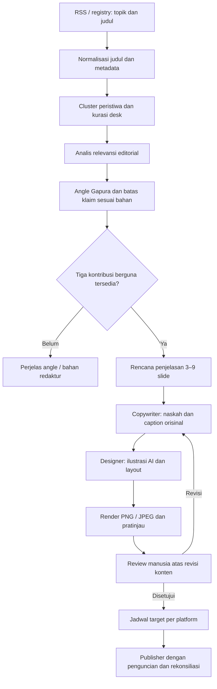

# Blueprint pembaruan editorial dan desain Gapura Media

Versi 2.1 · 17 November 2026 · Status: R0–R2 selesai; R3 kode/aset lokal tersedia,
generasi nyata tertahan kuota; R4–R8 mengikuti arah orisinal owner.

Dokumen ini menjadi acuan perubahan konten berikutnya. [Keputusan konten orisinal
dan ilustrasi AI](10_ORIGINAL_AI_EDITORIAL.md) menggantikan kewajiban memakai
body/foto penerbit dan petikan verbatim: RSS hanya memasok topik/judul serta
metadata asal; agen menghasilkan naskah dan visual Gapura sendiri. Rincian
keputusan dan acceptance pada dokumen tersebut menjadi acuan bila kontrak lama
berbeda. Penulisan produksi belum diperbarui; kontrak/fixture [R1](08_R1_EDITORIAL_CONTRACT.md)
dan reader/snapshot [R2](09_R2_ARTICLE_MATERIALS.md) tetap hasil historis yang
tersedia. Pembersihan workspace dan penjedaan otomatisasi sudah dilaksanakan;
buktinya tercantum di
[laporan reset](../EDITORIAL_WORKSPACE_RESET_20261116.md).
[R3](11_R3_AI_ILLUSTRATIONS.md) menambahkan adapter ilustrasi/provenance lokal
dan disclosure, tanpa menyatakan naskah orisinal R4–R6 sudah terpasang.

## 1. Keputusan produk dan tujuan

Gapura menjadi media penjelas isu nasional: **politik, sosial, hukum,
lingkungan, serta ekonomi nasional termasuk bursa saham**. Produk utamanya satu
carousel penjelas yang dapat dipahami tanpa membuka artikel lain, dengan naskah
orisinal, ilustrasi AI relevan dan caption yang mengembangkan isu. Fakta aktual
tetap memiliki dasar; topik/judul saja tidak membenarkan model mengarang rincian
berita atau menyatakan dirinya melakukan peliputan.

Kebutuhan pembaca: mengetahui apa yang terjadi, mengapa penting, siapa yang
terdampak, apa yang dikatakan pihak terkait, dan bagaimana peristiwanya
berkembang. Kebutuhan redaktur: memeriksa bahan, ilustrasi, wording, dan desain dalam
satu workspace, lalu menyetujui versi konten yang benar-benar dilihat.

Keputusan yang digunakan untuk membuat rencana konkret:

- **Satu berita menghasilkan minimal satu posting carousel**, bukan satu gambar
  yang disebut carousel. Default enam slide, normal 5–8, rentang konfigurasi 3–9.
  Format single hanya boleh menjadi pilihan eksplisit owner untuk produk lain;
  jalur berita reguler tidak boleh turun ke single secara diam-diam.
- Setidaknya satu ilustrasi AI orisinal pada cover. Agen memakai brief visual
  konseptual, bukan foto penerbit atau rekonstruksi realistis yang terkesan
  dokumentasi kejadian. Renderer menampilkan `Ilustrasi AI · Gapura Media`.
  Visual isi ditambah bila membantu, bukan sekadar mengisi slide.
- Registry/RSS dipakai untuk topik/judul dan provenance. Body, ringkasan dan foto
  penerbit tidak masuk payload penulisan/desain default. Agen menulis angle,
  struktur, penjelasan dan caption sendiri; tidak sekadar mengganti sinonim.
- Judul saja menghasilkan penjelasan isu dengan batas klaim. Rincian aktual,
  angka dan kutipan memerlukan catatan fakta/referensi yang tersedia; riset
  sumber primer yang diizinkan merupakan kapabilitas terpisah, bukan fetch body
  penerbit diam-diam. Pengetahuan model bukan bukti berita terbaru.
- Caption Instagram menargetkan 1.200–1.900 karakter isi saat materi cukup;
  payload akhir maksimal 2.200 karakter termasuk paragraf tambahan dan tagar.
  Target panjang tidak membenarkan filler atau fakta buatan.
- Agen/halaman/fungsi Verifikator dihapus sepenuhnya dari jalur aktif. Tidak
  diganti agen penilai kebenaran lain dengan nama baru.
- Pemeriksaan struktur/angka/kutipan dan review redaktur tetap ada. Reader
  materi R2 menjadi kemampuan terpisah, bukan prasyarat generasi judul saja.
  Pemeriksaan tidak menghasilkan label verified/unverified, confidence
  kebenaran, atau gerbang persetujuan otomatis oleh LLM.
- Publikasi tetap memerlukan persetujuan manusia atas revisi konten terkini.
  Timer publisher tetap berhenti selama pencarian format; koneksi Meta disimpan.

**Asumsi yang perlu disetujui lewat sampel:** target enam slide, rentang caption,
ukuran ruang ilustrasi, tone headline, dan campuran rubrik. Angka ini adalah rancangan,
bukan preferensi visual owner yang sudah terbukti.

## 2. Temuan audit historis dan pemetaan delapan permintaan

Bagian ini mencatat alasan rancangan awal sebelum perubahan arah konten
orisinal. Solusi foto/artikel pada tabel adalah konteks historis, bukan
instruksi memakai ulang body/foto penerbit pada jalur default baru.

Audit terdiri dari pemeriksaan source code, reproduksi offline, dan inventaris
database sebelum reset. Endpoint feed baru serta izin lisensi setiap penerbit
belum diuji; kandidat sumber dalam dokumen ini belum dinyatakan aktif. Bukti
reproduksi sintetis tersimpan di [audit baseline](../EDITORIAL_BASELINE_AUDIT_20261116.md);
jumlah produksi dan verifikasi backup mengikuti laporan reset, bukan fixture.

| No. | Temuan owner | Penyebab yang teramati | Perubahan yang direncanakan |
| --- | --- | --- | --- |
| 1 | Gambar sering tidak muncul | Host policy duplikat; X/RSSHub/Google fallback memberi `image_url=null`; SEO menghilangkan foto; fallback cover tidak menyalin gambar; hydration gagal tanpa diagnostik | Jalur aset eksplisit dari sumber sampai render, foto dipilih deterministik, cache lokal, diagnostik, fallback tetap mempertahankan aset |
| 2 | Hasil selalu satu gambar | `chooseFormat` memilih single untuk materi pendek; fallback memerlukan dua potongan isi lalu menurunkan format; setting jumlah slide tidak dipakai konsisten | Produk berita carousel-first 3–9 slide, default enam; pengayaan materi sebelum menulis; bahan tidak cukup tetap menunggu materi |
| 3 | Label fallback/nama penerbit masuk judul | Adapter memasukkan prefix secara literal; pembersihan hanya HTML/whitespace; validator mewajibkan headline sama dengan kalimat sumber | Pisahkan judul asli, judul bersih, headline editorial, dan provenance; satu normalizer idempotent |
| 4 | Caption tidak menjelaskan berita | Input hanya summary feed; batas 1.000 karakter; validator hanya menerima kalimat sumber utuh; suffix metadata mendapat prioritas ruang | Ambil isi artikel yang diizinkan, susun konteks/statement/kronologi, izinkan parafrasa bersumber, alokasi panjang ke isi |
| 5 | Boilerplate caption mengganggu | `composeCaption` memaksakan sumber primer, status verifikasi, disclaimer terkait verifikasi, tagar | Kontrak caption publik terpisah dari metadata internal; hapus boilerplate dan disclaimer generik yang tidak relevan |
| 6 | Sumber umum/tidak menarik | Discovery dominan feed pasar dan query generik; tidak ada paket materi berita; penilaian masih finance-first | Kurasi per desk, skor kepentingan publik dan kebaruan, cluster peristiwa, sumber primer dan jurnalisme independen |
| 7 | Fokus diperluas | Seed, kategori UI, heuristik, prompt, dan hashtag tetap ekonomi/regulasi finansial | Satu taxonomy enam desk digunakan dari source sampai dashboard dan caption |
| 8 | Hapus verifikasi seluruh fungsi | Verifier ada di produksi, Studio, API, UI, config, Telegram, dan kedua publisher | Lepaskan dependensi runtime secara terpadu, hapus fitur/config/polling, migrasi schema setelah consumer dibersihkan |

Sebelum reset terakhir tersedia 142 draf dan 269 slide. Snapshot audit saat
pipeline baru dihentikan menunjukkan 32 carousel dari 140 draf berstatus draft,
dan 12 draf memuat `image_url`. Jadi masalah single/gambar dominan terkonfirmasi,
tetapi pernyataan bahwa seluruh draf selalu single tidak tepat untuk seluruh
riwayat. Tidak ada klaim tingkat keberhasilan foto render dari hitungan URL saja.

### Lokasi kode yang menjelaskan akar masalah

- [scout/sources.js](../../services/scout/sources.js): `normalizeFeedItem`
  memilih description sebelum isi lebih lengkap lalu memotong 1.000 karakter;
  `fetchXQuery` menambahkan `[Google News: X query fallback]`.
- [scout/scout.js](../../services/scout/scout.js): penyimpanan ringkasan dan
  pemetaan bahan ke topik; publication timestamp belum menjadi kontrak topik.
- [seo/seo.js](../../services/seo/seo.js): foto tidak bertahan pada normalisasi
  dan promosi trend; label volume pencarian dapat masuk summary bahan berita.
- [common/images.js](../../services/common/images.js) dan Scout memiliki
  host policy terpisah; kegagalan unduh menjadi `null` dan URL dihapus dari
  payload tanpa status alasan.
- [common/carousel.js](../../services/common/carousel.js): compact summary
  memilih single; nama `trendScore` berbeda dengan `trend_score` tersimpan.
- [copywriter/editorial.js](../../services/copywriter/editorial.js): fallback
  menurunkan carousel bila isi kurang, cover fallback tanpa foto, caption
  memiliki suffix wajib, dan parafrasa/headline bersih ditolak aturan verbatim.
- [designer/designer.js](../../services/designer/designer.js): pemilihan foto
  bergantung pada LLM; satu field invalid dapat menjatuhkan seluruh hasil ke
  fallback tekstual.
- [render/engine.js](../../services/render/engine.js): cover sudah mendukung
  raster embedded; beberapa layout data masih punya default demonstrasi yang
  harus dibersihkan sebelum aturan penulisan dilonggarkan.
- [common/editorial.js](../../services/common/editorial.js),
  [studio/studio.js](../../services/studio/studio.js),
  [copywriter/copywriter.js](../../services/copywriter/copywriter.js),
  [publisher/meta-worker.js](../../services/publisher/meta-worker.js), dan
  [telegram/bot.js](../../services/telegram/bot.js): report/confidence verifier
  masih mengikat produksi/persetujuan/publikasi.

## 3. Identitas editorial dan pemilihan isu

### Enam desk yang dipakai bersama

| Desk / key | Isi prioritas | Contoh sudut penjelasan |
| --- | --- | --- |
| Politik / `politik` | Kebijakan, pemerintah, DPR, pemilu, akuntabilitas | Keputusan apa yang berubah, siapa penentu, konsekuensi bagi publik |
| Sosial / `sosial` | Layanan publik, pendidikan, kesehatan, ketenagakerjaan, ketimpangan | Siapa terdampak, skala masalah, respons lembaga dan warga |
| Hukum / `hukum` | Putusan, legislasi, penegakan hukum, hak warga | Status proses, pasal/putusan yang relevan, posisi para pihak |
| Lingkungan / `lingkungan` | Iklim, bencana, polusi, kehutanan, pertambangan, transisi energi | Lokasi/periode, dampak terukur, kronologi, respons dan kebijakan |
| Ekonomi nasional / `ekonomi` | Fiskal, moneter, harga, pangan, industri, perdagangan | Data terbaru, konteks periode, mekanisme dampak pada masyarakat |
| Bursa / `bursa` | BEI, emiten, keterbukaan informasi, sektor dan indeks | Peristiwa korporasi, data/satuan/periode, risiko; tanpa ajakan transaksi |

Prioritas isu mengikuti kepentingan publik, kebaruan/perubahan nyata, jangkauan
dampak, kekuatan materi, serta kejelasan penjelasan yang bisa diberikan. Viralitas
hanya sinyal discovery, bukan bukti atau alasan mengabaikan konteks.

Usulan rubrik Analis 100 poin: kepentingan publik 30, kebaruan 20, dampak 20,
kecukupan materi 20, potensi penjelasan 10. Nilai/perubahan threshold diuji pada
fixture enam desk sebelum aktif; skor historis tidak ditulis ulang. Filter
keyword harus membedakan pemberitaan tentang tuduhan/ujaran dari ajakan atau
ujaran yang dibuat media sendiri. Kata `fitnah`, misalnya, tidak otomatis
menggugurkan berita perkara hukum.

Pemberitaan politik bersifat informatif dan seimbang menurut konteksnya. Kutipan
pejabat tidak otomatis diperlakukan sebagai fakta terbukti. Klaim, bantahan,
dugaan, tahap perkara, tanggal, dan pelaku tetap teratribusi; tidak menghapus
kata pembatas seperti `diduga` hanya untuk membuat judul lebih menarik.

### Katalog sumber yang lebih berguna

Daftar ini adalah **calon organisasi**, bukan endpoint RSS yang sudah valid:

| Keluarga | Kandidat | Fungsi |
| --- | --- | --- |
| Jurnalisme nasional | Antara, Kompas, Tempo, CNN Indonesia, BBC Indonesia, detik, Tirto | Berita, konteks, statement, pelaporan independen lintas desk |
| Politik/pemerintahan | DPR, KPU, Bawaslu, rilis lembaga/pemerintah yang relevan | Dokumen keputusan dan statement yang dapat diatribusikan |
| Hukum/hak/layanan | MA, MK, JDIH, KPK, Ombudsman, Komnas HAM | Putusan, regulasi, laporan lembaga, tahap perkara |
| Lingkungan/bencana | BMKG, BNPB, lembaga lingkungan/kehutanan terkait, Mongabay Indonesia | Data kejadian, dampak, penjelasan dan pelaporan lingkungan |
| Ekonomi/bursa | BPS, BI, Kemenkeu, OJK, BEI, keterbukaan emiten, Kontan, CNBC Indonesia, Bisnis | Data ekonomi, kebijakan, pengumuman korporasi, konteks pasar |
| Perspektif warga/keahlian | Liputan lapangan, akademisi, organisasi masyarakat sipil yang relevan | Statement/pengalaman dengan atribusi dan kepentingan yang jelas |

Setiap calon harus melalui uji adapter: alamat aktual, format respons, judul,
publication timestamp, metadata asal, ketentuan akses, rate limit dan kegagalan.
Body dan foto yang kebetulan tersedia di feed tidak masuk payload generasi
default. Query Google News menjadi discovery cadangan dengan provenance yang
jujur; jangan memakai homepage penerbit sebagai identitas artikel.

Hindari query `politik`/`ekonomi` sendirian. Buat query per isu/desk dengan
konteks Indonesia, variasi aktor/kebijakan dan recency. Cluster laporan tentang
peristiwa yang sama agar satu isu tidak memenuhi galeri dengan duplikat.

## 4. Alur produksi yang dituju



Tidak ada tahap Verifikator, permintaan report, confidence, atau badge kebenaran
otomatis dalam alur baru. UI menampilkan kekurangan bahan/gagal generasi di
editor, bukan menyisipkan diagnostik ke headline/caption. Disclosure ilustrasi
AI merupakan informasi pembaca dan tetap terlihat pada visual publik.

**Definisi operasional bahan cukup:** minimal tiga kontribusi penjelasan yang
berbeda dan berguna. Judul saja boleh memicu penjelasan isu umum dengan batas
klaim; jangan mengarang detail aktual agar slide terisi. Mode aktual memerlukan
catatan fakta/referensi bagi klaim kejadian, angka, kutipan dan kronologi yang
dipakai. Tidak mensyaratkan dua sumber, body artikel penuh, atau keputusan
kebenaran oleh LLM. Redaktur dapat memperjelas angle atau menambahkan bahan;
tidak membuat report Verifikator. Pemisahan kedua mode mengikuti
[keputusan konten orisinal](10_ORIGINAL_AI_EDITORIAL.md).

## 5. Kontrak input dan penulisan orisinal

Gunakan `topics` sebagai identitas isu. Discovery hanya meneruskan source ID,
nama/URL sumber, raw/normalized title, waktu, desk dan topic/keywords melalui
daftar field yang diizinkan. `editorial_headline` merupakan tulisan Gapura.
Body, summary, HTML, snapshot artikel dan URL foto tidak masuk payload default.

`topic_materials`/reader [R2](09_R2_ARTICLE_MATERIALS.md) tetap kemampuan terpisah
yang historis, bukan prasyarat jalur judul saja. Jangan menambahkan pengayaan
artikel otomatis atau menghapus snapshot lama untuk mengubah arah produk.

Brief penulis memisahkan: discovery; angle/pertanyaan pembaca; mode penjelasan
umum atau aktual; catatan fakta/angka/kutipan/referensi bila tersedia; rencana
kontribusi slide; dan kekurangan bahan. Arahan editorial bukan fakta baru.

Copywriter menghasilkan naskah/struktur/caption sendiri. Judul discovery tidak
dijadikan paragraf fakta baru secara otomatis. Klaim aktual tetap teratribusi,
angka/satuan/periode tepat, kutipan persis bila dipakai, serta analisis bersyarat
tidak disajikan sebagai kepastian. Penjelasan umum tidak mengaku sebagai laporan
kejadian. Review manusia menilai makna; validator struktur tidak membuktikan
kebenaran atau orisinalitas semantik. Rincian acceptance ada di
[keputusan konten orisinal](10_ORIGINAL_AI_EDITORIAL.md).

## 6. Ilustrasi AI harus bertahan sampai render

Designer menyusun brief ilustrasi editorial konseptual/stilisasi yang relevan
dengan isu. Adapter provider menghasilkan bytes raster nyata, disimpan lokal
sebelum render. Chat model tidak mengarang URL/bytes sebagai bukti sukses.
Tidak memakai foto RSS/artikel sebagai input, style salinan, atau fallback.

`media_assets` mencatat asset ID, provider/model, prompt, waktu/generation ID
bila tersedia, dasar syarat penggunaan provider, disclosure, MIME, dimensi,
checksum, path lokal dan crop/focal point. URL sumber eksternal tidak wajib
untuk aset yang memang dihasilkan provider; jangan mengisi URL foto fiktif.
Tidak menyatakan hak eksklusif otomatis dari label “AI”.

Renderer menambahkan `Ilustrasi AI · Gapura Media`, menjaga label tetap terbaca
di preview, fallback, export dan JPEG publisher. Hindari rekonstruksi realistis
yang terkesan foto kejadian nyata. Teks, angka dan grafik faktual dibuat renderer
dari naskah/data yang sudah ditinjau, bukan digambar bebas oleh generator.

Asset ID dipilih sebelum layout, lalu dipakai konsisten pada simpan editor,
render, fallback dan regenerasi. Regenerasi teks mempertahankan aset terpilih;
regenerasi visual eksplisit membuat revisi baru dan membatalkan approval.
Generator gagal, bytes invalid, model/key tidak tersedia atau gambar tidak
relevan menghasilkan error/`needs_media` yang terlihat. Tidak kembali mengambil
foto sumber atau menganggap cover kosong siap unggah.

Validasi bytes, MIME raster, dimensi, checksum, batas ukuran dan timeout tetap
wajib. Jika provider mengembalikan URL, gunakan kebijakan host provider, DNS
publik/redirect yang aman dan penyimpanan lokal; engine render tidak fetch URL.
Adapter dan cabang kontrak visual R1 tersedia pada [R3](11_R3_AI_ILLUSTRATIONS.md)
setelah TDD. Uji provider nyata tertahan kuota 0; belum ada raster model nyata
yang dapat dinyatakan siap atau diterima owner.

## 7. Produk carousel dan desain editorial

Default enam slide dengan urutan menyesuaikan mode dan bahan:

| Slide | Tujuan | Contoh komponen |
| --- | --- | --- |
| 1 | Menarik perhatian dengan inti isu | Ilustrasi AI relevan, headline orisinal, identitas Gapura dan disclosure |
| 2 | Menjelaskan inti isu | Definisi/pertanyaan pembaca; aktor/lokasi/tanggal kejadian hanya bila ada bahan aktual |
| 3 | Memberi konteks | Latar kebijakan/perkara/data yang penting |
| 4 | Mengembangkan penjelasan | Mekanisme atau perbandingan; statement/kronologi hanya bila didukung bahan |
| 5 | Menjelaskan arti bagi pembaca | Dampak bersyarat dan batasnya; angka/respons aktual hanya bila ada referensi |
| 6 | Menyimpulkan dan mengarahkan pembacaan | Inti penjelasan dan pertanyaan lanjutan; perkembangan aktual hanya bila ada dasar |

Slide boleh 3–9, normal 5–8. Statement/kronologi bukan template wajib untuk
semua berita. Tidak mengarang kutipan, respons pihak lain, tanggal, dampak, atau
langkah selanjutnya untuk mengisi enam slot. Setiap slide memberi kontribusi
unik; judul/paragraph yang sama tidak diulang untuk memenuhi jumlah.

Keputusan format berlaku identik di konfigurasi, Studio, API, editor, renderer,
export, dan publisher. Hapus fallback single dari produk berita ini. Jika materi
kurang dari tiga kontribusi berbeda, jalur kembali ke perumusan angle/bahan
redaktur, tanpa mengambil body penerbit otomatis.

Desain mempertahankan brand Gapura, dua keluarga font Archivo Black/Inter,
kanvas 1080×1350, hierarki judul-isi, margin konsisten, kontras teks/ilustrasi,
counter slide, dan disclosure AI yang terbaca tanpa menutupi konten. Headline target
6–14 kata/sekitar 60–100 karakter adalah pedoman, bukan truncation mekanis.
Naskah orisinal disusun menjadi paragraf pendek atau poin; pemecahan slide mendahului
pengecilan font berlebihan. Tidak memakai CTA/filler/slide disclaimer wajib.

Semua default faktual demonstrasi pada layout chart/stat/timeline/comparison
dihapus. Data yang hilang menghasilkan validasi terarah atau layout teks netral,
bukan angka/kejadian contoh. Golden render disusun untuk enam desk dan desktop/
mobile preview, termasuk ilustrasi landscape/portrait, judul panjang, kutipan dan data.

## 8. Headline bersih dan caption yang menjelaskan

### Headline

Satu fungsi normalisasi dipakai RSS, akun/query X, SEO, promotion, dan editor.
Simpan raw title; hilangkan hanya prefix teknis yang dikenali dan suffix
penerbit yang cocok dengan metadata. Jangan menghapus sembarang kata `CNN`,
`Kompas`, atau tanda hubung karena dapat menjadi bagian peristiwa/nama.

```text
Input feed:
[Google News: X query fallback] DPR Membahas RUU ... - CNN Indonesia

normalized_title:
DPR Membahas RUU ...

provider/publisher tetap ada di metadata internal, bukan pada headline.
```

Headline editorial ditulis sendiri sesuai angle Gapura; tidak dibatasi menjadi
parafrasa judul discovery. Fakta, negasi, angka, status dugaan dan aktor tetap
konsisten bila disebut. Uji normalizer harus idempotent dan menyertakan judul
dengan tanda hubung/kurung bermakna.

### Caption publik

Struktur mode aktual yang disarankan, bila bahan tersedia:

1. Lead yang menyebut peristiwa dan mengapa penting, tanpa clickbait kosong.
2. Penjelasan siapa/apa/kapan/di mana dan data kunci yang diperlukan.
3. Konteks atau kronologi yang membantu pembaca memahami sebab/urutan.
4. Statement teratribusi dan respons relevan yang benar-benar tersedia.
5. Dampak/perkembangan lanjutan yang didukung bahan, lalu penutup natural.

Mode judul saja memakai lead pertanyaan/isu, penjelasan mekanisme, konteks
umum, arti bagi pembaca dan batasnya. Jangan mengisi siapa/kapan/angka/statement
aktual yang tidak diketahui demi mengikuti struktur mode aktual.

Hapus dari caption publik: `[Google News ...]`, label fallback, `Sumber primer:`,
`Status verifikasi:`, `Belum terverifikasi otomatis`, disclaimer tentang
ketidakpastian mesin, confidence, dan instruksi internal redaksi. Sumber/dokumen
tetap tersedia di editor/audit. Atribusi natural seperti `Menurut ...` dan
credit hak penggunaan tidak dilarang; itu berbeda dari blok diagnostik.

Tidak memaksakan disclaimer finansial/hukum pada isu sosial/politik/lingkungan.
Peringatan relevan untuk konten investasi dapat ditempatkan ringkas sesuai
kebijakan editorial, bukan otomatis menyita hampir seluruh caption.

Simpan **caption body** terpisah dari hashtags, reference internal, dan varian
platform. Satu assembler menghasilkan teks akhir yang sama bagi preview,
copy, Telegram, ZIP, dan publisher; tagar tidak digandakan. Target Instagram
1.200–1.900 karakter bila materi cukup, maksimum final 2.200. Hindari clipping
tengah kalimat, hilangnya negasi, atau fakta yang tersisa tanpa konteks.

Facebook boleh versi lebih panjang yang tetap koheren. Threads perlu caption
khusus maksimal 500 karakter pada adapter saat ini; versi panjang diringkas
secara editorial dan ditinjau sendiri. Tidak memotong caption Instagram
diam-diam. Pembuatan thread berseri dapat menyusul jika memang diperlukan.

## 9. Penghapusan Verifikator secara menyeluruh

Penghapusan bukan sekadar menyembunyikan menu atau memaksa semua status menjadi
verified. Tahap implementasi ini menghapus consumer dan kontrak report/confidence
dari jalur aktif, lalu membersihkan schema dan dokumentasi yang berlaku.

| Permukaan | Pekerjaan |
| --- | --- |
| Runtime | Hapus `services/verificator/`, pemanggilan batch di pipeline, import dan export layanan |
| Production | Hapus syarat report, query latest verification, recheck report setelah render, audit `verification_id` |
| Shared policy | Ganti parameter report/confidence menjadi prasyarat sumber/materi, struktur draf dan review revisi; tidak ada label kebenaran otomatis |
| Studio | Hapus `verifying`, `verification_requested`, `verification_id`, report query, progress dan pesan terkait |
| Web/API | Hapus halaman, badge, tombol verify, polling, endpoint `/api/verifications` dan `/api/topics/:id/verify|verification` |
| Agen/settings | Hapus agen verifikator, config/skills/prompt/tab/validator; perbarui AGENT_KEYS dan daftar yang dipersyaratkan |
| Publisher/Telegram | Hapus SQL report/status/confidence; tetap cek bukti persetujuan manusia, revision hash, jadwal/akun dan hasil ambigu |
| Desain/caption | Hapus slide layout verifikasi, helper/status text, prompt dan metadata publik yang menyebut hasil verifikasi |
| Schema | Arsipkan report historis, lalu hapus `verification_reports`, `topics.verification_status`, `prompt_jobs.verification_id` dari schema aktif sesudah semua consumer dilepas |
| Tests/docs/workflow | Ganti ekspektasi verifier-required dengan human-reviewed material, perbarui workflow canvas dan dokumen; migrasi historis tetap dicatat sebagai sejarah |

`agent_type` enum lama boleh mempertahankan nilai historis yang tidak digunakan
untuk menjaga audit lama; tidak ada consumer yang boleh menjalankan agen itu.
UI Studio memakai beberapa class CSS `.verif-*` generik: pindahkan styling
bersama sebelum membuang CSS agar kartu Studio tidak ikut rusak.

Review publikasi yang tetap diperlukan: bahan tersedia, angka/kutipan sesuai
materi, aset/renders lengkap, redaktur menyetujui current content/material hash,
edit membatalkan approval, target akun dan jadwal cocok, lock mencegah duplikat,
serta hasil `unknown` wajib rekonsiliasi. Jangan menyamakan hilangnya Verifikator
dengan izin autopost konten yang belum direview manusia.

## 10. Perubahan data dan kompatibilitas

- Bahan mentah, sumber, audit historis dan skor tidak dipurge dalam reset desain.
  Berita lama tidak otomatis diproduksi kembali; gunakan batch fixture/berita baru
  yang dipilih untuk eksperimen.
- Migrasi dilakukan bertahap: tambah material/media/revision fields → migrasi
  consumer produksi → lepas verifier → arsip/drop schema aktif lama.
- Revision hash diperluas mencakup materi dan aset terpilih selain caption/slides/
  hashtags; perubahan yang memengaruhi output memerlukan review ulang.
- Tidak ada reset ID sequence. ID konten baru tidak bertabrakan dengan riwayat
  lama yang masih tersimpan dalam audit/backup.
- Kredensial Unified Instagram, Page token Facebook, Threads, provider, dan
  signature media tidak dipindahkan ke browser atau direset.
- Hasil publish di platform Meta tidak dihapus oleh reset lokal. Pemeriksaan
  sebelum reset tidak menemukan bukti publikasi remote sehingga penghapusan
  draf lokal aman dalam lingkup yang diminta.

## 11. Urutan implementasi dan gate penerimaan

Satu tahap menghasilkan diff/commit yang dapat ditinjau. Tahap di bawah adalah
urutan implementasi blueprint baru, bukan label P2 audit database sebelumnya.
Semua perubahan kode dimulai dari tes merah yang mereproduksi masalah.

| Tahap | Hasil | Gate sebelum lanjut |
| --- | --- | --- |
| R0 — Workspace bersih | Backup/restore teruji, konten kosong, timer dan worker otomatis dijeda | **Selesai**, lihat laporan reset; koneksi Meta tetap connected |
| R1 — Kontrak editorial | Taxonomy enam desk, material/media contract, kebijakan hak/credit minimum, aturan headline/caption/carousel, corpus fixture | **Tersedia offline**, lihat [kontrak R1](08_R1_EDITORIAL_CONTRACT.md); bukan acceptance foto berita live/visual owner |
| R2 — Pengambilan materi | Feed body penuh yang tersedia, publisher article resolver, metadata, akses status, snapshot hash idempotent | **Tersedia**, lihat [hasil R2](09_R2_ARTICLE_MATERIALS.md); validasi fixture dan migrasi tanpa rewrite. Clustering peristiwa lintas URL menyusul bersama kurasi sumber R4 |
| R3 — Ilustrasi AI end-to-end | Revisi kontrak visual R1, adapter gambar, asset ID lokal, provenance/disclosure, hydration | **Kode/API/render teruji**, lihat [R3](11_R3_AI_ILLUSTRATIONS.md); fixture raster/label bertahan pada normal/fallback/regenerasi. Generasi provider nyata **tertahan kuota 0**, belum acceptance visual live |
| R4 — Sources dan Analis | Topik/judul dan metadata saja, cluster enam desk, angle/kepentingan publik | Body/ringkasan/foto tidak masuk payload agen; fixture per desk dan endpoint gagal teruji |
| R5 — Lepas Verifikator | Seluruh runtime/API/UI/config/SQL consumer report hilang | Produksi/review tanpa report berhasil; publish tanpa review tetap ditolak |
| R6 — Penulisan dan desain | Hapus verbatim/fallback salin sumber; angle/naskah/caption orisinal; mode umum/aktual | Sampel enam desk tidak mengarang fakta, 3–9 slide bermakna dan render lulus |
| R7 — Review visual owner | Satu carousel per desk dengan ilustrasi AI dan variasi cover/layout | Owner menyetujui orisinalitas/style/isi/disclosure; perbaiki sebelum batch |
| R8 — Aktivasi bertahap | 20 draf berurutan, shadow, satu publish uji yang disetujui | Tidak ada drop ilustrasi, foto sumber, single/boilerplate; approval/hash/idempotency lulus |

Jangan mengaktifkan kembali timer hanya karena test unit hijau. Keputusan style
dan kedalaman isi harus lulus review owner pada R7. Sampel awal memakai materi
yang diizinkan, tidak membutuhkan publikasi live.

Urutan aktivasi yang dipakai semua runbook: R7 sampel disetujui → R8 batch dan
shadow dijalankan manual → satu publish uji mendapat persetujuan tersendiri →
otomatisasi diaktifkan atas mandat eksplisit owner. Lulus tes atau selesainya
reset tidak otomatis memberikan mandat untuk menyalakan timer.

## 12. Matriks pengujian dan definisi selesai

### Discovery dan bahan

- Jalur default hanya meneruskan topik/judul dan metadata asal dari registry.
  Body, summary, HTML, kandidat foto dan snapshot lama tidak masuk payload agen,
  termasuk pada fallback/regenerasi. Reader/snapshot R2 diuji sebagai kemampuan
  terpisah yang tidak dipanggil otomatis pada jalur ini.
- Judul raw tetap tersimpan; headline tidak memuat prefix fallback atau suffix
  penerbit; punctuation/negasi/nama dan status dugaan dipertahankan.
- Field judul/tanggal/URL invalid dan kegagalan feed diuji. Penjelasan judul
  saja tidak menyatakan detail aktual yang tidak disediakan; mode aktual
  memerlukan referensi yang benar-benar tersedia. Fixture reader R2 tetap
  historis dan tidak membuktikan riset sumber primer baru sudah terpasang.
- Volume tren/metadata discovery tidak pernah dipromosikan menjadi kalimat berita.

### Konten dan caption

- Minimal satu carousel 3–9 slide untuk setiap berita siap review; 1/2/10 slide
  ditolak pada jalur berita, materi kurang tidak menjadi sukses single.
- Enam desk memiliki fixture: politik, sosial, hukum, lingkungan, ekonomi, bursa.
- Corpus mencakup minimal satu contoh lengkap berita statement dan satu berita
  kronologi: headline → isi carousel → statement/urutan kejadian → caption
  mendalam. Setiap bagian dapat ditelusuri ke materi fixture; struktur ini tidak
  dipaksakan untuk semua jenis berita.
- Fixture enam desk memakai adapter/query dari katalog sumber baru yang
  diseleksi untuk desknya, bukan hanya mengganti kategori pada feed finansial
  lama. Uji integrasi menegaskan source ID, desk, waktu, URL discovery, mode
  artikel, referensi bila ada, serta aset generatif yang benar-benar dipakai.
- Setiap slide menyumbang informasi berbeda; kutipan hanya bila ada speaker/
  kutipan persis; timeline hanya bila urutan/waktu tersedia.
- Naskah memakai angle, struktur, penjelasan dan wording Gapura sendiri;
  validator tidak mewajibkan kalimat sumber utuh. Angka/negasi/qualifier tidak
  diubah dan brief/model tidak dijadikan bukti fakta aktual. Penilaian makna
  dan orisinalitas tetap lewat review redaktur.
- Caption menjawab peristiwa/konteks/pihak terkait tanpa boilerplate terlarang.
  Kasus 1.200–1.900 dan batas 2.200 diuji; tags hanya sekali pada semua consumer.
- Varian Threads diuji maksimal 500 dengan review sendiri, bukan slice string.

### Visual

- Golden render 1080×1350 untuk ilustrasi portrait/landscape, long headline,
  kutipan, kronologi, data dan teks pada body; cover memakai ilustrasi generatif.
- Tidak ada teks meluber, logo tertutup, contrast rendah atau font terlalu kecil.
- Ilustrasi terkait isu, bytes lokal benar-benar muncul, provenance/provider
  tercatat dan label `Ilustrasi AI · Gapura Media` tetap terbaca pada fallback,
  regenerasi, export dan JPEG. Gagal generator tidak beralih ke foto penerbit.
- Chart/stat/timeline kosong tidak pernah menampilkan fakta demo.

### Penghapusan verifier dan review

- Pencarian referensi aktif `verifyTopic`, `verification_reports`, confidence dan
  state `verifying` tidak menemukan consumer selain migrasi/audit historis.
- Agen Verifikator tidak dapat dipilih/dipanggil lewat pipeline, Studio, API,
  Telegram, publisher, konfigurasi maupun prompt aktif. Produksi tidak membuat
  report atau panggilan LLM verifier; tidak ada polling/job background verifier.
  Enum/report arsip tidak boleh ikut query keputusan runtime.
- API lama 404, menu/tab/badge/tombol/polling hilang, navigasi/Back tetap berjalan.
- Produksi materi cukup tanpa report berhasil. Human review tetap wajib;
  approve stale revision, edit saat publish, akun tidak cocok, jadwal belum tiba,
  retry duplikat, dan timeout ambigu tetap ditolak/ditangani.
- Koneksi Meta status connected tetap sama; tidak ada token/secret di respons/log.

### Batch penerimaan

Batch 20 draf berturut-turut harus memenuhi kontrak: 100% carousel bermakna,
100% cover dengan ilustrasi AI relevan dan disclosure, 0 body/foto penerbit di
payload generasi default, 0 label teknis pada judul/caption, 0 quote/angka atau
detail kejadian buatan, 0 posting tanpa review. Target berlaku pada hasil yang
memenuhi bahan sesuai mode; kegagalan generator/bahan tetap terlihat.

Denominator batch harus dilaporkan: jumlah kandidat dicoba, berhasil, tertahan
karena bahan/visual, gagal teknis, dan diterima/redaktur ditolak. Target 100%
di atas berlaku pada kandidat yang bahan dan asetnya siap; persentase tidak
boleh menyembunyikan kegagalan discovery, bahan atau generator.

Owner menilai setiap sampel pada lima aspek 1–5: visual, kelengkapan penjelasan,
orisinalitas angle/struktur/wording, keterbacaan caption, dan relevansi isu.
**Usulan gate:** tiap aspek minimal 4,
tanpa error faktual/atribusi yang belum diperbaiki. Angka ini menunggu penerimaan
owner, bukan klaim penilaian yang sudah dilakukan.

## 13. Risiko, batas lingkup, dan keputusan terbuka

- **Hak metadata dan visual:** judul publik dan gambar AI tidak otomatis bebas
  seluruh hak/merek. Hormati syarat feed dan provider; catat provenance visual.
- **Fakta aktual:** judul saja tidak mendukung detail kejadian. Gunakan batas
  klaim penjelasan umum atau catatan fakta yang tersedia, tanpa mengarang bukti.
- **Kedalaman vs anggaran:** generasi naskah/gambar menambah waktu/token. Ukur
  per draf, pertahankan aset terpilih, gunakan provider yang teruji tanpa
  pemanggilan Verifikator tambahan.
- **Penghapusan report:** tidak ada label verified lagi; redaktur bertanggung
  jawab pada konteks dan wording sebelum publish. Bukti sumber tetap terlihat.
- **Dashboard terbuka:** sesuai keputusan owner sebelumnya, tidak menambahkan
  kembali login dalam pekerjaan ini. Tetap redaksi key dan validasi Origin.
- **Belum termasuk:** video/reels generatif, targeting politik personal,
  scraping berbayar, integrasi Threads baru, multi-user/RBAC, kalender drag-drop,
  penghapusan posting remote, atau aktivasi autopost massal.

Keputusan terbuka melalui R7: proporsi desk, style ilustrasi AI, batas panjang
headline, tata letak disclosure, biaya/latensi generator dan kebutuhan caption
Facebook/Threads. Visual belum tersedia tetap dapat diedit sebagai `needs_media`,
bukan otomatis siap unggah. Pilihan style diuji pada sampel; keputusan memakai
ilustrasi AI dan naskah orisinal sudah ditetapkan owner.

## 14. Langkah konkret berikutnya

Kontrak/corpus sintetis **R1** dan reader/snapshot **R2** tersedia setelah mandat
owner; lihat [hasil R1](08_R1_EDITORIAL_CONTRACT.md) dan
[hasil R2](09_R2_ARTICLE_MATERIALS.md). [R3](11_R3_AI_ILLUSTRATIONS.md) sudah
menyediakan adapter gambar, aset lokal/provenance/disclosure serta kontinuitas
preview/render/fallback yang diuji dengan TDD. Kuota gambar provider nyata
masih tertahan; kelulusan fixture tidak menggantikan sampel nyata R7.
Pekerjaan kode berikutnya R4/R6 menghubungkan input topik/judul dan naskah
orisinal, disertai penghapusan Verifikator R5. Naskah produksi lama belum diubah.

Otomatisasi produksi/publish tetap dijeda sampai owner menyetujui sampel. Lihat
[laporan reset](../EDITORIAL_WORKSPACE_RESET_20261116.md) untuk backup, keadaan
layanan, dan langkah pemulihan/re-enable yang eksplisit.
