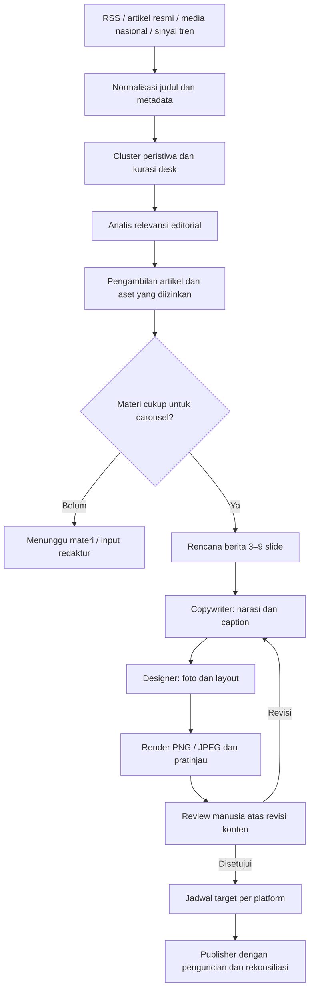

# Blueprint pembaruan editorial dan desain Gapura Media

Versi 1.2 · 17 November 2026 · Status: R0 selesai, kontrak R1 dan reader/snapshot R2 tersedia.

Dokumen ini menjadi acuan perubahan konten berikutnya. Persyaratan baru owner
menggantikan ketentuan lama tentang niche finansial sempit, single otomatis,
caption petikan verbatim, dan kewajiban melewati Agen Verifikator. Perubahan
penulisan produksi belum diterapkan; kontrak dan fixture sintetis [R1](08_R1_EDITORIAL_CONTRACT.md)
tersedia offline, sedangkan [R2](09_R2_ARTICLE_MATERIALS.md) menyediakan reader
dan snapshot materi tanpa menghasilkan draf. Pembersihan workspace dan penjedaan
otomatisasi sudah dilaksanakan; buktinya tercantum di
[laporan reset](../EDITORIAL_WORKSPACE_RESET_20261116.md).

## 1. Keputusan produk dan tujuan

Gapura menjadi media penjelas isu nasional: **politik, sosial, hukum,
lingkungan, serta ekonomi nasional termasuk bursa saham**. Produk utamanya satu
carousel berita yang dapat dipahami tanpa membuka artikel lain, dengan foto
relevan dan caption yang menjelaskan peristiwa, konteks, pihak terkait, serta
perkembangan yang diketahui.

Kebutuhan pembaca: mengetahui apa yang terjadi, mengapa penting, siapa yang
terdampak, apa yang dikatakan pihak terkait, dan bagaimana peristiwanya
berkembang. Kebutuhan redaktur: memeriksa bahan, foto, wording, dan desain dalam
satu workspace, lalu menyetujui versi konten yang benar-benar dilihat.

Keputusan yang digunakan untuk membuat rencana konkret:

- **Satu berita menghasilkan minimal satu posting carousel**, bukan satu gambar
  yang disebut carousel. Default enam slide, normal 5–8, rentang konfigurasi 3–9.
  Format single hanya boleh menjadi pilihan eksplisit owner untuk produk lain;
  jalur berita reguler tidak boleh turun ke single secara diam-diam.
- Setidaknya satu foto jurnalistik relevan pada cover. Foto isi dapat ditambah
  jika tersedia dan membantu penjelasan. Tidak memakai gambar generatif untuk
  menggambarkan kejadian nyata, dan tidak mengulang foto sekadar mengisi slide.
- Caption Instagram menargetkan 1.200–1.900 karakter isi saat materi cukup;
  payload akhir maksimal 2.200 karakter termasuk paragraf tambahan dan tagar.
  Target panjang tidak membenarkan filler atau fakta buatan.
- Agen/halaman/fungsi Verifikator dihapus sepenuhnya dari jalur aktif. Tidak
  diganti agen penilai kebenaran lain dengan nama baru.
- Pengambilan materi, pemeriksaan struktur/angka/kutipan, dan review redaktur
  tetap ada. Ini diperlukan agar berita tidak mengarang fakta atau salah
  mengatribusikan pernyataan; tidak menghasilkan label verified/unverified,
  confidence kebenaran, atau gerbang persetujuan otomatis oleh LLM.
- Publikasi tetap memerlukan persetujuan manusia atas revisi konten terkini.
  Timer publisher tetap berhenti selama pencarian format; koneksi Meta disimpan.

**Asumsi yang perlu disetujui lewat sampel:** target enam slide, rentang caption,
ukuran ruang foto, tone headline, dan campuran rubrik. Angka ini adalah rancangan,
bukan preferensi visual owner yang sudah terbukti.

## 2. Temuan audit dan pemetaan delapan permintaan

Audit terdiri dari pemeriksaan source code, reproduksi offline, dan inventaris
database sebelum reset. Endpoint feed baru serta izin lisensi setiap penerbit
belum diuji; kandidat sumber dalam dokumen ini belum dinyatakan aktif. Bukti
reproduksi sintetis tersimpan di [audit baseline](../EDITORIAL_BASELINE_AUDIT_20261116.md);
jumlah produksi dan verifikasi backup mengikuti laporan reset, bukan fixture.

| No. | Temuan owner | Penyebab yang teramati | Perubahan yang direncanakan |
| --- | --- | --- | --- |
| 1 | Gambar sering tidak muncul | Host policy duplikat; X/RSSHub/Google fallback memberi `image_url=null`; SEO menghilangkan foto; fallback cover tidak menyalin gambar; hydration gagal tanpa diagnostik | Jalur aset eksplisit dari sumber sampai render, foto dipilih deterministik, cache lokal, diagnostik, fallback tetap mempertahankan aset |
| 2 | Hasil selalu satu gambar | `chooseFormat` memilih single untuk materi pendek; fallback memerlukan dua potongan isi lalu menurunkan format; setting jumlah slide tidak dipakai konsisten | Produk berita carousel-first 3–9 slide, default enam; pengayaan materi sebelum menulis; bahan tidak cukup tetap menunggu materi |
| 3 | Label fallback/nama penerbit masuk judul | Adapter memasukkan prefix secara literal; pembersihan hanya HTML/whitespace; validator mewajibkan headline sama dengan kalimat sumber | Pisahkan judul asli, judul bersih, headline editorial, dan provenance; satu normalizer idempotent |
| 4 | Caption tidak menjelaskan berita | Input hanya summary feed; batas 1.000 karakter; validator hanya menerima kalimat sumber utuh; suffix metadata mendapat prioritas ruang | Ambil isi artikel yang diizinkan, susun konteks/statement/kronologi, izinkan parafrasa bersumber, alokasi panjang ke isi |
| 5 | Boilerplate caption mengganggu | `composeCaption` memaksakan sumber primer, status verifikasi, disclaimer terkait verifikasi, tagar | Kontrak caption publik terpisah dari metadata internal; hapus boilerplate dan disclaimer generik yang tidak relevan |
| 6 | Sumber umum/tidak menarik | Discovery dominan feed pasar dan query generik; tidak ada paket materi berita; penilaian masih finance-first | Kurasi per desk, skor kepentingan publik dan kebaruan, cluster peristiwa, sumber primer dan jurnalisme independen |
| 7 | Fokus diperluas | Seed, kategori UI, heuristik, prompt, dan hashtag tetap ekonomi/regulasi finansial | Satu taxonomy enam desk digunakan dari source sampai dashboard dan caption |
| 8 | Hapus verifikasi seluruh fungsi | Verifier ada di produksi, Studio, API, UI, config, Telegram, dan kedua publisher | Lepaskan dependensi runtime secara terpadu, hapus fitur/config/polling, migrasi schema setelah consumer dibersihkan |

Sebelum reset terakhir tersedia 142 draf dan 269 slide. Snapshot audit saat
pipeline baru dihentikan menunjukkan 32 carousel dari 140 draf berstatus draft,
dan 12 draf memuat `image_url`. Jadi masalah single/gambar dominan terkonfirmasi,
tetapi pernyataan bahwa seluruh draf selalu single tidak tepat untuk seluruh
riwayat. Tidak ada klaim tingkat keberhasilan foto render dari hitungan URL saja.

### Lokasi kode yang menjelaskan akar masalah

- [scout/sources.js](../../services/scout/sources.js): `normalizeFeedItem`
  memilih description sebelum isi lebih lengkap lalu memotong 1.000 karakter;
  `fetchXQuery` menambahkan `[Google News: X query fallback]`.
- [scout/scout.js](../../services/scout/scout.js): penyimpanan ringkasan dan
  pemetaan bahan ke topik; publication timestamp belum menjadi kontrak topik.
- [seo/seo.js](../../services/seo/seo.js): foto tidak bertahan pada normalisasi
  dan promosi trend; label volume pencarian dapat masuk summary bahan berita.
- [common/images.js](../../services/common/images.js) dan Scout memiliki
  host policy terpisah; kegagalan unduh menjadi `null` dan URL dihapus dari
  payload tanpa status alasan.
- [common/carousel.js](../../services/common/carousel.js): compact summary
  memilih single; nama `trendScore` berbeda dengan `trend_score` tersimpan.
- [copywriter/editorial.js](../../services/copywriter/editorial.js): fallback
  menurunkan carousel bila isi kurang, cover fallback tanpa foto, caption
  memiliki suffix wajib, dan parafrasa/headline bersih ditolak aturan verbatim.
- [designer/designer.js](../../services/designer/designer.js): pemilihan foto
  bergantung pada LLM; satu field invalid dapat menjatuhkan seluruh hasil ke
  fallback tekstual.
- [render/engine.js](../../services/render/engine.js): cover sudah mendukung
  raster embedded; beberapa layout data masih punya default demonstrasi yang
  harus dibersihkan sebelum aturan penulisan dilonggarkan.
- [common/editorial.js](../../services/common/editorial.js),
  [studio/studio.js](../../services/studio/studio.js),
  [copywriter/copywriter.js](../../services/copywriter/copywriter.js),
  [publisher/meta-worker.js](../../services/publisher/meta-worker.js), dan
  [telegram/bot.js](../../services/telegram/bot.js): report/confidence verifier
  masih mengikat produksi/persetujuan/publikasi.

## 3. Identitas editorial dan pemilihan isu

### Enam desk yang dipakai bersama

| Desk / key | Isi prioritas | Contoh sudut penjelasan |
| --- | --- | --- |
| Politik / `politik` | Kebijakan, pemerintah, DPR, pemilu, akuntabilitas | Keputusan apa yang berubah, siapa penentu, konsekuensi bagi publik |
| Sosial / `sosial` | Layanan publik, pendidikan, kesehatan, ketenagakerjaan, ketimpangan | Siapa terdampak, skala masalah, respons lembaga dan warga |
| Hukum / `hukum` | Putusan, legislasi, penegakan hukum, hak warga | Status proses, pasal/putusan yang relevan, posisi para pihak |
| Lingkungan / `lingkungan` | Iklim, bencana, polusi, kehutanan, pertambangan, transisi energi | Lokasi/periode, dampak terukur, kronologi, respons dan kebijakan |
| Ekonomi nasional / `ekonomi` | Fiskal, moneter, harga, pangan, industri, perdagangan | Data terbaru, konteks periode, mekanisme dampak pada masyarakat |
| Bursa / `bursa` | BEI, emiten, keterbukaan informasi, sektor dan indeks | Peristiwa korporasi, data/satuan/periode, risiko; tanpa ajakan transaksi |

Prioritas isu mengikuti kepentingan publik, kebaruan/perubahan nyata, jangkauan
dampak, kekuatan materi, serta kejelasan penjelasan yang bisa diberikan. Viralitas
hanya sinyal discovery, bukan bukti atau alasan mengabaikan konteks.

Usulan rubrik Analis 100 poin: kepentingan publik 30, kebaruan 20, dampak 20,
kecukupan materi 20, potensi penjelasan 10. Nilai/perubahan threshold diuji pada
fixture enam desk sebelum aktif; skor historis tidak ditulis ulang. Filter
keyword harus membedakan pemberitaan tentang tuduhan/ujaran dari ajakan atau
ujaran yang dibuat media sendiri. Kata `fitnah`, misalnya, tidak otomatis
menggugurkan berita perkara hukum.

Pemberitaan politik bersifat informatif dan seimbang menurut konteksnya. Kutipan
pejabat tidak otomatis diperlakukan sebagai fakta terbukti. Klaim, bantahan,
dugaan, tahap perkara, tanggal, dan pelaku tetap teratribusi; tidak menghapus
kata pembatas seperti `diduga` hanya untuk membuat judul lebih menarik.

### Katalog sumber yang lebih berguna

Daftar ini adalah **calon organisasi**, bukan endpoint RSS yang sudah valid:

| Keluarga | Kandidat | Fungsi |
| --- | --- | --- |
| Jurnalisme nasional | Antara, Kompas, Tempo, CNN Indonesia, BBC Indonesia, detik, Tirto | Berita, konteks, statement, pelaporan independen lintas desk |
| Politik/pemerintahan | DPR, KPU, Bawaslu, rilis lembaga/pemerintah yang relevan | Dokumen keputusan dan statement yang dapat diatribusikan |
| Hukum/hak/layanan | MA, MK, JDIH, KPK, Ombudsman, Komnas HAM | Putusan, regulasi, laporan lembaga, tahap perkara |
| Lingkungan/bencana | BMKG, BNPB, lembaga lingkungan/kehutanan terkait, Mongabay Indonesia | Data kejadian, dampak, penjelasan dan pelaporan lingkungan |
| Ekonomi/bursa | BPS, BI, Kemenkeu, OJK, BEI, keterbukaan emiten, Kontan, CNBC Indonesia, Bisnis | Data ekonomi, kebijakan, pengumuman korporasi, konteks pasar |
| Perspektif warga/keahlian | Liputan lapangan, akademisi, organisasi masyarakat sipil yang relevan | Statement/pengalaman dengan atribusi dan kepentingan yang jelas |

Setiap calon harus melalui uji adapter: alamat aktual, format respons,
publication timestamp, body yang tersedia, gambar, hak penggunaan, rate limit,
dan kegagalan. Uji yang gagal tidak boleh disamarkan sebagai feed sehat. Query
Google News menjadi discovery cadangan; resolver harus menuju artikel asli,
bukan memakai homepage penerbit sebagai URL artikel.

Hindari query `politik`/`ekonomi` sendirian. Buat query per isu/desk dengan
konteks Indonesia, variasi aktor/kebijakan dan recency. Cluster laporan tentang
peristiwa yang sama agar satu isu tidak memenuhi galeri dengan duplikat.

## 4. Alur produksi yang dituju



Tidak ada tahap Verifikator, permintaan report, confidence, atau badge kebenaran
otomatis dalam alur baru. UI boleh menunjukkan status teknis seperti artikel
belum terambil/foto gagal; status itu hanya di editor, tidak disisipkan ke
headline/caption.

**Definisi operasional materi cukup:** bahan yang tersedia mendukung minimal
tiga kontribusi slide berbeda; pernyataan memiliki atribusi yang jelas, dan
angka/kutipan yang dipakai mempunyai rujukan bagian sumber. Ini bukan syarat
dua sumber, artikel penuh, konfirmasi resmi, atau keputusan LLM tentang
kebenaran. Berita tentang suatu statement dapat bertumpu pada satu rekaman,
rilis, atau artikel yang diatribusikan jelas. Jika bahan sudah cukup, produksi
dapat berjalan tanpa menunggu sumber tambahan. Ketidakcukupan hanya menunjukkan
bagian isi yang belum tersedia untuk produk carousel; redaktur dapat menambah
materi atau menyunting rencana, tanpa membuat report verifikasi.

## 5. Kontrak materi berita

Gunakan `topics` sebagai identitas berita agar tidak membangun sistem paralel.
Tambahkan dua penyimpanan minimal untuk materi dan aset; JSONB cukup untuk detail
yang bervariasi. Schema final ditetapkan melalui migrasi berurutan.

### `topics` diperluas

- `raw_title`: judul feed asli untuk audit.
- `normalized_title`: judul penerbit setelah pembersihan noise teknis.
- `editorial_headline`: judul publik yang dapat ditulis ulang redaktur.
- `editorial_category`: salah satu enam desk.
- `source_published_at` dan `source_updated_at`, dibedakan dari waktu ditemukan.
- `material_status`: ready/needs_material/access_failed; tidak berarti benar/salah.

### `topic_materials`

Referensi `topic_id`, URL artikel kanonis, penerbit, judul dokumen, waktu
publish/update/retrieval, isi hasil ekstraksi, hash isi, status akses,
adapter/metode ekstraksi, serta bagian-bagian sumber dalam JSONB. Satu berita
dapat merujuk beberapa dokumen. Preferensi pengambilan:

1. Isi lengkap feed berizin: `content:encoded`/`content` yang substantif.
2. Halaman artikel publik dengan parser artikel, metadata Open Graph/JSON-LD,
   serta pengecualian navigasi/iklan/related stories.
3. Materi resmi yang diizinkan dan dapat diekstrak.
4. Teks/foto yang disediakan redaktur dengan URL/atribusi/hak yang jelas.

Tidak melewati paywall, login, robots, pembatasan atau anti-bot. Status akses
eksplisit: full/partial/summary_only/paywall/access_denied/robots_disallowed/
rate_limited/parse_failed/unavailable. Batas respons/timeouts dan cache wajib.
Materi ringkasan tidak boleh dinamai full article. Dokumen eksternal diperlakukan
sebagai data dan tidak dapat memberi instruksi untuk tool atau model.

### Isi terstruktur yang dikirim ke penulis

```text
story: event, desk, clean headline, dates, material revision
documents: id, article URL, publisher, title, paragraph/source spans
facts: subject, statement, evidence_refs
figures: subject, value, unit, period, evidence_refs
quotes: exact text, speaker, role, date/context, evidence_refs
events: date/sequence, event text, evidence_refs
responses: actor, position/statement, evidence_refs
assets: id, source article, credit, rights, local file, crop/focal point
gaps: material still unavailable; editor-facing only
```

Ini adalah kontrak bahan dan jejak penulisan, bukan report penilaian kebenaran.
Validator memeriksa referensi ada, angka/satuan/periode tidak tertukar, dan
kutipan cocok persis. Parafrasa akurat diperbolehkan; validator deterministik
tidak diklaim dapat membuktikan kebenaran semantik. Review redaktur tetap penentu.

## 6. Foto harus bertahan sampai hasil render

### `media_assets` dan pemilihan foto

Simpan keterkaitan ke dokumen, URL asal, credit/pemilik, status hak penggunaan,
dimensi, MIME, checksum, local path, caption foto, serta focal point/crop.
Satu kebijakan host dipakai Scout, SEO, downloader, dan editor. Host yang
diizinkan tidak otomatis membuktikan relevansi atau izin publikasi.

Urutan kandidat: foto artikel asli → lampiran resmi yang boleh digunakan →
unggahan redaktur yang berhak → foto editorial berlisensi yang relevan dan
ditandai sebagai ilustrasi jika bukan kejadian yang sama. Pemilihan tidak
bergantung pada LLM menyalin URL: designer menerima `asset_id` yang sudah dipilih.

Parser mempertimbangkan `media:content`, enclosure, gambar body, `og:image`,
JSON-LD, URL relatif dan varian resolusi. Kebijakan unduh tetap HTTPS, host
tepercaya, DNS/IP publik pada setiap redirect, MIME dan magic bytes raster,
ukuran/dimensi terbatas, timeout, serta tidak menerima SVG atau URL bebas dari
model. Gambar disimpan lokal sebelum render, bukan diambil dari internet oleh
engine render.

Kebijakan minimum hak foto ditetapkan di R1, sebelum sampel dibuat: foto milik
Gapura/unggahan yang dinyatakan berhak oleh redaktur, berlisensi yang sesuai
penggunaan, atau materi resmi yang syarat penggunaannya secara eksplisit
mengizinkan. Catat asal, pemilik/credit, dasar izin, dan batas penggunaan.
Foto artikel milik media lain dengan hak yang belum diketahui tidak otomatis
dipakai hanya karena URL dapat diunduh; redaktur memilih aset sah pengganti.
Ketepatan crop dan penempatan credit disempurnakan melalui R7.

Status aset harus terlihat: candidate/selected/downloaded/rejected/failed, dengan
alasan seperti host tidak diizinkan, 403, terlalu kecil, bytes invalid,
hak belum jelas, atau tidak relevan. Tidak ada kegagalan diam-diam yang berakhir
sebagai desain sukses tanpa foto. Bila foto wajib belum tersedia, draf berstatus
`needs_media` dan redaktur diminta memilih/unggah foto. Jangan mengambil foto
acak hanya agar metrik gambar lulus.

Draf `needs_media` tetap dapat dibuka, diedit, dan dipratinjau selama eksperimen;
belum memenuhi acceptance produk berita siap unggah. Cover tanpa foto bukan
pengecualian otomatis. Jika owner kemudian menginginkan produk infografik tanpa
foto, tetapkan mode dan kriteria tersendiri secara eksplisit.

Paling sedikit cover menggunakan foto nyata yang dipilih. Layout isi `photo`
opsional dikembangkan untuk kronologi/lokasi/statement bergambar. Local asset
harus tetap ikut fallback, regenerasi, simpan editor, export, dan JPEG publisher.

## 7. Produk carousel dan desain editorial

Default enam slide dengan urutan menyesuaikan bukti:

| Slide | Tujuan | Contoh komponen |
| --- | --- | --- |
| 1 | Menarik perhatian dengan inti peristiwa | Foto relevan, headline singkat, identitas Gapura |
| 2 | Menjelaskan apa yang terjadi | Aktor, lokasi, tanggal, keputusan/peristiwa utama |
| 3 | Memberi konteks | Latar kebijakan/perkara/data yang penting |
| 4 | Menyajikan statement atau kronologi | Kutipan beratribusi ATAU urutan kejadian, sesuai bahan |
| 5 | Menjelaskan dampak/respons | Siapa terdampak, angka yang relevan, tanggapan pihak lain |
| 6 | Menyimpulkan dan mengarahkan pembacaan | Yang sudah diketahui, perkembangan berikutnya yang dinyatakan sumber |

Slide boleh 3–9, normal 5–8. Statement/kronologi bukan template wajib untuk
semua berita. Tidak mengarang kutipan, respons pihak lain, tanggal, dampak, atau
langkah selanjutnya untuk mengisi enam slot. Setiap slide memberi kontribusi
unik; judul/paragraph yang sama tidak diulang untuk memenuhi jumlah.

Keputusan format berlaku identik di konfigurasi, Studio, API, editor, renderer,
export, dan publisher. Hapus fallback single dari produk berita ini. Jika materi
kurang dari tiga kontribusi berbeda, jalur kembali ke pengayaan/input redaktur.

Desain mempertahankan brand Gapura, dua keluarga font Archivo Black/Inter,
kanvas 1080×1350, hierarki judul-isi, margin konsisten, kontras teks/foto,
counter slide, dan credit foto kecil yang tidak menutupi konten. Headline target
6–14 kata/sekitar 60–100 karakter adalah pedoman, bukan truncation mekanis.
Body diringkas ke paragraf pendek atau poin; pemecahan slide mendahului
pengecilan font berlebihan. Tidak memakai CTA/filler/slide disclaimer wajib.

Semua default faktual demonstrasi pada layout chart/stat/timeline/comparison
dihapus. Data yang hilang menghasilkan validasi terarah atau layout teks netral,
bukan angka/kejadian contoh. Golden render disusun untuk enam desk dan desktop/
mobile preview, termasuk foto landscape/portrait, judul panjang, kutipan dan data.

## 8. Headline bersih dan caption yang menjelaskan

### Headline

Satu fungsi normalisasi dipakai RSS, akun/query X, SEO, promotion, dan editor.
Simpan raw title; hilangkan hanya prefix teknis yang dikenali dan suffix
penerbit yang cocok dengan metadata. Jangan menghapus sembarang kata `CNN`,
`Kompas`, atau tanda hubung karena dapat menjadi bagian peristiwa/nama.

```text
Input feed:
[Google News: X query fallback] DPR Membahas RUU ... - CNN Indonesia

normalized_title:
DPR Membahas RUU ...

provider/publisher tetap ada di metadata internal, bukan pada headline.
```

Headline editorial boleh parafrasa dengan fakta, negasi, angka, status dugaan,
dan aktor yang konsisten. Uji normalizer harus idempotent dan menyertakan judul
dengan tanda hubung/kurung bermakna.

### Caption publik

Struktur yang disarankan:

1. Lead yang menyebut peristiwa dan mengapa penting, tanpa clickbait kosong.
2. Penjelasan siapa/apa/kapan/di mana dan data kunci yang diperlukan.
3. Konteks atau kronologi yang membantu pembaca memahami sebab/urutan.
4. Statement teratribusi dan respons relevan yang benar-benar tersedia.
5. Dampak/perkembangan lanjutan yang didukung bahan, lalu penutup natural.

Hapus dari caption publik: `[Google News ...]`, label fallback, `Sumber primer:`,
`Status verifikasi:`, `Belum terverifikasi otomatis`, disclaimer tentang
ketidakpastian mesin, confidence, dan instruksi internal redaksi. Sumber/dokumen
tetap tersedia di editor/audit. Atribusi natural seperti `Menurut ...` dan
credit hak penggunaan tidak dilarang; itu berbeda dari blok diagnostik.

Tidak memaksakan disclaimer finansial/hukum pada isu sosial/politik/lingkungan.
Peringatan relevan untuk konten investasi dapat ditempatkan ringkas sesuai
kebijakan editorial, bukan otomatis menyita hampir seluruh caption.

Simpan **caption body** terpisah dari hashtags, reference internal, dan varian
platform. Satu assembler menghasilkan teks akhir yang sama bagi preview,
copy, Telegram, ZIP, dan publisher; tagar tidak digandakan. Target Instagram
1.200–1.900 karakter bila materi cukup, maksimum final 2.200. Hindari clipping
tengah kalimat, hilangnya negasi, atau fakta yang tersisa tanpa konteks.

Facebook boleh versi lebih panjang yang tetap koheren. Threads perlu caption
khusus maksimal 500 karakter pada adapter saat ini; versi panjang diringkas
secara editorial dan ditinjau sendiri. Tidak memotong caption Instagram
diam-diam. Pembuatan thread berseri dapat menyusul jika memang diperlukan.

## 9. Penghapusan Verifikator secara menyeluruh

Penghapusan bukan sekadar menyembunyikan menu atau memaksa semua status menjadi
verified. Tahap implementasi ini menghapus consumer dan kontrak report/confidence
dari jalur aktif, lalu membersihkan schema dan dokumentasi yang berlaku.

| Permukaan | Pekerjaan |
| --- | --- |
| Runtime | Hapus `services/verificator/`, pemanggilan batch di pipeline, import dan export layanan |
| Production | Hapus syarat report, query latest verification, recheck report setelah render, audit `verification_id` |
| Shared policy | Ganti parameter report/confidence menjadi prasyarat sumber/materi, struktur draf dan review revisi; tidak ada label kebenaran otomatis |
| Studio | Hapus `verifying`, `verification_requested`, `verification_id`, report query, progress dan pesan terkait |
| Web/API | Hapus halaman, badge, tombol verify, polling, endpoint `/api/verifications` dan `/api/topics/:id/verify|verification` |
| Agen/settings | Hapus agen verifikator, config/skills/prompt/tab/validator; perbarui AGENT_KEYS dan daftar yang dipersyaratkan |
| Publisher/Telegram | Hapus SQL report/status/confidence; tetap cek bukti persetujuan manusia, revision hash, jadwal/akun dan hasil ambigu |
| Desain/caption | Hapus slide layout verifikasi, helper/status text, prompt dan metadata publik yang menyebut hasil verifikasi |
| Schema | Arsipkan report historis, lalu hapus `verification_reports`, `topics.verification_status`, `prompt_jobs.verification_id` dari schema aktif sesudah semua consumer dilepas |
| Tests/docs/workflow | Ganti ekspektasi verifier-required dengan human-reviewed material, perbarui workflow canvas dan dokumen; migrasi historis tetap dicatat sebagai sejarah |

`agent_type` enum lama boleh mempertahankan nilai historis yang tidak digunakan
untuk menjaga audit lama; tidak ada consumer yang boleh menjalankan agen itu.
UI Studio memakai beberapa class CSS `.verif-*` generik: pindahkan styling
bersama sebelum membuang CSS agar kartu Studio tidak ikut rusak.

Review publikasi yang tetap diperlukan: bahan tersedia, angka/kutipan sesuai
materi, aset/renders lengkap, redaktur menyetujui current content/material hash,
edit membatalkan approval, target akun dan jadwal cocok, lock mencegah duplikat,
serta hasil `unknown` wajib rekonsiliasi. Jangan menyamakan hilangnya Verifikator
dengan izin autopost konten yang belum direview manusia.

## 10. Perubahan data dan kompatibilitas

- Bahan mentah, sumber, audit historis dan skor tidak dipurge dalam reset desain.
  Berita lama tidak otomatis diproduksi kembali; gunakan batch fixture/berita baru
  yang dipilih untuk eksperimen.
- Migrasi dilakukan bertahap: tambah material/media/revision fields → migrasi
  consumer produksi → lepas verifier → arsip/drop schema aktif lama.
- Revision hash diperluas mencakup materi dan aset terpilih selain caption/slides/
  hashtags; perubahan yang memengaruhi output memerlukan review ulang.
- Tidak ada reset ID sequence. ID konten baru tidak bertabrakan dengan riwayat
  lama yang masih tersimpan dalam audit/backup.
- Kredensial Unified Instagram, Page token Facebook, Threads, provider, dan
  signature media tidak dipindahkan ke browser atau direset.
- Hasil publish di platform Meta tidak dihapus oleh reset lokal. Pemeriksaan
  sebelum reset tidak menemukan bukti publikasi remote sehingga penghapusan
  draf lokal aman dalam lingkup yang diminta.

## 11. Urutan implementasi dan gate penerimaan

Satu tahap menghasilkan diff/commit yang dapat ditinjau. Tahap di bawah adalah
urutan implementasi blueprint baru, bukan label P2 audit database sebelumnya.
Semua perubahan kode dimulai dari tes merah yang mereproduksi masalah.

| Tahap | Hasil | Gate sebelum lanjut |
| --- | --- | --- |
| R0 — Workspace bersih | Backup/restore teruji, konten kosong, timer dan worker otomatis dijeda | **Selesai**, lihat laporan reset; koneksi Meta tetap connected |
| R1 — Kontrak editorial | Taxonomy enam desk, material/media contract, kebijakan hak/credit minimum, aturan headline/caption/carousel, corpus fixture | **Tersedia offline**, lihat [kontrak R1](08_R1_EDITORIAL_CONTRACT.md); bukan acceptance foto berita live/visual owner |
| R2 — Pengambilan materi | Feed body penuh yang tersedia, publisher article resolver, metadata, akses status, snapshot hash idempotent | **Tersedia**, lihat [hasil R2](09_R2_ARTICLE_MATERIALS.md); validasi fixture dan migrasi tanpa rewrite. Clustering peristiwa lintas URL menyusul bersama kurasi sumber R4 |
| R3 — Foto end-to-end | Asset ID lokal, host policy tunggal, rights/credit, hydration, fallback/photo layout | Foto nyata tampil pada normal/fallback/regenerasi; semua kegagalan terlihat |
| R4 — Sources dan Analis | Katalog tervalidasi enam desk, scoring kepentingan publik, query aktual | Fixture tiap desk lolos/gugur sesuai materi dan konteks; endpoint gagal nonaktif |
| R5 — Lepas Verifikator | Seluruh runtime/API/UI/config/SQL consumer report hilang | Produksi/review tanpa report berhasil; publish tanpa review tetap ditolak |
| R6 — Penulisan dan desain | Carousel default enam 3–9, caption mendalam, headline bersih, no demo facts | Sampel lokal untuk enam desk lulus kontrak isi dan render |
| R7 — Review visual owner | Galeri kecil berisi satu carousel sampel per desk dan variasi cover/layout | Owner menyetujui style/isi; perbaiki sampel, jangan isi ratusan draf |
| R8 — Aktivasi bertahap | 20 draf berurutan, shadow, satu publish uji yang disetujui | Tidak ada drop foto/single/boilerplate, approval/hash/idempotency lulus |

Jangan mengaktifkan kembali timer hanya karena test unit hijau. Keputusan style
dan kedalaman isi harus lulus review owner pada R7. Sampel awal memakai materi
yang diizinkan, tidak membutuhkan publikasi live.

Urutan aktivasi yang dipakai semua runbook: R7 sampel disetujui → R8 batch dan
shadow dijalankan manual → satu publish uji mendapat persetujuan tersendiri →
otomatisasi diaktifkan atas mandat eksplisit owner. Lulus tes atau selesainya
reset tidak otomatis memberikan mandat untuk menyalakan timer.

## 12. Matriks pengujian dan definisi selesai

### Source dan materi

- Isi kaya `content:encoded` tidak kalah oleh description pendek; batas/token
  budget diterapkan setelah isi bersih disimpan, bukan memotong bukti asli.
- Judul raw tetap tersimpan; headline tidak memuat prefix fallback atau suffix
  penerbit; punctuation/negasi/nama dan status dugaan dipertahankan.
- HTML/JSON-LD/feed, URL relatif, encoding, robots/paywall/401/403/429/timeout,
  response oversized, redirect dan parse_failed diuji dengan fixture lokal.
- Volume tren/metadata discovery tidak pernah dipromosikan menjadi kalimat berita.

### Konten dan caption

- Minimal satu carousel 3–9 slide untuk setiap berita siap review; 1/2/10 slide
  ditolak pada jalur berita, materi kurang tidak menjadi sukses single.
- Enam desk memiliki fixture: politik, sosial, hukum, lingkungan, ekonomi, bursa.
- Corpus mencakup minimal satu contoh lengkap berita statement dan satu berita
  kronologi: headline → isi carousel → statement/urutan kejadian → caption
  mendalam. Setiap bagian dapat ditelusuri ke materi fixture; struktur ini tidak
  dipaksakan untuk semua jenis berita.
- Fixture enam desk memakai adapter/query dari katalog sumber baru yang
  diseleksi untuk desknya, bukan hanya mengganti kategori pada feed finansial
  lama. Uji integrasi menegaskan source ID, desk, tanggal, URL artikel, dan aset
  yang benar-benar dipakai.
- Setiap slide menyumbang informasi berbeda; kutipan hanya bila ada speaker/
  kutipan persis; timeline hanya bila urutan/waktu tersedia.
- Parafrasa yang setara boleh lolos; angka, unit, periode, nama atau negasi yang
  berubah ditolak; brief redaktur tidak menjadi sumber fakta baru.
- Caption menjawab peristiwa/konteks/pihak terkait tanpa boilerplate terlarang.
  Kasus 1.200–1.900 dan batas 2.200 diuji; tags hanya sekali pada semua consumer.
- Varian Threads diuji maksimal 500 dengan review sendiri, bukan slice string.

### Visual

- Golden render 1080×1350 untuk foto portrait/landscape, long headline, kutipan,
  kronologi, data dan teks saja pada body; cover wajib foto pada produk utama.
- Tidak ada teks meluber, logo tertutup, contrast rendah atau font terlalu kecil.
- Foto terkait peristiwa, local raster muncul, credit dan rights tercatat.
  Fallback/regenerasi/export/JPEG memakai aset yang sama.
- Chart/stat/timeline kosong tidak pernah menampilkan fakta demo.

### Penghapusan verifier dan review

- Pencarian referensi aktif `verifyTopic`, `verification_reports`, confidence dan
  state `verifying` tidak menemukan consumer selain migrasi/audit historis.
- Agen Verifikator tidak dapat dipilih/dipanggil lewat pipeline, Studio, API,
  Telegram, publisher, konfigurasi maupun prompt aktif. Produksi tidak membuat
  report atau panggilan LLM verifier; tidak ada polling/job background verifier.
  Enum/report arsip tidak boleh ikut query keputusan runtime.
- API lama 404, menu/tab/badge/tombol/polling hilang, navigasi/Back tetap berjalan.
- Produksi materi cukup tanpa report berhasil. Human review tetap wajib;
  approve stale revision, edit saat publish, akun tidak cocok, jadwal belum tiba,
  retry duplikat, dan timeout ambigu tetap ditolak/ditangani.
- Koneksi Meta status connected tetap sama; tidak ada token/secret di respons/log.

### Batch penerimaan

Batch 20 draf berturut-turut harus memenuhi kontrak: 100% carousel bermakna,
100% cover dengan foto relevan berhak pakai, 0 label teknis pada judul/caption,
0 quote/angka demonstrasi, 0 parsing error yang disamarkan menjadi konten tipis,
0 posting tanpa review. Target 100% ini berlaku pada corpus yang memang punya
materi/foto; kegagalan sumber luar harus terlihat dan menahan produksi.

Denominator batch harus dilaporkan: jumlah kandidat dicoba, berhasil, tertahan
karena materi/foto, gagal teknis, dan diterima/redaktur ditolak. Target 100%
di atas hanya berlaku pada kandidat yang memiliki materi dan foto berhak pakai;
persentase tidak boleh menyembunyikan kegagalan resolver sumber atau downloader.

Owner menilai setiap sampel pada empat aspek 1–5: visual, kelengkapan berita,
keterbacaan caption, dan relevansi isu. **Usulan gate:** tiap aspek minimal 4,
tanpa error faktual/atribusi yang belum diperbaiki. Angka ini menunggu penerimaan
owner, bukan klaim penilaian yang sudah dilakukan.

## 13. Risiko, batas lingkup, dan keputusan terbuka

- **Hak materi/foto:** akses publik bukan izin republication. Perlu kebijakan
  penggunaan, credit, dan daftar sumber/unggahan yang diizinkan owner.
- **Akses sumber:** halaman berbayar/blocked tetap bisa gagal. Gunakan alternatif
  yang sah atau input redaktur; tidak membuka paywall/anti-bot.
- **Kedalaman vs anggaran:** enrichment, multi-document dan caption lebih kaya
  menambah waktu/token. Ukur per draf, cache artikel, kirim materi terstruktur,
  gunakan provider yang teruji tanpa pemanggilan Verifikator tambahan.
- **Penghapusan report:** tidak ada label verified lagi; redaktur bertanggung
  jawab pada konteks dan wording sebelum publish. Bukti sumber tetap terlihat.
- **Dashboard terbuka:** sesuai keputusan owner sebelumnya, tidak menambahkan
  kembali login dalam pekerjaan ini. Tetap redaksi key dan validasi Origin.
- **Belum termasuk:** video/reels generatif, targeting politik personal,
  scraping berbayar, integrasi Threads baru, multi-user/RBAC, kalender drag-drop,
  penghapusan posting remote, atau aktivasi autopost massal.

Keputusan terbuka melalui R7: proporsi desk, contoh referensi visual owner, gaya
foto penuh/kolase, batas panjang headline, tata letak credit, serta kebutuhan
caption Facebook/Threads. Dasar hak penggunaan foto sudah wajib diputuskan
lebih awal di R1–R3; foto belum tersedia tetap dapat diedit sebagai `needs_media`,
bukan otomatis dianggap siap unggah. Mode produk tanpa foto, jika diinginkan,
memerlukan keputusan eksplisit. Default sementara ini membantu blueprint
ditinjau tanpa mengklaim preferensi owner telah tervalidasi.

## 14. Langkah konkret berikutnya

Kontrak/corpus sintetis **R1** dan reader/snapshot **R2** tersedia setelah mandat
owner; lihat [hasil R1](08_R1_EDITORIAL_CONTRACT.md) dan
[hasil R2](09_R2_ARTICLE_MATERIALS.md). Langkah berikutnya **R3** adalah jalur
aset foto nyata: pemilihan relevan berhak pakai, download lokal, credit,
checksum, serta kontinuitas preview/render/fallback. Penulisan/carousel baru
baru dihubungkan setelah materi dan aset memadai; ketersediaan parser bukan
klaim bahwa semua sumber live sudah teruji.

Otomatisasi produksi/publish tetap dijeda sampai owner menyetujui sampel. Lihat
[laporan reset](../EDITORIAL_WORKSPACE_RESET_20261116.md) untuk backup, keadaan
layanan, dan langkah pemulihan/re-enable yang eksplisit.
