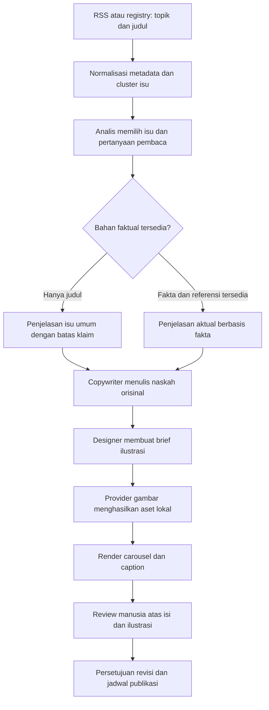

# Gapura Media — Konten orisinal dan ilustrasi AI

Tanggal: 17 November 2026. Status: **keputusan produk owner; implementasi runtime
belum diterapkan**. Mengubah arah [blueprint R0–R8](07_EDITORIAL_REDESIGN_BLUEPRINT.md).

## 1. Ringkasan keputusan

Owner menetapkan: “aplikasi hanya menggunakan topik/judul dari sumber, isi berita
dan gambar yang akan digunakan nantinya di generate oleh agent ai” serta
“mengedepankan originalitas konten yang dibuat oleh gapura media”.

Registry/RSS menjadi sarana menemukan isu. Agen menyusun headline publik,
angle, urutan penjelasan, naskah carousel, caption dan ilustrasi sendiri.
Body artikel dan foto penerbit tidak menjadi bahan yang disalin atau ditulis
ulang pada jalur default. Ketentuan lama tentang foto jurnalistik wajib dan
caption berupa petikan verbatim diganti oleh keputusan ini.

Orisinalitas berlaku pada ekspresi, analisis dan visual. Fakta kejadian, angka,
kutipan dan kronologi tetap membutuhkan dasar yang dapat ditelusuri. Model
tidak memperoleh pengetahuan tentang detail kejadian hanya karena diberi judul.

## 2. Masalah yang diselesaikan

Redaktur membutuhkan produk dengan identitas Gapura dan penjelasan yang berguna.
Jalur lama memaksa petikan sumber, sehingga model yang menulis dengan kalimat
sendiri justru gagal validasi. Cover bergantung pada URL foto penerbit.

Bukti kode yang diperiksa:

- [copywriter.js](../../services/copywriter/copywriter.js) memerintahkan caption
  berupa petikan verbatim dari judul/ringkasan.
- [editorial.js](../../services/copywriter/editorial.js) memeriksa kalimat sumber
  utuh dan membuat fallback dari potongan summary.
- [designer.js](../../services/designer/designer.js) mewajibkan petikan verbatim
  dan hanya menerima URL foto yang disediakan topik.
- [Kontrak R1](08_R1_EDITORIAL_CONTRACT.md) dan validator masih mengharuskan aset
  foto sumber dengan URL/rights. Reader R2 belum terhubung ke penulis baru.

Dokumen ini mengoreksi spesifikasi; belum mengklaim kode di atas sudah berubah.

## 3. Pengguna dan kebutuhan

Pengguna utama adalah owner/redaktur Gapura: memilih isu, melihat angle dan
hasil generasi, menyunting, lalu menyetujui revisi. Pembaca membutuhkan
penjelasan nasional yang jelas, akurat, dan dapat membedakan ilustrasi dari
dokumentasi kejadian.

**Asumsi desain:** gaya ilustrasi editorial konseptual cocok untuk seluruh enam
desk. Asumsi ini diuji pada sampel R7; belum merupakan style visual yang sudah
disetujui owner.

## 4. Konteks dan batas keputusan

Enam desk, carousel 3–9 slide/default enam, caption mendalam, review manusia,
revision hash dan penjedaan otomatisasi tetap mengikuti blueprint. Riset
sindikasi teks/foto bukan lagi prasyarat jalur default ini. Hak metadata/feed
dan ketentuan provider AI tetap perlu dihormati.

[R1](08_R1_EDITORIAL_CONTRACT.md) dan [R2](09_R2_ARTICLE_MATERIALS.md) adalah hasil
historis yang sudah selesai. Reader/snapshot R2 tetap tersedia sebagai kemampuan
terpisah, tanpa backfill, purge atau pengayaan otomatis untuk jalur judul saja.
Tidak menyatakan fitur pengambilan artikel yang sudah ada telah dihapus.

## 5. Alur yang dituju



Tidak menambah agen Verifikator pengganti. Analis, Copywriter dan Designer yang
sudah ada diberi tanggung jawab baru; generator gambar adalah kapabilitas
Designer, bukan alasan menambah lapisan agen.

### Input discovery

Daftar field yang boleh masuk jalur generasi default:

```text
source_id, source_name, source_url, raw_title, normalized_title,
published_at, discovered_at, desk, topic/keywords
```

`source_url` menyimpan jejak asal, bukan perintah mengunduh artikel. Tidak
mengirim `summary`, `content`, `content_html`, `articleBody`, kandidat foto,
`image_url`, maupun materi snapshot historis ke penulis/designer default.
Feed boleh memuat field tambahan saat diterima; adapter hanya memproyeksikan
metadata tersebut ke input editorial. RSS tidak otomatis menjadikan judul
sebagai fakta yang sudah dibuktikan.

### Dua keluaran sesuai bahan

| Bahan tersedia | Keluaran | Batas klaim |
| --- | --- | --- |
| Topik/judul saja | Penjelasan isu orisinal, misalnya cara kerja kebijakan dan pertanyaan yang perlu dipahami | Tidak mengarang rincian kejadian, kutipan, tanggal, jumlah korban, hasil sidang atau harga pasar; klaim dalam judul tetap diatribusikan dan dibatasi |
| Catatan fakta dengan referensi yang diberikan redaktur atau diperoleh agen dari sumber primer yang diizinkan | Penjelasan aktual dengan konteks/analisis Gapura | Setiap klaim aktual, angka dan kutipan menunjuk referensi yang benar-benar tersedia; tidak menyalin narasi artikel |

Riset sumber primer adalah kapabilitas terpisah yang belum terpasang, bukan
pengayaan body penerbit diam-diam. Pada versi judul saja, jangan menjadikan
riset tambahan syarat menemukan/mengusulkan topik. Penjelasan umum juga tidak
boleh memuat fakta spesifik yang dibuat model. Bila bahan tidak cukup untuk
tiga kontribusi yang berguna, tampilkan bagian yang kurang di editor; jangan
memanjang-manjangkan judul menjadi enam slide atau menurunkan format ke single.

Contoh sintetis: judul discovery “Bank sentral menyesuaikan suku bunga” dapat
memicu angle Gapura “Bagaimana perubahan suku bunga memengaruhi cicilan?”.
Agen boleh menjelaskan mekanismenya dengan batas yang jelas. Agen tidak boleh
menambahkan besaran perubahan, tanggal keputusan, atau kutipan pejabat yang
tidak ada dalam bahan. Itu bukan laporan lapangan atau konfirmasi keputusan.

## 6. Ukuran keberhasilan

| Ukuran | Baseline yang diketahui | Target penerimaan |
| --- | --- | --- |
| Naskah orisinal yang lolos review owner | Belum diukur; prompt lama mewajibkan verbatim | Enam sampel total, satu per desk, dan batch R8 dinilai untuk angle, struktur, manfaat dan wording sendiri |
| Body/foto penerbit masuk payload generasi default | Jalur lama memakai summary/image URL | Nol pada tes proyeksi payload, produksi, fallback dan regenerasi |
| Visual AI dengan disclosure dan provenance | Belum ada adapter gambar aplikasi | Semua visual generatif menampilkan `Ilustrasi AI · Gapura Media` dan memiliki catatan generasi |
| Klaim aktual/angka/kutipan tanpa bahan pendukung | Belum ada baseline evaluasi baru | Nol pada corpus penerimaan; review redaktur wajib |
| Carousel dan caption | Kontrak R1 tersedia offline | Minimal tiga kontribusi; default enam, rentang 3–9; caption dan payload mengikuti batas R1 |
| Konten tayang tanpa approval current revision | Publisher sudah memiliki approval/hash/lock | Tetap nol |

Tidak menggunakan persentase kemiripan atau satu skor LLM sebagai bukti bahwa
konten pasti orisinal/benar. Nama, istilah teknis, angka dan kutipan yang sah
dapat sama dengan sumber; kemiripan membantu review, bukan target mengganti
sinonim. Biaya dan latensi diukur per draf; batas gambar ditetapkan setelah
provider diuji, tanpa mengarang harga atau kemampuan model.

## 7. Persyaratan dan acceptance

### A. Discovery sebagai metadata

Sebagai redaktur, saya ingin memilih isu dari RSS tanpa membawa naskah atau
foto media lain ke proses generasi.

- Adapter memakai daftar field yang diizinkan, bukan meneruskan object topik
  dengan spread lalu berharap prompt mengabaikan field lain.
- URL/nama/waktu sumber dipertahankan di editor dan audit; judul publik ditulis
  Gapura, bukan diwajibkan sama dengan judul discovery.
- Tes payload membuktikan body/ringkasan/foto tidak masuk pada produksi normal,
  fallback maupun regenerasi; `content_kind=rss_full` bukan pengecualian.
- Query discovery/cluster lintas URL mengikuti R4; sumber gagal tetap terlihat.

### B. Penulisan orisinal

Sebagai redaktur, saya ingin angle, naskah, penjelasan dan caption ditulis agen
dengan suara Gapura.

- Analis menyusun pertanyaan pembaca dan angle, bukan kalimat artikel yang
  wajib disalin. Copywriter membuat rencana kontribusi slide dan naskah sendiri.
- Validator verbatim diganti oleh struktur, referensi aktual bila ada,
  kecocokan angka/kutipan, qualifier dan review manusia. Tidak mengklaim
  validator deterministik membuktikan kesetaraan makna.
- Output membedakan penjelasan isu umum, fakta aktual teratribusi, dan analisis
  yang bersyarat. Judul tentang tuduhan tetap mempertahankan status dugaan.
- Kutipan langsung hanya dari kutipan persis yang tersedia. Tanpa bahan itu,
  tidak membuat ucapan fiktif atas nama orang/lembaga nyata.
- Kegagalan model tidak kembali menyalin summary atau menghasilkan naskah
  berita seolah sukses. Simpan kegagalan yang dapat dicoba ulang.
- Caption mengembangkan penjelasan dengan paragraf koheren, tanpa boilerplate
  Verifikator; sumber/atribusi yang diperlukan tetap tersedia.

### C. Ilustrasi AI buatan Gapura

Sebagai pembaca, saya ingin ilustrasi relevan dengan isu dan jelas sifatnya.

- Default memakai ilustrasi editorial konseptual/stilisasi, diagram atau
  komposisi simbolik. Tidak mengambil foto penerbit sebagai image input,
  referensi gaya yang disalin, atau fallback otomatis.
- Jangan menyajikan render sebagai foto dokumentasi. Hindari rekonstruksi
  realistis peristiwa politik, hukum, bencana, korban atau tindakan seseorang
  yang dapat menyesatkan tentang kejadian nyata.
- Nama orang, statistik, label data dan kutipan ditempatkan oleh renderer dari
  naskah yang ditinjau; generator tidak diminta menggambar angka/ucapan faktual.
- Label `Ilustrasi AI · Gapura Media` ditambahkan renderer secara konsisten,
  tetap terlihat pada preview, fallback, export dan JPEG publisher. Metadata
  provenance mencatat generatif; disclosure platform digunakan bila didukung
  dan diperlukan setelah kontrak adapter diperiksa.
- Designer menghasilkan brief/prompt; adapter provider menghasilkan bytes
  raster. Model chat tidak boleh mengarang URL atau string gambar sebagai
  pengganti panggilan generator yang benar-benar berhasil.
- Provider/model, prompt, waktu, generation/job ID bila disediakan, dasar syarat
  penggunaan provider, MIME, dimensi, checksum dan versi terpilih dicatat.
  Tidak memberi label `owned` yang menjanjikan hak eksklusif otomatis.
- Simpan lokal dan gunakan `asset_id` yang stabil. Aset bertahan pada
  simpan/edit/render/fallback/export; regenerasi teks tidak otomatis membuat
  gambar baru. Regenerasi visual eksplisit membatalkan approval.
- Generator gagal atau key/model belum tersedia → `needs_media`/error yang
  terlihat. Jangan kembali memakai foto RSS atau menandai cover kosong siap.

### D. Review dan operasi

- Approval mengikat naskah, fact references bila ada, mode artikel, visual,
  disclosure, dan revision hash. Perubahan yang memengaruhi hasil membatalkan
  persetujuan sebelumnya.
- Review owner menilai orisinalitas angle/struktur/wording dan kegunaan bagi
  pembaca, selain akurasi serta visual. AI yang hanya mengganti sinonim gagal.
- Dashboard tetap terbuka sesuai keputusan owner; validasi Origin, redaksi
  secret, signature media, lock publisher dan rekonsiliasi `unknown` tetap ada.
- Timer intake/publisher tetap disabled dan worker Studio tetap dijeda sampai
  tahapan review/aktivasi mendapat mandat yang sesuai.

## 8. Lingkup pekerjaan saat ini

Perubahan sesi ini adalah penyelarasan dokumen keputusan, blueprint dan roadmap.
Tidak ada pembuatan konten live, pembelian paket, kontak penerbit, perubahan
kredensial/provider, backfill atau penghapusan data.

Implementasi mengikuti R3–R8 yang direvisi. Kontrak R1 perlu dibarui dengan TDD
sebelum dipakai pada sampel baru. Raster sintetis fixture R1 tetap bukti uji
raster historis; bukan bukti bahwa generator gambar sudah bekerja.

## 9. Dependensi, risiko, dan urutan pelaksanaan

| Tahap | Hasil yang direvisi | Bukti penerimaan |
| --- | --- | --- |
| R3 | Revisi kontrak input/visual; adapter ilustrasi AI, local asset ID, provenance/disclosure, hydration | Tes merah→hijau; bytes raster lokal benar-benar muncul dan label bertahan pada normal/fallback/regenerasi |
| R4 | RSS judul/topik saja, cluster peristiwa enam desk, scoring isu | Payload daftar field teruji; body/foto tidak masuk ke agen; metadata sumber tersedia |
| R5 | Hapus seluruh Verifikator runtime/API/UI/config/dependensi | Tidak ada consumer aktif report/confidence; human approval tetap berlaku |
| R6 | Naskah orisinal dan desain; hapus kewajiban verbatim dan fallback salin sumber | Fixture enam desk, dua mode bahan, tidak ada angka/kutipan/kejadian karangan |
| R7 | Sampel kecil dengan ilustrasi AI untuk owner | Review style/isi/orisinalitas/disclosure, perbaiki sebelum batch |
| R8 | Batch manual, shadow, satu publish uji disetujui | Tidak ada regresi foto sumber, single diam-diam, stale approval atau publish duplikat |

**Dependensi teknis:** belum ditemukan adapter image generation dalam kode yang
diperiksa. Dukungan chat/katalog model tidak membuktikan endpoint image dan
key-nya kompatibel. Engineer memverifikasi provider sebelum wiring, memakai
mock untuk TDD dan request nyata yang terbatas sesudah konfigurasi tersedia.

**Risiko faktual:** judul tidak cukup untuk laporan aktual panjang. Tahan klaim
yang tidak didukung; keluaran judul saja memakai bentuk penjelasan isu dengan
batas klaim. **Risiko editorial:** visual terlalu generik atau terkesan foto
kejadian; uji enam desk dan disclosure pada R7. **Risiko hak:** gambar AI tidak
otomatis bebas semua hak/merek/kemiripan; simpan syarat provider dan periksa
output. Tidak ada jaminan eksklusivitas atau bebas pelanggaran dari kata “AI”.

## 10. Keputusan terbuka dan pemeriksaan

| Hal yang belum diketahui | Penanggung jawab | Diselesaikan sebelum |
| --- | --- | --- |
| Provider/model gambar dan kemampuan yang benar-benar tersedia | Engineer | Implementasi adapter R3 |
| Gaya ilustrasi, proporsi cover, batas biaya/latensi nyata | Engineer mengukur; owner menilai sampel | R7/R8 |
| Sumber primer/alat riset yang dapat mendukung penjelasan aktual tanpa body penerbit | Engineer/redaktur | Mengaktifkan mode aktual di R6 |

Bagian terkuat: keputusan default input dan keluaran jelas dari mandat owner.
Bagian yang perlu diuji: kapabilitas/biaya generator dan penerimaan style.
Langkah implementasi berikutnya adalah revisi kontrak R1 dan jalur aset R3
dengan TDD, dilanjutkan wiring input/naskah sesuai tabel. Dokumen ini tidak
menyatakan fitur-fitur itu telah terpasang.

Pemeriksaan perubahan dokumen: enam dokumen terkait diperiksa, 83 tautan lokal
valid dan `git diff --check` bersih. Tidak menjalankan suite aplikasi untuk
perubahan Markdown saja. GET lokal `/api/drafts` dan `/api/studio/jobs` masing-
masing 200 dengan nol item; kedua timer tetap disabled/inactive dan drop-in
worker tetap `GAPURA_DISABLE_WORKERS=true`. Pemeriksaan GET melalui domain
publik mendapat 403; pemeriksaan lokal tidak membuktikan jalur domain publik
sehat. Tidak ada restart/deploy atau perubahan runtime dalam perubahan ini.
